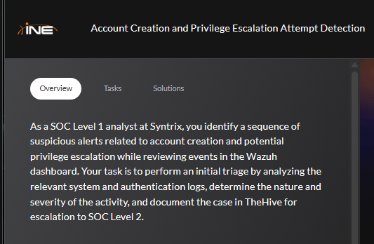
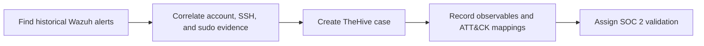

# Account Creation and Privilege Escalation Attempt Detection

## 1. Lab Overview

Triage a series of Linux alerts in Wazuh. Correlate a new local account, a later SSH logon, and activity involving sudoers. Document the timeline in TheHive and hand the case to SOC Level 2 for validation.

## 2. Lab Environment

| Component | Role |
| --- | --- |
| Ubuntu machine 1 | Wazuh at https://wazuh.ine.local |
| Ubuntu machine 2 | TheHive at http://localhost:9000 |
| Wazuh agent 002 | Disconnected Linux endpoint named ip-10-0-0-100 |
| 10.0.0.11 | Recorded source of the SSH logon |

The event date is 24 December 2025. The supplied sighting times have no specified time zone.

## 3. Workflow Diagram

## 4. Tools Used

| Tool | Purpose |
| --- | --- |
| Firefox | Open Wazuh and TheHive |
| Wazuh | Inspect retained alert records |
| MITRE ATT&CK view | Find related techniques and events |
| TheHive | Document the incident, evidence, and handoff |

## 5. Task-by-Task Walkthrough

The [redacted source notes](lab-source.md) supply the events and proposed case entries. The overview screenshot is included. The environment screenshot shows a password and was excluded. Raw events were not supplied.

### T1: Locate the account-creation alert

**Goal.** Identify the new account and affected endpoint.

**Steps**

1. In Wazuh, select disconnected agent **002** from **Agents Summary**.
2. Open **More > MITRE ATT&CK > Framework**, select **24 December 2025**, and hide techniques without alerts.
3. Expand **Create Account** and record the time, username, and agent.

**Commands.** Use the Wazuh dashboard filters.

**Expected result / Finding.** The notes report creation of eviluser on ip-10-0-0-100 at 07:41.

### T2: Correlate SSH and sudo activity

**Goal.** Reconstruct the order of activity and identify the privilege question for follow-up.

**Steps**

1. Expand **Remote Services** and compare the account and time with the account-creation event.
2. Expand **Sudo and Sudo Caching** and inspect the reported access to /etc/sudoers.
3. Record which facts the supplied notes support and which outcomes still need evidence.

**Commands.** Inspect the expanded event records.

**Expected result / Finding.** The notes report successful SSH authentication for eviluser from 10.0.0.11 at 07:59 and sudo-related access to /etc/sudoers at 08:00. The source case narrative describes a possible modification attempt. File access alone does not confirm a successful edit or privilege escalation.

### T3: Create the case and add observables

**Goal.** Capture the timeline and scope in TheHive.

**Steps**

1. Select **Create case > Empty case**. Use **Suspicious Account Creation Followed by Privileged Access Attempt**, the case creation date, and severity **High**.
2. Apply the lab's TLP:AMBER and PAP:AMBER labels and tags privilege-escalation, account-creation, persistence, sudo, and ssh.
3. Describe the three events and mark the privilege outcome as pending validation. Add the observable rows below and mark each as sighted.

| Type | Value | Sighting time | IOC in lab notes | Tags |
| --- | --- | --- | --- | --- |
| other | eviluser | 07:41 | Yes | new-account, persistence, local-user |
| ip | 10.0.0.11 | 07:59 | Unspecified | ssh, remote-access |
| hostname | ip-10-0-0-100 | 08:00 | Unspecified | linux, privilege-escalation |
| filename | /etc/sudoers | 08:00 | Yes | sudo, privilege-escalation, configuration |

**Commands.** Use the TheHive case and observable forms.

**Expected result / Finding.** The case has four observables and a timeline. The lab IOC markings are case context. A source address or system file name alone does not establish malicious activity.

### T4: Map techniques and hand off the case

**Goal.** Record the lab's ATT&CK mappings and assign SOC Level 2 verification.

**Steps**

1. In **TTPs**, select the Enterprise ATT&CK catalog. Add the lab mappings below. The notes set the TTP occurrence date to 24 December 2025 at 07:41. Preserve the separate observable times in the timeline.
2. Add the mandatory task **Validate legitimacy of privileged access attempt** in the default group. Ask SOC Level 2 to verify authorization, whether sudoers changed, whether elevated privileges were obtained, and the potential impact.
3. Assign the task and case to SOC Level 2.

| Technique | Evidence mapped in the lab |
| --- | --- |
| T1136 | Local account creation |
| T1078 | Use of the newly created account |
| T1021 | SSH access from 10.0.0.11 |
| T1548.003 | Sudo activity associated with sudoers |

**Commands.** Use the TheHive TTP, task, and assignment controls.

**Expected result / Finding.** The notes report that the case was escalated. They do not show a completed SOC Level 2 review.

## 6. Key Concepts (Beginner-Friendly)

- **Timeline.** Events become easier to compare when ordered by host, account, and time.
- **Observable.** A value recorded during an investigation, such as an account or IP address.
- **Privilege escalation attempt.** Activity that suggests an effort to gain greater access. Successful escalation requires corroborating evidence.

## 7. SOC / Real-World Relevance

A new account followed by remote access and privileged configuration activity warrants a closer review. An analyst can compare change approvals, authentication and sudo outcomes, and file integrity evidence before making a final determination.

## 8. Quick Command Cheat Sheet

| Dashboard control | Purpose |
| --- | --- |
| Agents Summary > Disconnected > 002 | Select the endpoint |
| More > MITRE ATT&CK > Framework | Find historical alerts |
| TheHive > Create case > Empty case | Record severity and the timeline |
| Observables and TTPs | Record evidence and technique mappings |
| Tasks and assignment | Hand off independent validation |

## 9. Common Mistakes & Troubleshooting

| Symptom | What to check |
| --- | --- |
| Alerts are absent | Verify agent ID, date range, and technique visibility. |
| The activity appears to have succeeded | Check command outcome and file integrity evidence. |
| Case times disagree | Keep creation, event, sighting, and technique times distinct. |

## 10. Conclusion

- I correlated account creation, SSH authentication, and sudo activity.
- I documented the timeline and evidence in a high-severity case.
- I handed off authorization and privilege checks to SOC Level 2.
