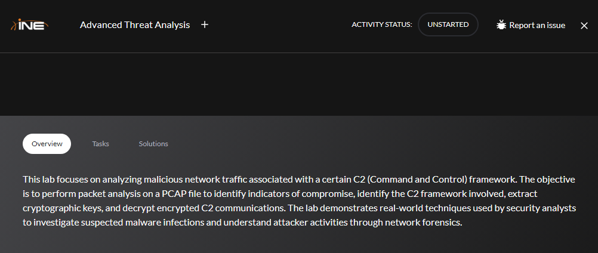
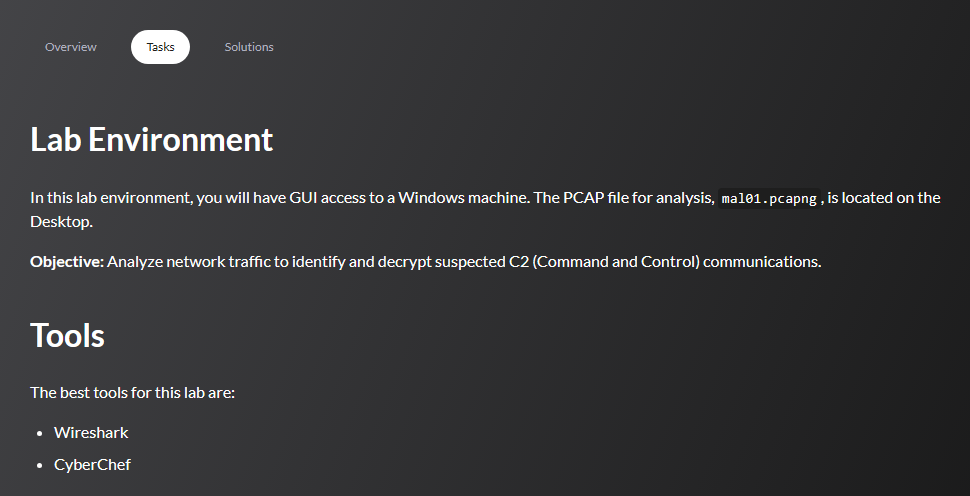

# Advanced Threat Analysis

## 1. Lab Overview

Investigate suspected command-and-control traffic in a saved packet capture. Follow a suspicious HTTP download, measure the timing of later requests, and compare packet evidence with the reported Havoc protocol. Inspect a decrypted response to understand what the captured traffic reveals about the endpoint.



## 2. Lab Environment

- Windows workstation with Wireshark and CyberChef.
- The lab capture is named mal01.pcapng and is on the Windows Desktop.
- The notes show client 10.0.0.156 and peer 10.0.0.155. The download is reported on TCP 8000, while the supplied initialization packet dump shows destination TCP 80.
- The packet capture and extracted executable were not supplied.



## 3. Workflow Diagram


## 4. Tools Used

| Tool | Purpose |
| --- | --- |
| Wireshark | Inspect HTTP streams, export objects, and plot packet timing |
| PowerShell | Calculate the extracted file's MD5 |
| VirusTotal | Look up the hash reputation reported by the lab |
| CyberChef | Inspect the captured response using AES-CTR decryption |

## 5. Task-by-Task Walkthrough

The [original pasted notes](lab-source.md) supply the filters, packet excerpt, and reported findings. The two uploaded screenshots show the overview and environment. The individual solution screenshots are linked in the original notes.

### T1: Identify the HTTP download

**Goal.** Record the source, destination, and request details.

**Steps**

1. Open mal01.pcapng in Wireshark and apply the display filter below.
2. Find the GET for /checkmate.exe and open **Follow > HTTP Stream**.
3. Record the addresses, port, User-Agent, server header, and content type.

**Filter**

```text
http
```

**Command explained.** The filter displays packets Wireshark decodes as HTTP.

**Expected result / Finding.** The notes show 10.0.0.156 requesting /checkmate.exe from 10.0.0.155:8000. The stream reports WindowsPowerShell/5.1.17763.1432, SimpleHTTP/0.6 Python/3.12.8, and application/x-msdos-program. These headers describe the transfer and do not establish how the executable was launched.

### T2: Check the extracted file's hash

**Goal.** Identify the downloaded bytes and check the reported reputation result.

**Steps**

1. In Wireshark, use **File > Export Objects > HTTP** and save the captured checkmate.exe object to Desktop for static analysis.
2. Compute its MD5 in PowerShell. Compare the hash with the lab's reported lookup.

**Commands**

```powershell
cd Desktop
Get-FileHash -Algorithm MD5 checkmate.exe
```

**Command explained.** cd changes the current directory. Get-FileHash calculates the MD5 digest of the file.

**Expected result / Finding.** The notes report no VirusTotal match at the time of the exercise. They provide no hash value in the pasted text. An absent match gives no verdict on whether the file is malicious.

### T3: Measure repeated HTTP traffic

**Goal.** Check whether later traffic follows a regular pattern.

**Steps**

1. Apply the two-host display filter. Compare the POST requests and their 200 responses.
2. In **Statistics > I/O Graphs**, plot the filtered packets and compare the spacing.

**Filter**

```text
http && ip.addr==10.0.0.155 && ip.addr==10.0.0.156
```

**Command explained.** Both address predicates must match, which selects HTTP packets between the hosts in either direction.

**Expected result / Finding.** The notes report activity roughly every two seconds. That cadence is consistent with beaconing and should be interpreted together with packet content.

### T4: Examine the protocol marker and initialization fields

**Goal.** Compare the capture against the reported Havoc format.

**Steps**

1. Inspect the first relevant POST after the download and record the byte marker.
2. Compare the first message with the registration evidence described in the source notes. Record the AES key and IV lengths.

**Commands.** Use Wireshark's packet bytes pane.

**Expected result / Finding.** The notes report the marker DE AD BE EF and identify it as consistent with Havoc. The supplied excerpt yields a 32-byte key and a 16-byte IV at the offsets described in the original notes. The marker is stronger when combined with the message structure and readable output.

### T5: Interpret a decrypted response

**Goal.** Identify what the changed POST size and plaintext reveal.

**Steps**

1. Locate the later POST whose size departs from the regular exchanges and copy its HTTP data as recorded evidence.
2. In CyberChef, inspect it with AES Decrypt in CTR mode using the capture-specific key and IV. The notes specify removing a 20-byte protocol header from this message before decryption.
3. Read the resulting text and document the identity and privilege evidence it contains.

**Commands.** Use the Wireshark and CyberChef controls described above.

**Expected result / Finding.** The notes describe readable output consistent with whoami /all and administrative-level access on 10.0.0.156. The actual capture was unavailable for independent replay.

## 6. Key Concepts (Beginner-Friendly)

- **Beaconing.** Repeated contact between hosts at an approximately regular interval.
- **Protocol marker.** A byte sequence that helps identify a message format.
- **AES-CTR.** A mode that uses a key and initial counter value to generate a stream for encrypting or decrypting data.
- **File hash.** A fingerprint of the captured bytes used to compare copies and search historical reputation records.

## 7. SOC / Real-World Relevance

A SOC analyst can connect a download to later network activity by matching hosts, timing, and message details. Reconstructed plaintext may reveal commands or privileges that can be checked against endpoint telemetry.

## 8. Quick Command Cheat Sheet

| Command or filter | Purpose |
| --- | --- |
| http | Display decoded HTTP traffic |
| http && ip.addr==10.0.0.155 && ip.addr==10.0.0.156 | Limit HTTP traffic to the two capture endpoints |
| cd Desktop | Select the exported object's directory |
| Get-FileHash -Algorithm MD5 checkmate.exe | Compute the object's MD5 |

## 9. Common Mistakes & Troubleshooting

| Symptom | What to check |
| --- | --- |
| No HTTP packets appear | Check the capture, display filter, and how Wireshark decoded the port. |
| The graph includes unrelated traffic | Check that only the filtered series is enabled. |
| Decrypted text is unreadable | Verify the extracted HTTP body boundaries, protocol header length, AES mode, key, and IV. |
| The two port references differ | Check the individual download and initialization frames before attributing them to one connection. |

## 10. Conclusion

- I traced an executable download and the subsequent HTTP activity.
- I identified protocol and timing evidence consistent with Havoc.
- I documented the reported plaintext and the limits of the available evidence.
