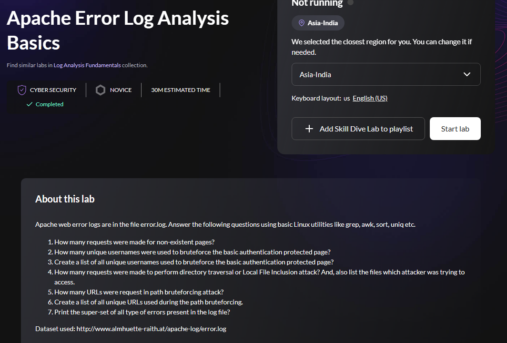

# Apache Error Log Analysis Basics

## 1. Lab Overview

Use Linux command-line tools to investigate an Apache error log. Count missing-file events, summarize basic-auth usernames, and review invalid URI messages and path-probing evidence. By the end, you can explain what each filter counts and where access-log correlation is needed.



## 2. Lab Environment

- Linux shell with the historical lab file `error.log`.
- The [source notes](lab-source.md) document the original dataset URL and verification status.
- The tasks analyze existing records locally. No running server or network port is required.

## 3. Workflow Diagram


## 4. Tools Used

| Tool | Purpose |
| --- | --- |
| grep | Select log records by message or pattern |
| cut | Extract parts of the lab's message format |
| sort and uniq | Group repeated values and remove duplicates |
| wc and cat | Count records and read the file |

## 5. Task-by-Task Walkthrough

Commands and reported findings come from the [PDF source notes](lab-source.md). Both export commands write to the file named `list`.

### T1: Count missing-file records

**Goal.** Count records reporting a missing file.

**Steps**

1. Select the missing-file messages and count the resulting lines.

**Commands**

```bash
cat error.log | grep " File does not exist" | cut -d "]" -f4 | cut -d ":" -f2 | wc -l
```

**Command explained.** grep filters the message, cut isolates parts of the error text, and wc -l counts matching rows.

**Expected result / Finding.** 229,112 matching records in the manual. This is a count of occurrences, not distinct paths.

### T2: Count distinct attempted usernames

**Goal.** Measure the variety of account names in the basic-auth evidence.

**Steps**

1. Extract usernames from the matching message text, deduplicate, and count them.

**Commands**

```bash
cat error.log | cut -d "]" -f4 | cut -d ":" -f1 | grep user | cut -d " " -f3 | sort | uniq | wc -l
```

**Command explained.** The cuts select the message and username. sort and uniq collapse repeated values before wc -l counts them.

**Expected result / Finding.** 75 distinct usernames in the manual. A failed or unknown-user record does not establish successful authentication.

### T3: Export the unique username list

**Goal.** Write the deduplicated observed usernames to a local file.

**Steps**

1. Run the extraction pipeline and inspect the resulting list before proceeding to T6.

**Commands**

```bash
cat error.log | cut -d "]" -f4 | cut -d ":" -f1 | grep user | cut -d " " -f3 | sort | uniq > list
```

**Command explained.** The final redirection writes the distinct values to list and overwrites an existing file of that name.

**Expected result / Finding.** The exported list should correspond to the 75 distinct values reported in T2.

### T4: Investigate invalid URI records

**Goal.** Count candidate traversal or local file inclusion attempts and identify their target filenames.

**Steps**

1. Use the manual filters to review the recorded errors. Inspect matching messages as evidence, then count the Invalid URI records.

**Commands**

```bash
grep "/\.\./\.\./" error.log
grep "Invalid URI" error.log
grep "Invalid URI" error.log | wc -l
```

**Command explained.** The first grep searches for repeated parent-directory markers in existing log text. The second finds the broader error category used for the lab count.

**Expected result / Finding.** 15 Invalid URI records. The manual lists boot.ini, sam, config.dat, passwd, win.ini, vmInventory.xml, dvr2.ini, and shadow. The error records do not establish file access.

### T5: Count path-probing records

**Goal.** Find the number of missing-file records used in the lab's path-probing count.

**Steps**

1. Count matching rows and compare with T1.

**Commands**

```bash
grep "File does not exist" error.log  | wc -l
```

**Command explained.** grep selects the missing-file message. wc counts occurrences, including repeated paths.

**Expected result / Finding.** 229,112 matching records in the manual. The filter alone does not establish that every miss came from the same activity.

### T6: Export unique path values

**Goal.** Produce a deduplicated list of the paths logged for missing files.

**Steps**

1. Run the pipeline and inspect its exported results. Save the T3 output separately first if needed.

**Commands**

```bash
grep "File does not exist" error.log  | cut -d "]" -f4 | cut -d ":" -f2 | sort | uniq > list
```

**Command explained.** cut extracts the path portion, sort arranges matching values together, and uniq deduplicates them. The shell replaces list with the new output.

**Expected result / Finding.** The manual gives the export command. The error log records server-side paths, so use the access log when you need the original URLs.

### T7: Summarize error types

**Goal.** Build a readable inventory of error message categories.

**Steps**

1. Extract message prefixes and deduplicate them. Review the result manually to combine variable details into stable categories.

**Commands**

```bash
cat error.log | cut -d "]" -f4 | cut -d ":" -f1 | sort | uniq
```

**Command explained.** The pipeline groups matching prefixes. Different usernames and paths can still produce distinct strings within the same category.

**Expected result / Finding.** The manual lists seven categories: unknown user, no acceptable variant, script not found or unable to stat, invalid URI, access denied by server configuration, missing file, and invalid Content-Length.

## 6. Key Concepts (Beginner-Friendly)

- **Error log.** Server messages that describe errors and other notable events.
- **Occurrences and unique values.** A path can appear in many records while counting as one distinct path.
- **Message category.** A stable error type can include changing details such as users or files.
- **Attempt and outcome.** Error evidence can describe a rejected action. Other records may be needed to confirm what happened next.

## 7. SOC / Real-World Relevance

Analysts can use error records to spot bursts of missing paths, unusual requests, and authentication problems. Comparing error messages with access logs can establish which clients, timestamps, and response statuses belong to the same activity.

## 8. Quick Command Cheat Sheet

| Operation | Purpose |
| --- | --- |
| `grep "File does not exist"` | Find missing-file messages |
| `grep "Invalid URI"` | Find invalid URI messages |
| `cut -d "]" -f4` | Select the message segment used in this lab format |
| `sort` followed by `uniq` | Deduplicate values |
| `wc -l` | Count matching rows |
| `> list` | Save output to a local file and replace its previous contents |

## 9. Common Mistakes & Troubleshooting

| Symptom | What to check |
| --- | --- |
| The output count differs | Check that you have the original error.log sample and that the message format matches. |
| A cut field is blank | Inspect the bracket and colon positions in the actual log. |
| The username export disappeared | T3 and T6 both write to list. Save the first output before running the second. |
| Extracted paths look unlike URLs | The error log can show filesystem paths. Check the access log for original request targets. |

## 10. Conclusion

- I counted missing-file and invalid URI messages.
- I used field extraction and deduplication to summarize attempted usernames and paths.
- I separated the reported error patterns from claims that require more evidence.
