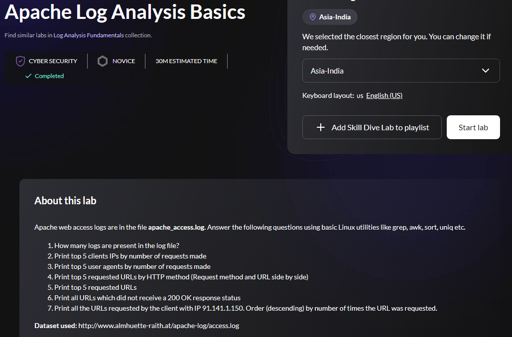
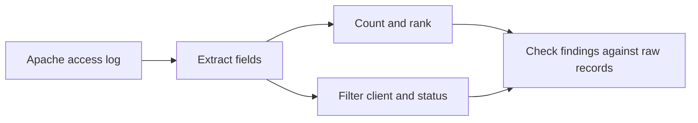

# Apache Log Analysis Basics

## 1. Lab Overview

Analyze an Apache access log with basic Linux utilities. Count events and rank clients, user agents, request lines, and paths. Then inspect response statuses and isolate the activity of one client.



## 2. Lab Environment

- Linux shell and the lab file `apache_access.log`.
- The PDF solution uses a 10,000-line sample. The first 10,000 lines of the archived dataset reproduce the manual's reported rankings. The full archive contains 2,660,050 lines. See the [source notes](lab-source.md).
- The exercise reads an existing file and does not require a running web server.

## 3. Workflow Diagram



## 4. Tools Used

| Tool | Purpose |
| --- | --- |
| cat and wc | Read the log and count lines |
| awk and cut | Extract fields and the request target |
| sort, uniq, and tail | Group, count, rank, and limit results |
| grep | Filter text in the original PDF examples |

## 5. Task-by-Task Walkthrough

The [PDF source notes](lab-source.md) document the sample and dataset check. The original commands are shown first. T6 and T7 also include field-aware adaptations to meet the stated tasks.

### T1: Count log records

**Goal.** Find the number of lines in the lab file.

**Steps**

1. Run the pipeline from the directory containing apache_access.log.

**Command**

```bash
cat apache_access.log | wc -l
```

**Command explained.** cat reads the file and wc -l counts newline-delimited records.

**Expected result / Finding.** 10,000 lines in the PDF lab sample.

### T2: Rank client IP addresses

**Goal.** Find the five clients with the most requests.

**Steps**

1. Extract the first field, count each address, and read the five highest counts.

**Command**

```bash
awk '{print $1}' apache_access.log | sort | uniq -c | sort -b -n -k1 | tail -5
```

**Command explained.** awk selects the client IP. sort groups identical IPs, uniq -c counts them, and the final sort and tail select the highest counts in ascending order.

**Expected result / Finding.** Descending order: 148.251.50.49 (1,929), 213.150.254.81 (434), 195.212.98.190 (241), 37.1.206.196 (160), and 91.141.1.150 (139).

### T3: Rank user agents

**Goal.** Find the five most common nonmissing user agents.

**Steps**

1. Extract the user-agent field and count matching strings. Leave the missing-value marker out of the ranking.

**Command**

```bash
awk -F\" '{print $6}' apache_access.log | sort | uniq -c | sort -fn | tail -6
```

**Command explained.** The quote delimiter keeps spaces inside user agents together. The PDF keeps six rows because one value is the missing marker.

**Expected result / Finding.** Firefox 34.0 (5,135), MSIE 10.0 (434), Chrome 36.0.1985.143 (332), Trident 7.0 with rv:11.0 (185), and Chrome 31.0.1650.57 (165). The marker - appears 1,949 times.

### T4: Rank complete HTTP request lines

**Goal.** Find the most frequent combinations of method, target, and HTTP version.

**Steps**

1. Extract the first quoted field and count identical request lines.

**Command**

```bash
awk -F\" '{print $2}' apache_access.log | sort | uniq -c | sort -fn | tail -5
```

**Command explained.** In the quote-delimited format, field 2 is the complete HTTP request line. The PDF command keeps HTTP versions separate.

**Expected result / Finding.** Descending order: POST /administrator/index.php HTTP/1.1 (2,621), GET /administrator/ HTTP/1.1 (2,576), GET /administrator/index.php HTTP/1.0 (978), POST /administrator/index.php HTTP/1.0 (962), and GET / HTTP/1.1 (281).

### T5: Rank request targets

**Goal.** Count requested URLs without grouping by method.

**Steps**

1. Extract the request line and keep just its second space-delimited token before counting.

**Command**

```bash
awk -F\" '{print $2}' apache_access.log | cut -d " " -f2 | sort | uniq -c | sort -fn | tail -5
```

**Command explained.** cut selects the target inside the request line, so methods and versions are grouped together.

**Expected result / Finding.** Descending order: /administrator/index.php (4,669), /administrator/ (2,587), / (322), /templates/_system/css/general.css (117), and /robots.txt (106).

### T6: List targets with non-200 responses

**Goal.** Find request targets whose logged status was different from 200.

**Steps**

1. Use the field-aware version to read only the response-status position and extract the request target.

**Commands**

```bash
grep -v 200 apache_access.log | awk -F\" '{print $3 $2 }'| sort | uniq -c | sort -fn
```

**Field-aware adaptation**

```bash
awk -F '"' 'NF >= 3 {split($3, response, " "); split($2, request, " "); if (response[1] ~ /^[0-9][0-9][0-9]$/ && response[1] != "200" && request[2] != "") print request[2]}' apache_access.log | sort -u
```

**Command explained.** The original grep excludes any line containing 200 anywhere. The adapted command checks the actual status field and prints distinct targets.

**Expected result / Finding.** The PDF screenshot includes 304 and 404 responses. The adapted filter identifies 108 distinct targets with at least one non-200 response in the matching sample.

### T7: Rank targets from one client

**Goal.** List the targets requested by 91.141.1.150, most frequent first.

**Steps**

1. Use the field-aware version to match the exact client and sort counts in descending order.

**Commands**

```bash
grep "91.141.1.150" apache_access.log | awk -F\" '{print $2 }'| sort | uniq -c | sort -fn
```

**Field-aware adaptation**

```bash
awk -F '"' '{split($1, client, " "); split($2, request, " "); if (client[1] == "91.141.1.150" && request[2] != "") print request[2]}' apache_access.log | sort | uniq -c | sort -nr
```

**Command explained.** The original grep searches the whole line as a regex, counts complete requests, and sorts ascending. The adapted command compares the client field exactly, extracts only the target, and reverses the numeric sort.

**Expected result / Finding.** The matching sample contains 139 requests for 109 distinct targets from this client. The adapted command prints the per-target counts in the requested order.

## 6. Key Concepts (Beginner-Friendly)

- **Request line.** Contains the HTTP method, request target, and protocol version.
- **Response status.** The number that describes how the server handled a request.
- **User agent.** Client-supplied software information. A missing or unusual string needs context.
- **Exact-field matching.** Parse the intended field before filtering so a match elsewhere in the line does not change the result.

## 7. SOC / Real-World Relevance

An analyst can use simple counts to find unusual clients, repeated requests, and error bursts. Examining the underlying request targets and status codes helps explain why a pattern stands out.

## 8. Quick Command Cheat Sheet

| Command or operation | Purpose |
| --- | --- |
| `wc -l` | Count lines |
| `awk '{print $1}'` | Select the leading client field |
| `awk -F\"` | Split fields at quotation marks |
| `cut -d " " -f2` | Extract the target from a request line |
| `sort` then `uniq -c` | Count repeated values |
| `sort -nr` | Rank numeric counts highest first |
| `tail -5` | Show the final five rows after sorting |

## 9. Common Mistakes & Troubleshooting

| Symptom | What to check |
| --- | --- |
| Counts differ from the PDF | Verify you have the same 10,000-line lab sample. |
| A user agent is a dash | Treat the dash as a missing value when ranking named agents. |
| One path appears twice | Check whether the command groups by complete request line or by path alone. |
| A 200 record survives the status filter | Extract the status field before comparing it. |
| The IP filter includes extra records | Compare the first field exactly. |

## 10. Conclusion

- I counted and ranked fields in Apache access logs.
- I distinguished complete requests from URL-only counts.
- I used exact-field filters to check response status and isolate one client.
