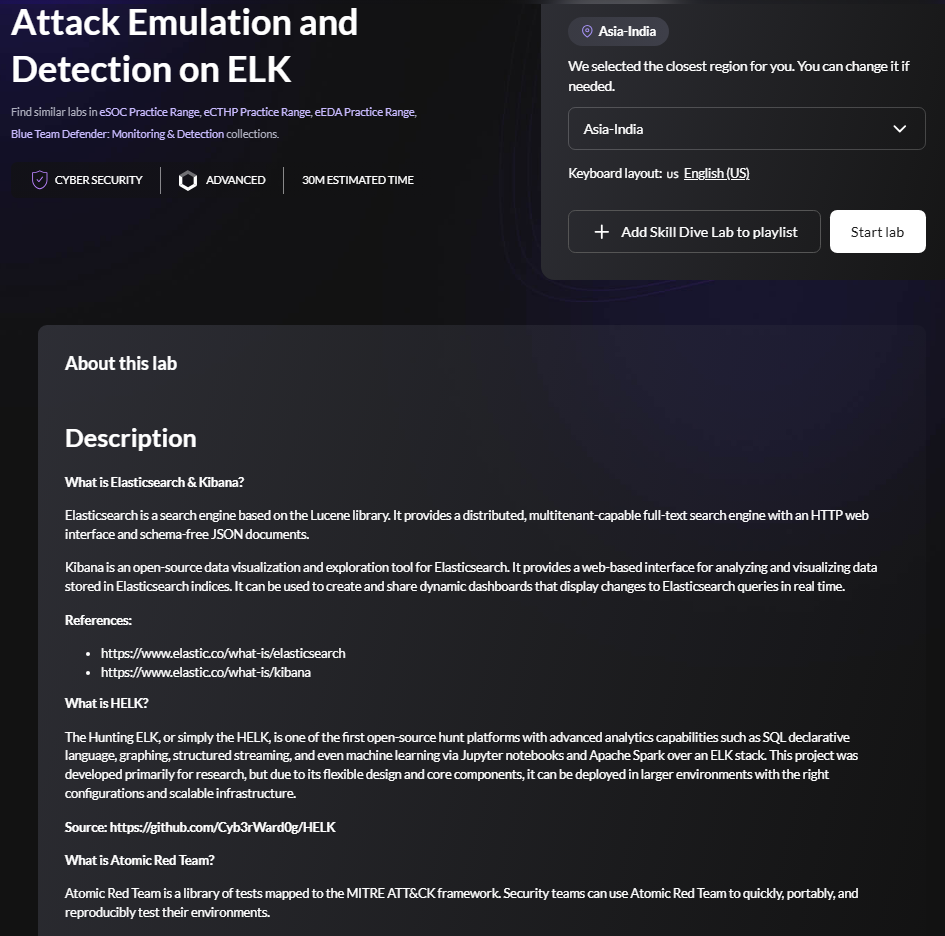
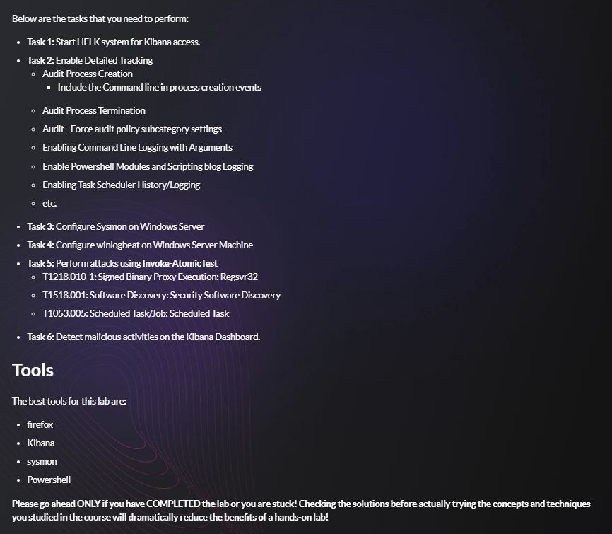
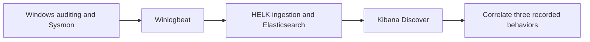

# Attack Emulation and Detection on ELK

## 1. Lab Overview

Configure Windows telemetry for HELK and investigate three simulated behaviors in Kibana. Use process, PowerShell, and Task Scheduler records to distinguish observed activity from an inferred outcome.



## 2. Lab Environment

| Machine | Role |
| --- | --- |
| Ubuntu 20.04 | HELK and Kibana at https://localhost |
| Windows Server 2019 | Monitored endpoint with Sysmon, Winlogbeat, and the lab's Atomic Red Team material |
| Kali GUI | Lab workstation listed in the environment |

Winlogbeat uses the HELK listener on TCP 9092. The notes use 10.0.21.29 as the example SOC address.



## 3. Workflow Diagram



## 4. Tools Used

| Tool | Purpose |
| --- | --- |
| HELK, Elasticsearch, and Kibana | Ingest, index, and investigate endpoint records |
| Group Policy and PowerShell | Configure detailed Windows logging |
| Sysmon | Supply process telemetry according to its configuration |
| Winlogbeat | Forward Windows event records |
| Atomic Red Team | Source of the lab's ATT&CK-mapped scenarios |

[Red Canary Atomic Red Team](https://github.com/redcanaryco/atomic-red-team)

## 5. Task-by-Task Walkthrough

Findings come from the [redacted solution notes](lab-source.md). The credential-bearing environment screenshot was excluded. Individual output screenshots and original event records were not supplied.

### T1: Start HELK and open Kibana

**Goal.** Make the lab's search interface available.

**Steps**

1. Run the lab's supplied HELK setup script from its Docker directory on Ubuntu.
2. After the services start, open the lab dashboard in Firefox on the SOC machine.

**Commands**

```bash
cd /opt/HELK/docker/
./helk_install.sh
```

**Command explained.** cd selects the setup directory. The script starts the lab HELK setup.

**Expected result / Finding.** The notes report that Kibana opens at https://localhost.

### T2: Enable detailed Windows tracking

**Goal.** Record process, PowerShell, and scheduled-task activity.

**Steps**

1. In the local Group Policy editor, enable Audit Process Creation and Audit Process Termination under **Advanced Audit Policy Configuration > Detailed Tracking**. Enable the setting that forces audit subcategories to override category policy.
2. Enable command-line inclusion under **Administrative Templates > System > Audit Process Creation**. Enable Module Logging and Script Block Logging under **Windows Components > Windows PowerShell**.
3. Apply the source's PowerShell profile settings in C:\Windows\System32\WindowsPowerShell\v1.0\profile.ps1. Enable the Task Scheduler Operational channel and verify that history is available. Reboot the disposable lab endpoint as specified in the notes.

**Commands and profile settings**

```powershell
$LogCommandLifeCycleEvent = $true
$LogCommandHealthEvent = $true
```

```powershell
$logName = 'Microsoft-Windows-TaskScheduler/Operational'
$log = New-Object System.Diagnostics.Eventing.Reader.EventLogConfiguration $logName
$log.IsEnabled=$true
$log.SaveChanges()
Restart-Computer -Force
```

**Command explained.** The profile preferences request command lifecycle and health logging when the profile loads. The event-log configuration enables Task Scheduler history. Restart-Computer reboots the host.

**Expected result / Finding.** The source describes the logging policies and history setup. It mentions increasing log size without specifying a value.

### T3: Configure Sysmon

**Goal.** Collect endpoint process evidence.

**Steps**

1. Install Sysmon with the supplied configuration.
2. Check the service state and inspect the Operational channel.

**Commands**

```powershell
C:\Users\Administrator\Documents\Sysmon.exe -accepteula -i C:\Users\Administrator\Documents\sysmonconfig-export.xml
Get-Service -Name Sysmon
```

**Command explained.** The installer accepts the license and applies the specified XML. Get-Service reports service state.

**Expected result / Finding.** The notes report that Sysmon was installed with the supplied configuration.

### T4: Configure Winlogbeat

**Goal.** Forward Windows events to HELK.

**Steps**

1. Identify the SOC address on Ubuntu. Substitute the current address in winlogbeat.yml.
2. From the Winlogbeat directory, install the service, start it, and verify its state.

**Commands and configuration**

```bash
ifconfig ens5
```

```yaml
hosts: ["10.0.21.29:9092"]
```

```powershell
cd C:\Users\Administrator\Desktop\Tools\winlogbeat
.\install-service-winlogbeat.ps1
Start-Service -Name winlogbeat
Get-Service -Name winlogbeat
```

**Command explained.** ifconfig shows the interface address. The YAML sets the HELK destination. The PowerShell commands register, start, and check the service.

**Expected result / Finding.** Winlogbeat is reported running. Confirm delivery separately in Discover.

### T5: Map the emulated behaviors to evidence

**Goal.** Identify the telemetry to inspect for each scenario.

**Steps**

1. Map Regsvr32 proxy execution (T1218.010) to process ancestry and command-line records.
2. Map security software discovery (T1518.001) to service or driver discovery activity.
3. Map scheduled task creation (T1053.005) to process and Task Scheduler records.

**Commands.** Review the reported emulation as evidence.

**Expected result / Finding.** The notes report a calculator launch, discovery of the Sysmon driver, and creation of a one-time scheduled task. The Regsvr32 scenario concerns signed-binary proxy execution. The source's description of automatic registry startup is inconsistent with the exercise it reports.

### T6: Detect the activity in Kibana

**Goal.** Find the relevant records and verify their links.

**Steps**

1. Open Discover, select the Windows host, and narrow the time range. For Regsvr32, review the reported Invoke-Process event and check process ancestry.
2. Search separately for sysmon and scheduled or spawn. Inspect the matching event fields and correlate by time, host, and process.
3. Check Task Scheduler history for the task outcome.

**Discover search terms**

```text
sysmon
scheduled
spawn
```

**Command explained.** These are text search terms from the notes. They return candidate records for review.

**Expected result / Finding.** The solution describes Regsvr32 scriptlet activity, a driver-discovery record, and task spawn configured to launch cmd.exe at 20:10. A task creation record gives the configured action and time. A separate event is needed to confirm execution.

## 6. Key Concepts (Beginner-Friendly)

- **Process ancestry.** Parent and child records show which process launched another.
- **Script block logging.** Records PowerShell content for later investigation.
- **Detection validation.** Compare a reported behavior with the events it produced and confirm that the required fields arrived.
- **Scheduled task record.** Creation and execution are separate events.

## 7. SOC / Real-World Relevance

Analysts can validate what an endpoint logs before relying on detections. Correlating process, scripting, and scheduler evidence helps distinguish routine administration from activity that needs investigation.

## 8. Quick Command Cheat Sheet

| Command or search | Purpose |
| --- | --- |
| ./helk_install.sh | Start the lab HELK setup |
| Get-Service -Name Sysmon | Check Sysmon service state |
| ifconfig ens5 | Find the SOC interface address |
| .\install-service-winlogbeat.ps1 | Register Winlogbeat |
| Start-Service -Name winlogbeat | Start Winlogbeat |
| Get-Service -Name winlogbeat | Check Winlogbeat service state |
| sysmon, scheduled, spawn | Find candidate evidence in Discover |

## 9. Common Mistakes & Troubleshooting

| Symptom | What to check |
| --- | --- |
| Kibana is unavailable | Check HELK startup on Ubuntu. |
| Windows results are absent | Verify local events, Winlogbeat service state, and address and port 9092. |
| Process records lack command lines | Check auditing, command-line inclusion, and Sysmon configuration. |
| A search returns many results | Narrow by host and time, then inspect parent and child process fields. |

## 10. Conclusion

- I configured detailed Windows logging and Winlogbeat forwarding.
- I used Kibana to identify evidence for three emulated behaviors.
- I distinguished recorded actions from outcomes that need corroboration.
