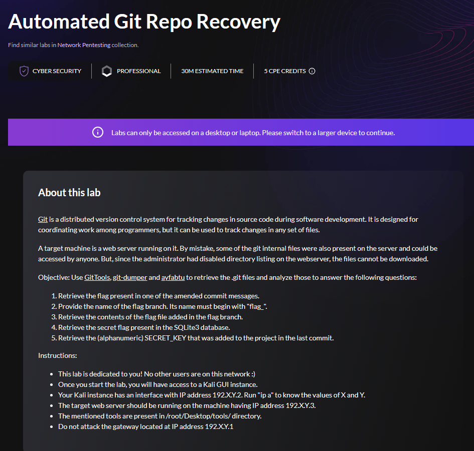
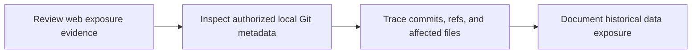
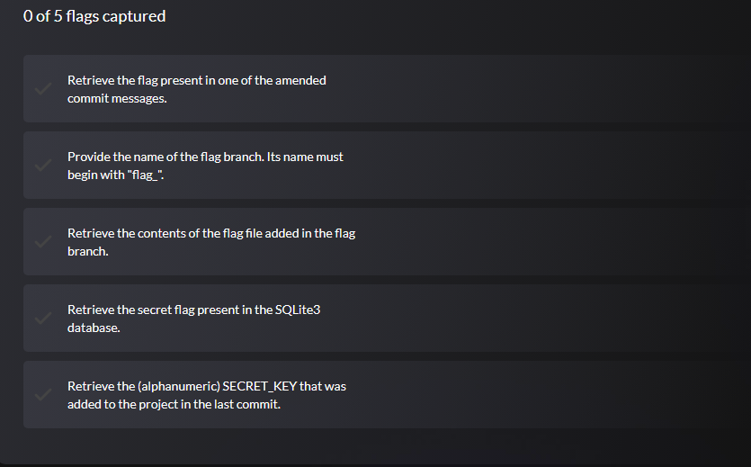

# Automated Git Repo Recovery

## 1. Lab Overview

This lab examines a web deployment that exposed Git files even though directory listings were disabled. It shows how repository history can retain amended messages, branch names, removed files, and application secrets. The walkthrough documents the reported evidence and uses local Git checks to explain it.



## 2. Lab Environment

| Component | Role |
| --- | --- |
| Kali GUI | Lab workstation |
| Apache web server | Example address 192.182.13.3 in the manual |
| Django repository | Project history and configuration under review |
| SQLite | Historical database artifact |

## 3. Workflow Diagram



## 4. Tools Used

| Tool | Purpose |
| --- | --- |
| Git | Inspect refs, reflogs, and file history in a local copy |
| GitTools, git-dumper, and ayfabtu | Recovery tooling named in the manual |
| SQLite and Django | Identify the types of artifacts discussed in the findings |

## 5. Task-by-Task Walkthrough

The [PDF source notes](lab-source.md) summarize the supplied manual. It reports that the server denied a directory listing while individual Git files were readable. The walkthrough omits remote recovery procedures, flag contents, and the signing key. The Git examples below are local review examples added for an authorized repository copy.



### T1: Compare amended commit evidence

**Goal.** Identify the metadata that suggests a commit was amended.

**Steps**

1. In an authorized local copy with retained reflogs, review recorded revisions. Compare author, parent, tree, and message evidence.

**Local review commands**

```bash
git reflog --all
```

**Command explained.** The reflog shows local reference updates where those logs are present.

**Expected result / Finding.** The manual shows two commits with the same author, tree, and parent but a differing message. The lab flag is omitted.

### T2: Identify the flag branch

**Goal.** Identify the branch named in the reported merge.

**Steps**

1. Review the local branch list and compare it with the merge history. A deleted branch may appear only in historical metadata.

**Local review commands**

```bash
git branch --all
git log --all --oneline --merges
```

**Command explained.** The branch listing shows local and remote-tracking refs. The log searches reachable merge commits.

**Expected result / Finding.** The manual identifies flag_f8dyxy5euu3wre8qw0vkgj9wm.

### T3: Document the historical flag file

**Goal.** Explain how a removed file can remain in repository history.

**Steps**

1. Compare the reported add, merge, and removal sequence. In an authorized copy, inspect change statistics without printing file contents.

**Local review commands**

```bash
git log --all --stat
```

**Command explained.** The log shows reachable history and changed paths with summary statistics.

**Expected result / Finding.** The manual reports a flag file under django_web_app/users that appeared in the branch, reached another branch through a merge, and was later removed. Its contents are omitted.

### T4: Document the historical SQLite artifact

**Goal.** Identify the database that held sensitive lab data.

**Steps**

1. Review the database file history in an authorized copy. Distinguish a file change from proof of a particular row change.

**Local review commands**

```bash
git log --all -- django_web_app/db.sqlite3
```

**Command explained.** The path filter limits the log to history relevant to the database file.

**Expected result / Finding.** The manual reports a flag in the historical SQLite database. The flag value is omitted.

### T5: Review the Django signing-key exposure

**Goal.** Explain how to attribute a key change to a revision without exposing its value.

**Steps**

1. Review the settings file's commit metadata and establish the intended baseline before interpreting candidate revisions.

**Local review commands**

```bash
git log --all -- django_web_app/django_web_app/settings.py
```

**Command explained.** The path filter identifies commits associated with the settings file. Verify chronology against the relevant branch and ancestry.

**Expected result / Finding.** The manual identifies a historical SECRET_KEY in Django settings. Its timing relative to the tip is described inconsistently in the task and solution. The value is omitted.

## 6. Key Concepts (Beginner-Friendly)

- **Blob, tree, and commit.** A blob holds file data, a tree maps paths to objects, and a commit refers to a tree and usually to a parent.
- **Amend.** Amending a commit creates a replacement commit. The earlier object can persist until pruned.
- **Reflog.** A local record of reference updates. A copy or clone may lack the original reflogs.
- **Directory listing.** A web setting that controls whether a directory index is displayed. File-level access is controlled separately.

## 7. SOC / Real-World Relevance

Review public deployment contents when you investigate repository exposure. Restrict access to version-control internals and assess what was served. If application secrets were exposed, rotate them and review their use.

## 8. Quick Command Cheat Sheet

| Command | Purpose |
| --- | --- |
| git reflog --all | Review available local reference updates |
| git branch --all | List local and remote-tracking branches |
| git log --all --oneline --merges | List reachable merge commits |
| git log --all --stat | Review changed paths and statistics |
| git log --all -- PATH | Inspect history affecting a file |

## 9. Common Mistakes & Troubleshooting

| Symptom | What to check |
| --- | --- |
| No amended revision appears | Check whether the local copy has the relevant reflog and objects. |
| A branch does not appear | Review retained merge metadata and which refs exist in the local copy. |
| A directory listing is denied | Check deployment configuration and distinguish listing from file access. |
| An old secret was deleted | Check rotation status and historical scope. |

## 10. Conclusion

- I documented the difference between hiding a directory listing and restricting file access.
- I traced how metadata and artifacts can survive in Git history.
- I recorded the affected files and key type for incident response.
