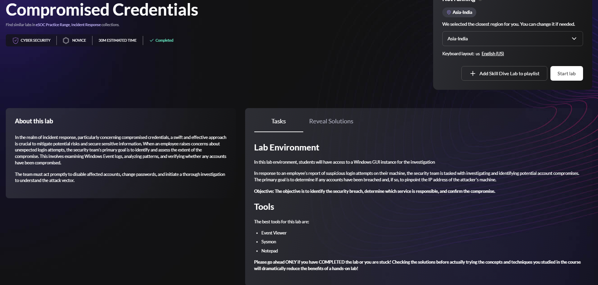
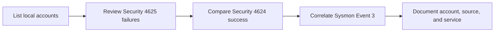

# Compromised Credentials

## 1. Lab Overview

Investigate suspicious Windows logons reported by an employee. Use Security and Sysmon records to identify failed logons, check for a later success, and determine which service was involved.



## 2. Lab Environment

- One Windows GUI workstation with Event Viewer, Sysmon, and PowerShell.
- Security events supply logon outcomes. Sysmon Operational records supply network connection context.
- The source reports SMB as the service. It does not give a numeric destination port in the pasted text.

## 3. Workflow Diagram



## 4. Tools Used

| Tool | Purpose |
| --- | --- |
| Event Viewer | Filter Security and Sysmon records by event ID |
| PowerShell | Count records and summarize event fields |
| Sysmon | Provide network connection evidence |
| Notepad | Record investigation notes |

## 5. Task-by-Task Walkthrough

Findings come from the [original pasted solution](lab-source.md). The supplied screenshot covers the overview and environment. The individual event screenshots and raw logs were not uploaded.

### T1: Inventory local accounts

**Goal.** Distinguish valid local users from attempted names.

**Steps**

1. Open a Windows command prompt and list local user accounts.
2. Record the inventory for comparison with Security event records.

```cmd
net user
```

**Command explained.** Lists the local user accounts.

**Expected result / Finding.** The solution reports five accounts, including built-in accounts.

### T2: Review failed logons and isolate the source

**Goal.** Count failures, identify targeted names, and find the recorded source IP.

**Steps**

1. In Event Viewer, open **Windows Logs > Security** and filter for event ID 4625.
2. Inspect TargetUserName and Source Network Address. Compare attempted names with the local inventory.
3. Use the PowerShell excerpt below to count failures and report distinct usernames and source addresses.

```powershell
$logName = 'Security'
$eventID = 4625
$events = Get-WinEvent -LogName $logName -FilterXPath "*[System[EventID=$eventID]]"
$eventCount = $events.Count
Write-Host "Number of events with Event ID $eventID in $logName log: $eventCount"

$accountNames = $events | ForEach-Object {
    [xml]$eventXml = $_.ToXml()
    $eventXml.Event.EventData.Data | Where-Object { $_.Name -eq 'TargetUserName' } | Select-Object -ExpandProperty '#text'
} | Sort-Object -Unique
$accountNames

$sourceNetworkAddresses = $events | ForEach-Object {
    [xml]$eventXml = $_.ToXml()
    $eventXml.Event.EventData.Data | Where-Object { $_.Name -eq 'IpAddress' } | Select-Object -ExpandProperty '#text'
} | Sort-Object -Unique
$sourceNetworkAddresses
```

**Command explained.** Get-WinEvent reads matching Security records. ToXml exposes the named fields. Sort-Object -Unique is an adaptation of the source's Get-Unique pipelines. It removes duplicates regardless of their original order.

**Expected result / Finding.** The notes report 3,651 failures from 13.214.192.125 and multiple attempted names. Administrator was the only valid local account identified among those names. The pattern supports repeated guessing, but the logs described do not establish which passwords were tried.

### T3: Correlate a successful logon

**Goal.** Check whether the source associated with failures also had a successful logon.

**Steps**

1. Filter Security for event ID 4624.
2. Match the target account, source IP, and time window to the failed-logon evidence. Record the source port for the next task.

**Commands.** Use Event Viewer's **Filter Current Log**.

**Expected result / Finding.** The notes report a successful Administrator logon from 13.214.192.125. This is the key evidence of unauthorized access in the lab scenario. A successful logon record does not by itself reveal how the credentials were obtained.

### T4: Identify the network service

**Goal.** Correlate the successful logon with Sysmon network evidence.

**Steps**

1. Open **Applications and Services Logs > Microsoft > Windows > Sysmon > Operational** and filter for event ID 3.
2. Compare the connection with event 4624 using the source address, source port, and time window. Review destination details for service context.

**Commands.** Use Event Viewer's Sysmon event ID filter.

**Expected result / Finding.** The solution reports a matching source port and attributes the activity to SMB. The raw records are needed to verify the port values and full connection details.

## 6. Key Concepts (Beginner-Friendly)

- **4625.** The Security log records a failed logon.
- **4624.** The Security log records a successful logon.
- **Sysmon Event 3.** Records a network connection when the configuration captures it.
- **Correlation.** Matching account, address, port, and time makes a link between records stronger.

## 7. SOC / Real-World Relevance

A burst of failures can identify activity worth reviewing. A related successful logon can raise the priority and help scope containment. Where response authority allows, preserve the evidence, contain the affected account, and review subsequent activity.

## 8. Quick Command Cheat Sheet

| Command or event | Purpose |
| --- | --- |
| net user | List local accounts |
| Get-WinEvent with FilterXPath | Query a specific Security event ID |
| Sort-Object -Unique | Return distinct field values |
| Security 4625 and 4624 | Compare failed and successful logons |
| Sysmon Event 3 | Correlate the connection with the logon |

## 9. Common Mistakes & Troubleshooting

| Symptom | What to check |
| --- | --- |
| The Security log query is denied | Check the account's log access in the lab. |
| A source address is empty | Check the event's logon context and compare related records. |
| The username list contains duplicates | Use a deduplication command that handles unsorted input. |
| A nearby network event looks related | Match the address, source port, endpoint, and time window. |

## 10. Conclusion

- I identified repeated failed logons and their reported source.
- I correlated a successful Administrator logon with the earlier failures.
- I reviewed the Sysmon evidence used to attribute the activity to SMB.
