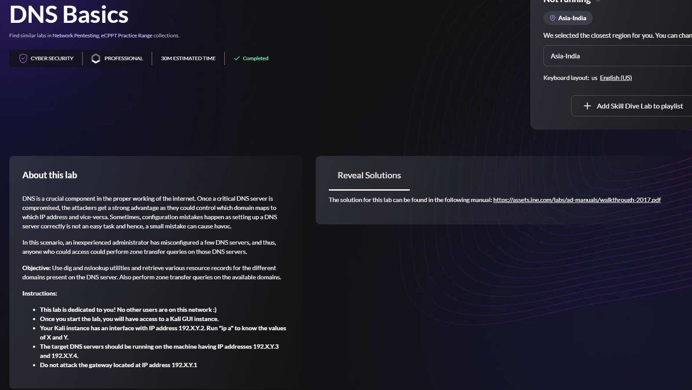
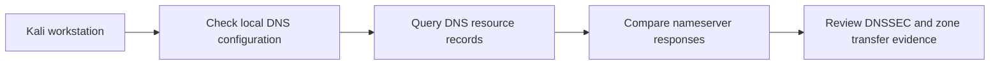

# DNS Basics

## 1. Lab Overview

Inspect DNS records in a Kali lab using nslookup and dig. Compare standard lookups, reverse lookups, and DNSSEC records. Review how the manual's zone transfer observation reveals a configuration risk.



## 2. Lab Environment

| Component | Role |
| --- | --- |
| Kali GUI | Lab workstation with nslookup and dig |
| DNS servers | Example lab addresses 192.211.79.3 and 192.211.79.4 |
| DNS service | Port 53 in the reported lab scan |

The addresses and domains below are from the manual's session. Use the lab-provided names and addresses for your session.

## 3. Workflow Diagram



## 4. Tools Used

| Tool | Purpose |
| --- | --- |
| ip | Inspect local interfaces and addresses |
| cat | Read resolver configuration |
| nslookup | Query specific resource record types |
| dig | Inspect DNS replies, reverse mappings, and DNSSEC records |

## 5. Task-by-Task Walkthrough

Findings are from the [manual summary](lab-source.md). The lab was documented from the supplied materials.

### T1: Identify the local network and resolver

**Goal.** Find the workstation address and configured nameserver.

**Steps**

1. Review the active interfaces on Kali.
2. Read the resolver configuration and identify the configured nameserver.

```bash
ip a
cat /etc/resolv.conf
```

**Command explained.** ip a shows interface addresses. cat displays the resolver configuration.

**Expected result / Finding.** The manual identifies two lab DNS servers and reports port 53 open.

### T2: Resolve names and mail records

**Goal.** Compare address, alias, mail, and text records.

**Steps**

1. Start with a reverse lookup, then query the record types shown below.
2. Compare the names and addresses returned.

```bash
nslookup 192.211.79.3
nslookup -type=A witrapper.com
nslookup -type=TXT witrap.com
nslookup -type=CNAME labs.witrap.com
dig A witrap.com +short
dig AAAA witrap.com
dig MX witrapper.com
dig TXT promo.witrap.com
```

**Command explained.** A and AAAA request IPv4 and IPv6 addresses. TXT requests text. CNAME identifies an alias target. MX lists mail exchangers, where lower preference values take priority. +short returns a compact answer.

**Expected result / Finding.** The manual reports an A record for witrap.com pointing to 192.211.79.3 and labs.witrap.com as an alias for witrapper.com.

### T3: Inspect DNS administration and signing records

**Goal.** Identify zone metadata and records related to DNSSEC.

**Steps**

1. Review the SOA and NS results for authority and administration details.
2. Compare DNSKEY and RRSIG results with the DNSSEC-enabled dig response.

```bash
dig SOA witrapper.com
dig NS witrap.com
dig CAA witrapper.com
nslookup -type=DNSKEY witrapper.com.
nslookup -type=RRSIG witrapper.com.
dig +dnssec witrapper.com +short
```

**Command explained.** SOA includes the primary server and zone serial. NS lists nameservers. CAA describes certificate issuance policy. DNSKEY publishes a public key and RRSIG contains a signature over a record set. +dnssec requests DNSSEC data when available.

**Expected result / Finding.** The manual reports signatures for witrapper.com. Seeing signature records alone does not establish that a resolver validated them.

### T4: Compare resolvers and narrow the output

**Goal.** See how answers vary by resolver and display option.

**Steps**

1. Query the second lab resolver explicitly and compare its answers for the two names.
2. Review the compact output, reverse lookup, and LDAP service example.

```bash
dig @192.211.79.4 witrap.com
dig @192.211.79.4 witrapper.com
dig +noall +answer +question witrap.com
dig -x 192.211.79.44 +short
nslookup -type=srv _ldap._tcp.witrapper.com
dig ldap.witrapper.com
```

**Command explained.** @ selects the DNS server. +noall clears the default sections and the following flags restore only the question and answer. -x requests a reverse lookup. SRV gives a service target and port.

**Expected result / Finding.** The manual reports no Answer section for witrapper.com on the second server. Check the response code and authority fields before interpreting an empty answer.

### T5: Review the zone transfer finding

**Goal.** Explain what an unrestricted full zone transfer can expose.

**Steps**

1. Compare the manual's individual record lookups with the reported transfer response.
2. Identify the record types exposed and note why transfer access should be limited to approved peers.

**Commands.** Review the recorded evidence in the source manual summary.

**Expected result / Finding.** The manual reports that the witrap.com transfer returned NS, A, AAAA, CAA, LOC, TXT, MX, CNAME, and SOA records. The record set shows how much zone information an unrestricted transfer can expose.

## 6. Key Concepts (Beginner-Friendly)

- **Forward and reverse DNS.** Forward lookup starts with a name. Reverse lookup starts with an address.
- **Authoritative server.** A server that holds the zone data and can answer for it.
- **TTL.** The caching lifetime of a DNS answer in seconds.
- **Zone transfer.** A way to synchronize records between authoritative servers. Full transfers use AXFR.

## 7. SOC / Real-World Relevance

Analysts can use DNS records to validate domain and host relationships. Unexpected transfer activity or inconsistent authoritative answers can justify a closer review of DNS configuration and logs.

## 8. Quick Command Cheat Sheet

| Command or option | Purpose |
| --- | --- |
| ip a | List local addresses |
| cat /etc/resolv.conf | Read the resolver configuration |
| nslookup -type=TYPE | Query a specific record type |
| dig @SERVER NAME | Direct a lookup to a selected server |
| dig -x ADDRESS | Request a reverse lookup |
| dig +dnssec | Ask for available DNSSEC records |

## 9. Common Mistakes & Troubleshooting

| Symptom | What to check |
| --- | --- |
| The example addresses differ from the lab | Check the active interface and current lab assignments. |
| A response has no Answer section | Review the response code, authority, resolver choice, and requested type. |
| The full reply looks hard to read | Limit dig to the question and answer sections. |
| A signature is present | Review validation evidence separately. |

## 10. Conclusion

- I checked the resolver and compared common DNS record types.
- I inspected DNSSEC and alternate resolver responses.
- I reviewed the risks shown by the reported zone transfer.
