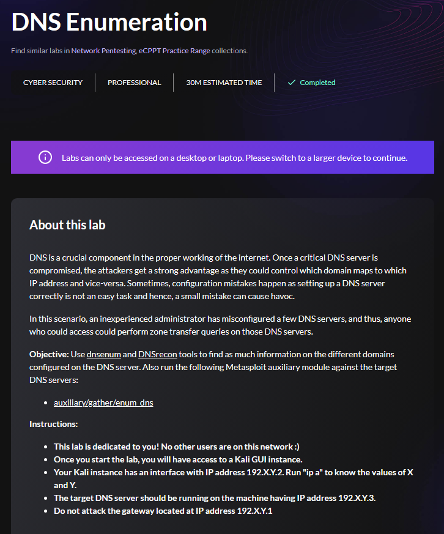
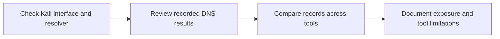

# DNS Enumeration

## 1. Lab Overview

Compare the DNS findings reported by three tools in the INE lab. Review ordinary resource records, DNSSEC indicators, and the evidence of an unrestricted zone transfer. Learn why tool warnings and missing records need to be checked against another source.



## 2. Lab Environment

| Component | Role |
| --- | --- |
| Kali GUI | Workstation for inspecting the local interface and resolver |
| Lab DNS server | 192.X.Y.3 in the lab instructions and 192.211.79.3 in the manual's example |
| DNS service | Port 53 in the reported check |

The example addresses are specific to the source session.

## 3. Workflow Diagram



## 4. Tools Used

| Tool | Purpose |
| --- | --- |
| ip and cat | Inspect local addresses and resolver configuration |
| DNSEnum | Report DNS record and address information |
| DNSRecon | Report DNS records, DNSSEC observations, and transfer results |
| Metasploit DNS Record Scanner and Enumerator | Provide a third set of DNS findings for comparison |

## 5. Task-by-Task Walkthrough

Findings come from the [manual summary](lab-source.md). The enumeration sections use recorded results from the PDF.

### T1: Identify the local interface and resolver

**Goal.** Understand which lab network and resolver are in use.

**Steps**

1. Inspect Kali's assigned address.
2. Read the nameserver settings before interpreting DNS results.

**Commands**

```bash
ip a
cat /etc/resolv.conf
```

**Command explained.** ip a displays interfaces and addresses. cat prints the resolver configuration.

**Expected result / Finding.** The manual identifies 192.211.79.3 as the example lab server and reports port 53 open.

### T2: Review the DNSEnum findings

**Goal.** Identify which kinds of DNS evidence the report contains.

**Steps**

1. Compare the reported forward records with reverse mappings and address information.
2. If the lab XML export is already available, inspect it as text.

**Command**

```bash
cat out.xml
```

**Command explained.** cat displays the saved XML report. It does not make a DNS request.

**Expected result / Finding.** The manual reports records including A, AAAA, MX, NS, SOA, TXT, SRV, and DNSSEC-related data for witrapper.com. It also describes an XML export for witrap.com.

### T3: Review DNSRecon and the transfer evidence

**Goal.** Distinguish routine DNS records from data exposed by a full transfer.

**Steps**

1. Compare the DNSSEC observation for witrapper.com with the reported transfer for witrap.com.
2. Review which findings are domain records and which are server observations.

**Commands.** Review the recorded output described in the source notes.

**Expected result / Finding.** The manual reports DNSSEC for witrapper.com and a successful transfer for witrap.com. It also reports a BIND version string. Treat that string as reported metadata.

### T4: Compare results with the Metasploit report

**Goal.** Identify what the third tool confirmed and where its output was incomplete.

**Steps**

1. Compare NS, MX, SOA, TXT, and SRV results across the reports.
2. Check record-type warnings against the DNSRecon findings before deciding that a record was absent.

**Commands.** Use the recorded report for comparison.

**Expected result / Finding.** The manual reports common record types for witrap.com and witrapper.com. It also says the module warned about some unrecognized DNSSEC record types.

## 6. Key Concepts (Beginner-Friendly)

- **Resource record.** A DNS entry that provides information such as an IP address, nameserver, or mail exchanger.
- **DNSSEC.** Signed DNS data helps a validating resolver check integrity and authenticity.
- **Zone transfer.** A way to synchronize zone data between authoritative servers. Restricting it to approved peers limits unintended disclosure.
- **Tool coverage.** An unrecognized record can be missing from a report even when the server returned it.

## 7. SOC / Real-World Relevance

Analysts can compare DNS evidence across tools to validate domain relationships and investigate unexpected transfers. Source address, request type, and the transfer outcome help distinguish replication from an exposure event.

## 8. Quick Command Cheat Sheet

| Command | Purpose |
| --- | --- |
| ip a | See local interfaces and addresses |
| cat /etc/resolv.conf | Read the configured resolver information |
| cat out.xml | Inspect a saved report locally |

## 9. Common Mistakes & Troubleshooting

| Symptom | What to check |
| --- | --- |
| The example server differs from your session | Check the current lab address assignment. |
| A tool omits a DNSSEC record | Check warnings and compare with another report. |
| A transfer appears in DNS logs | Check the source address, approved peers, and transfer outcome. |

## 10. Conclusion

- I compared the DNS record types identified by the lab reports.
- I reviewed the transfer finding and its exposure implications.
- I documented where tool limitations affected the interpretation.
