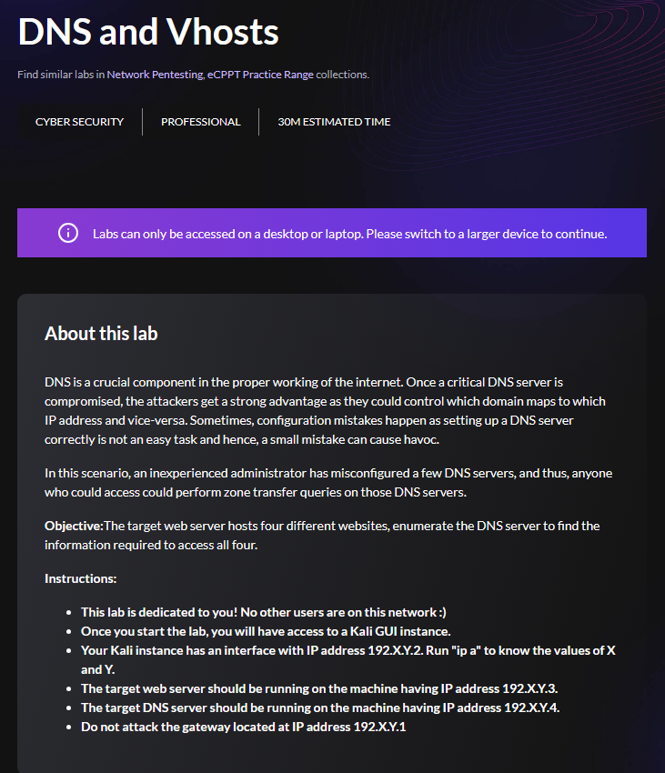
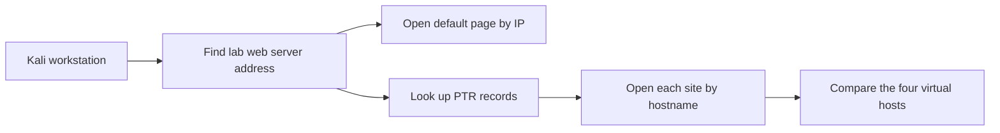

# DNS and Vhosts

## 1. Lab Overview

Use reverse DNS to identify four names associated with one lab web server. Compare the default page served at the IP address with the pages served under each name. The exercise shows how name-based virtual hosting lets one server serve multiple websites.



## 2. Lab Environment

| Component | Lab address pattern | Manual example |
| --- | --- | --- |
| Kali workstation | 192.X.Y.2 | 192.2.195.2 |
| Web server | 192.X.Y.3 | 192.2.195.3 |
| DNS server | 192.X.Y.4 | The screenshot specifies the lab address pattern |

The manual reports TCP ports 80 and 3306 open on the web server. The browser exercise uses HTTP. Use the addresses assigned to your lab session.

## 3. Workflow Diagram



## 4. Tools Used

| Tool | Purpose |
| --- | --- |
| ip | Inspect the workstation's interface addresses |
| dig | Look up PTR records for the lab web server |
| Firefox | Compare the default page with hostname-specific sites |
| Nmap | Source of the port observations reported in the PDF |

## 5. Task-by-Task Walkthrough

The results below come from the [PDF source notes](lab-source.md). The overview screenshot shows the lab topology. The walkthrough records the manual's port findings without repeating the scan command. No live lab traffic was generated while preparing these notes.

### T1: Identify the lab addresses

**Goal.** Find the assigned network and identify the web and DNS hosts.

**Steps**

1. On Kali, inspect the interface that has the 192.X.Y.2 address.
2. Use the lab's address pattern to identify the web server at .3 and DNS server at .4.

**Command**

```bash
ip a
```

**Command explained.** Lists interface addresses and prefix lengths.

**Expected result / Finding.** The manual's Kali address is 192.2.195.2. Its web server is 192.2.195.3.

### T2: Check the default HTTP page

**Goal.** Establish what the web server returns when opened by IP.

**Steps**

1. Review the manual's port observations.
2. On the lab workstation, open the lab web server by its IP address and note the response.

**Command**

```bash
firefox 192.2.195.3
```

**Command explained.** Opens the example IP in Firefox so you can record the default response.

**Expected result / Finding.** The manual shows a default web page on the server.

### T3: Look up the names attached to the web server

**Goal.** Find the PTR records returned for the lab web server.

**Steps**

1. Query the web server address in reverse DNS.
2. Compare the full response with the short output and write down the returned names.

**Commands**

```bash
dig -x 192.2.195.3
dig -x 192.2.195.3 +short
```

**Command explained.** `-x` performs a reverse lookup. `+short` prints a compact answer.

**Expected result / Finding.** The manual reports `witrapper.com`, `public.witrap.com`, `witrap.com`, and `promo.witrap.com`.

### T4: Verify all four virtual hosts

**Goal.** Compare what the same server returns for different hostnames.

**Steps**

1. In the lab browser, open each of the four hostnames using HTTP.
2. Compare each result with the IP-only default page and the other hostname responses.

**Commands.** Use Firefox to open the hostnames returned in T3.

**Expected result / Finding.** The manual shows four different pages served from the same IP. In this HTTP setup, the request's Host header allows the server to select the configured virtual host.

## 6. Key Concepts (Beginner-Friendly)

- **PTR record.** Maps a reverse DNS name for an IP address to a hostname. The lab returns several names for one address.
- **Name-based virtual host.** A web server configuration that selects a site using the requested hostname.
- **Default virtual host.** The site a server can return when the request's host does not match a configured name.
- **Fully qualified domain name.** A complete DNS name. A trailing dot explicitly marks the DNS root.

## 7. SOC / Real-World Relevance

A single IP can serve several sites. During an investigation, check the hostname in DNS, proxy, or web logs before attributing traffic to a specific application.

## 8. Quick Command Cheat Sheet

| Command | Purpose |
| --- | --- |
| `ip a` | Find the workstation address |
| `firefox 192.2.195.3` | Open the default HTTP page in the manual's session |
| `dig -x 192.2.195.3` | Inspect the reverse DNS reply |
| `dig -x 192.2.195.3 +short` | List the returned names compactly |

## 9. Common Mistakes & Troubleshooting

| Symptom | What to check |
| --- | --- |
| Commands point to a different network | Check your current Kali address and substitute the assigned lab IP. |
| Reverse lookup returns no names | Verify the selected address and lab resolver. |
| Every hostname shows the default page | Check the hostname, its resolution, and the page reached in the lab browser. |

## 10. Conclusion

- I found four hostnames associated with one lab web server.
- I compared the default page with the hostname-specific pages.
- I learned how the HTTP Host header helps a server select a virtual host.
