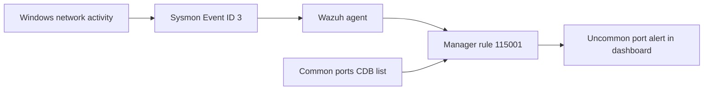

# Detecting Abnormal Network Connections With Wazuh

## 1. Lab Overview

This lab uses Sysmon network events to detect Windows connections to destination ports outside a lab baseline. You deploy a Wazuh agent, register a list of common ports, and add a rule that compares each matching event with that list. You then review the resulting alerts in Wazuh.

## 2. Lab Environment

| Machine | Role |
| --- | --- |
| Ubuntu 20.04 | Wazuh manager and dashboard at `https://localhost`. Example IP `10.0.18.204`. |
| Windows Server 2019 | Monitored endpoint running Wazuh Agent and Sysmon. Example IP `10.0.23.132`. |
| Kali Linux | Peer in the supplied exercise telemetry. Example IP `10.10.21.2`. |

TCP ports `4444` and `1234` are the uncommon destinations discussed in the solution. Use the manager IP assigned to your own lab instance.

## 3. Workflow Diagram



## 4. Tools Used

| Tool | Purpose |
| --- | --- |
| Sysmon | Record process and network activity on Windows |
| Wazuh agent | Collect and forward the Sysmon channel |
| Wazuh manager and dashboard | Apply the rule and show matching alerts |
| CDB list | Define destination ports excluded from this rule |
| PowerShell, Linux shell, and Firefox | Configure the system and review alerts |

## 5. Task-by-Task Walkthrough

The [redacted solution notes](lab-source.md) preserve the defensive configuration. The environment screenshot shows credentials and was excluded. The solution's individual task screenshots were absent.

### T1: Deploy the Wazuh agent on Windows

**Goal.** Connect Windows Server to the Ubuntu manager.

**Steps**

1. Open the Wazuh Dashboard on Ubuntu and check the starting agent count. Use the interface listing to find the manager address.
2. On Windows, open PowerShell and run the Desktop installer. Replace the example address in both manager properties.
3. Start the service and refresh the dashboard. Reconnect to the lab desktop if its session drops.

```bash
ip addr
```

```powershell
cd Desktop\Tools
msiexec.exe /i wazuh-agent-4.3.10-1.msi /q WAZUH_MANAGER=10.0.18.204 WAZUH_REGISTRATION_SERVER=10.0.18.204 WAZUH_AGENT_GROUP=default
Start-Service -Name WazuhSvc
```

**Command explained.** `ip addr` lists interfaces. `cd` selects the installer directory. The MSI uses `/i` to install and `/q` for quiet mode. Its properties set the manager, registration server, and group. `Start-Service` starts the agent.

**Expected result / Finding.** An active Windows agent should appear after refresh.

### T2: Set up Sysmon and forward its events

**Goal.** Collect Sysmon Operational events in Wazuh.

**Steps**

1. Install Sysmon from the Windows Tools directory using the supplied configuration.
2. Confirm the Operational channel in Event Viewer. Add the stanza below to `C:\Program Files (x86)\ossec-agent\ossec.conf`.
3. Restart the agent and record the Windows address.

```powershell
./Sysmon64.exe -accepteula -i sysmonconfig.xml
```

```xml
<localfile>
  <location>Microsoft-Windows-Sysmon/Operational</location>
  <log_format>eventchannel</log_format>
</localfile>
```

```powershell
Restart-Service -Name WazuhSvc
ipconfig
```

**Command explained.** `-accepteula` accepts the Sysinternals license and `-i` specifies the install configuration. The XML selects the Windows event channel. `Restart-Service` loads the updated configuration, and `ipconfig` lists interface settings.

**Expected result / Finding.** The channel should contain events locally and Wazuh should receive collected records. Event ID 3 depends on network-event coverage in the Sysmon configuration.

### T3: Register the common-ports list

**Goal.** Define destination ports that this rule should exclude.

**Steps**

1. On Ubuntu, create `common-ports` in `/var/ossec/etc/lists/` with the entries below.
2. Set ownership and permissions. Add the list entry inside the `ruleset` block of `/var/ossec/etc/ossec.conf`.
3. Restart the Wazuh manager.

```bash
cd /var/ossec/etc/lists/
vi common-ports
```

```text
21:
25:
22:
53:
80:
135:
389:
443:
445:
993:
995:
1514:
1515:
3389:
3306:
5000:
5223:
8000:
8002:
8080:
8083:
8443:
```

```bash
chown wazuh:wazuh common-ports
chmod 660 common-ports
```

```xml
<list>etc/lists/common-ports</list>
```

```bash
systemctl restart wazuh-manager
```

**Command explained.** `vi` edits the list. Each line is a port key followed by a colon, with no value needed here. `chown` sets owner and group. `chmod 660` gives them read and write permissions. The XML registers the list and the restart reloads manager settings.

**Expected result / Finding.** The manager should load the list containing the lab's baseline ports.

### T4: Add the uncommon destination-port rule

**Goal.** Alert on matching network events whose destination port is absent from the list.

**Steps**

1. Add the rule to `/var/ossec/etc/rules/local_rules.xml`.
2. Restart the manager using the command from T3.

```xml
<group name="windows,sysmon,">
    <rule id="115001" level="10">
        <if_sid>61605</if_sid>
        <list field="win.eventdata.destinationPort" lookup="not_match_key">etc/lists/common-ports</list>
```

**Command explained.** `if_sid` requires parent rule `61605`. The list lookup `not_match_key` matches when the destination port is absent. The description includes the destination port and process image.

**Expected result / Finding.** A qualifying event should produce rule `115001` at level 10. This rule contains no direction filter. Check the event's connection direction when interpreting a match.

### T5: Investigate uncommon-port alerts

**Goal.** Validate the alert against recorded Windows network activity.

**Steps**

1. Open **Security Events** in the Wazuh Dashboard and select the Windows agent and exercise time window.
2. Review rule `115001` and inspect its underlying Sysmon Event ID 3. Compare destination address, port, image, and timestamp.
3. Compare the reported ports with the CDB list and document the process and destination shown in each available record.

**Commands.** Use the dashboard to review recorded telemetry.

**Expected result / Finding.** The notes describe exercise traffic associated with ports `4444` and `1234`, both absent from the list. The underlying alert records were not supplied, so exact alert counts and process fields remain unverified.

## 6. Key Concepts (Beginner-Friendly)

- **Destination port.** The port reached on the other side of a connection.
- **Baseline.** A list of destinations expected in this environment. An unusual port is a lead for investigation.
- **Sysmon Event ID 3.** A network-connection record that can show the process and connection endpoints.
- **CDB list.** A set of keys the rule can check quickly when it evaluates a record.

## 7. SOC / Real-World Relevance

An analyst can use an uncommon-port alert to find an unexpected process or destination, then correlate it with host and network evidence. A lab baseline should be assessed in the context of each monitored environment.

## 8. Quick Command Cheat Sheet

| Command | What it does |
| --- | --- |
| `ip addr` | List manager addresses. |
| `cd Desktop\Tools` | Open Windows Tools. |
| `msiexec.exe /i wazuh-agent-4.3.10-1.msi /q WAZUH_MANAGER=10.0.18.204 WAZUH_REGISTRATION_SERVER=10.0.18.204 WAZUH_AGENT_GROUP=default` | Install and register the Wazuh agent. |
| `Start-Service -Name WazuhSvc` | Start the Windows agent. |
| `./Sysmon64.exe -accepteula -i sysmonconfig.xml` | Install Sysmon with the supplied XML. |
| `Restart-Service -Name WazuhSvc` | Reload agent configuration. |
| `ipconfig` | Show Windows addresses. |
| `cd /var/ossec/etc/lists/` | Open the CDB list directory. |
| `vi common-ports` | Edit the port list. |
| `chown wazuh:wazuh common-ports` | Set file owner and group. |
| `chmod 660 common-ports` | Set owner and group access. |
| `systemctl restart wazuh-manager` | Reload Wazuh manager settings. |

## 9. Common Mistakes & Troubleshooting

| Symptom | What to check |
| --- | --- |
| Windows agent stays offline | Verify the manager address, registration settings, and agent service. |
| Sysmon logs appear locally only | Verify the channel stanza and agent restart. |
| Network events are missing | Check that the applied Sysmon configuration captures network connections. |
| The rule does not fire | Check the parent rule, destination field, list path, and manager restart. |
| A common application triggers the rule | Inspect process, direction, and destination before interpreting the alert. |

## 10. Conclusion

- I forwarded Windows Sysmon events to Wazuh.
- I configured a common-port list and a rule that detects ports outside it.
- I reviewed how process and destination fields support uncommon-port triage.
