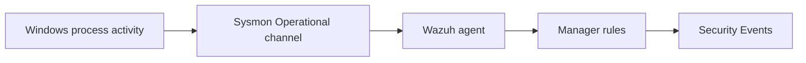

# Detecting Mimikatz Threat Using Sysmon and Wazuh

## 1. Lab Overview

This lab connects a Windows endpoint to Wazuh and collects Sysmon records for process creation, remote thread creation, and process access. You configure executable-specific rules and review the resulting alerts. By the end, you can explain which recorded behaviors each rule matches.

## 2. Lab Environment

| Machine | Role |
| --- | --- |
| Ubuntu 20.04 SOC machine | Wazuh manager and dashboard at https://localhost |
| Windows Server 2019 | Target endpoint running Sysmon and the Wazuh agent |
| Kali Linux | Listed in the solution environment |

The manager address in the notes is `10.0.31.41`. Use the address assigned to your lab session. The notes specify no numeric agent port.

## 3. Workflow Diagram



## 4. Tools Used

| Tool | Purpose |
| --- | --- |
| Sysmon | Record endpoint events selected by the XML configuration |
| Wazuh agent | Collect the Sysmon Operational channel |
| Wazuh manager and dashboard | Evaluate rules and inspect matching alerts |
| PowerShell | Apply Sysmon settings and manage the agent service |
| Firefox | Open the Wazuh dashboard |

## 5. Task-by-Task Walkthrough

Findings come from the [redacted solution notes](lab-source.md). The supplied environment screenshot shows a dashboard password and was excluded. Individual task screenshots were absent.

### T1: Connect the Wazuh agent to the server

**Goal.** Verify that the Windows agent registers with the manager.

**Steps**

1. On the SOC machine, check the dashboard and identify the manager address.
2. On Windows, set that address in `C:\Program Files (x86)\ossec-agent\ossec.conf`.
3. Start the agent service and refresh the dashboard.

**Commands**

```bash
ip addr
```

```powershell
Start-Service -Name WazuhSvc
```

**Command explained.** `ip addr` lists manager interface addresses. `Start-Service` starts the Windows agent service.

**Expected result / Finding.** The notes report one active agent after setup.

### T2: Configure Sysmon collection

**Goal.** Forward the Sysmon Operational channel with the lab's selected event filters.

**Steps**

1. On Windows, add the channel stanza to the agent's `ossec.conf`.
2. Save the lab configuration as `sysconfig.xml` in Downloads. Apply it from the Sysmon directory and restart the agent.

**Commands and configuration**

```xml
<localfile>
  <location>Microsoft-Windows-Sysmon/Operational</location>
  <log_format>eventchannel</log_format>
</localfile>
```

```xml
<Sysmon schemaversion="4.10">
   <HashAlgorithms>md5</HashAlgorithms>
   <EventFiltering>
      <!--SYSMON EVENT ID 1 : PROCESS CREATION-->
      <ProcessCreate onmatch="include">
         <Image condition="contains">mimikatz.exe</Image>
      </ProcessCreate>
      <!--SYSMON EVENT ID 2 : FILE CREATION TIME RETROACTIVELY CHANGED IN THE FILESYSTEM-->
      <FileCreateTime onmatch="include" />
      <!--SYSMON EVENT ID 3 : NETWORK CONNECTION INITIATED-->
      <NetworkConnect onmatch="include" />
      <!--SYSMON EVENT ID 4 : RESERVED FOR SYSMON STATUS MESSAGES, THIS LINE IS INCLUDED FOR DOCUMENTATION PURPOSES ONLY-->
      <!--SYSMON EVENT ID 5 : PROCESS ENDED-->
      <ProcessTerminate onmatch="include" />
      <!--SYSMON EVENT ID 6 : DRIVER LOADED INTO KERNEL-->
      <DriverLoad onmatch="include" />
      <!--SYSMON EVENT ID 7 : DLL (IMAGE) LOADED BY PROCESS-->
      <ImageLoad onmatch="include" />
      <!--SYSMON EVENT ID 8 : REMOTE THREAD CREATED-->
      <CreateRemoteThread onmatch="include">
         <SourceImage condition="contains">mimikatz.exe</SourceImage>
      </CreateRemoteThread>
      <!--SYSMON EVENT ID 9 : RAW DISK ACCESS-->
      <RawAccessRead onmatch="include" />
      <!--SYSMON EVENT ID 10 : INTER-PROCESS ACCESS-->
      <ProcessAccess onmatch="include">
         <SourceImage condition="contains">mimikatz.exe</SourceImage>
      </ProcessAccess>
      <!--SYSMON EVENT ID 11 : FILE CREATED-->
      <FileCreate onmatch="include" />
      <!--SYSMON EVENT ID 12 & 13 & 14 : REGISTRY MODIFICATION-->
      <RegistryEvent onmatch="include" />
      <!--SYSMON EVENT ID 15 : ALTERNATE DATA STREAM CREATED-->
      <FileCreateStreamHash onmatch="include" />
      <PipeEvent onmatch="include" />
   </EventFiltering>
</Sysmon>
```

```powershell
cd .\Downloads\Sysmon
.\Sysmon64.exe -c ..\sysconfig.xml
Restart-Service -Name WazuhSvc
```

**Command explained.** The channel stanza tells Wazuh to read the Windows event log. The Sysmon XML includes filename-based filters for event types 1, 8, and 10. `-c` updates the existing Sysmon configuration. Restarting the agent reloads its channel settings.

**Expected result / Finding.** Sysmon records that match the applied configuration can be collected by the agent. These lab filters provide narrow coverage based on the executable name.

### T3: Add custom rules on the manager

**Goal.** Match the selected Sysmon activity involving the executable.

**Steps**

1. Add the rule group to `/var/ossec/etc/rules/local_rules.xml` on Ubuntu.
2. Restart the manager to load the rules.

**Commands and configuration**

```xml
<group name="windows, sysmon, sysmon_process-anomalies,">
   <rule id="100000" level="12">
     <if_group>sysmon_event1</if_group>
     <field name="win.eventdata.image">mimikatz.exe</field>
     <description>Sysmon - Suspicious Process - mimikatz.exe</description>
   </rule>
   <rule id="100001" level="12">
     <if_group>sysmon_event8</if_group>
     <field name="win.eventdata.sourceImage">mimikatz.exe</field>
     <description>Sysmon - Suspicious Process mimikatz.exe created a remote thread</description>
   </rule>
   <rule id="100002" level="12">
     <if_group>sysmon_event_10</if_group>
     <field name="win.eventdata.sourceImage">mimikatz.exe</field>
     <description>Sysmon - Suspicious Process mimikatz.exe accessed $(win.eventdata.targetImage)</description>
   </rule>
</group>
```

```bash
systemctl restart wazuh-manager
```

**Command explained.** Rule `100000` matches process creation by image. Rules `100001` and `100002` examine the source image for remote thread creation and process access. Rule `100002` identifies the process that initiated access and displays the target image. This corrects the explanation in the supplied notes.

**Expected result / Finding.** Matching events can generate level 12 alerts when the corresponding Sysmon group and extracted fields are present.

### T4: Review the simulated activity as evidence

**Goal.** Map the reported activity to relevant event types.

**Steps**

1. Use the Windows agent and exercise time to scope the review.
2. Compare process creation, remote thread creation, and process access records by image, target process, host, and time.

**Commands.** Review the recorded simulation in Wazuh.

**Expected result / Finding.** The notes describe an executable launch and credential-access simulation. A process record or access event alone does not establish that credentials were recovered.

### T5: Investigate the Wazuh alerts

**Goal.** Validate which custom rules generated alerts.

**Steps**

1. On the SOC machine, open **Security Events** and select alerts at level 12 or above.
2. Expand rule `100000` and inspect the process image. Expand rule `100002` and inspect the source and target images.

**Commands.** Use the dashboard filters and event details.

**Expected result / Finding.** The notes show rules `100000` and `100002` in the review. They do not independently establish that rule `100001` fired.

## 6. Key Concepts (Beginner-Friendly)

- **Process creation.** An event that records a program starting.
- **Remote thread creation.** An event showing one process creating a thread in another process.
- **Process access.** An event showing a source process opening a target process.
- **Filename-based detection.** A rule that checks an image name. Legitimate context and additional evidence still matter.

## 7. SOC / Real-World Relevance

Analysts can link a suspicious process launch with later activity involving another process. Reading the source and target fields helps distinguish who initiated the action and what was affected.

## 8. Quick Command Cheat Sheet

| Command | What it does |
| --- | --- |
| `ip addr` | Find SOC machine addresses. |
| `Start-Service -Name WazuhSvc` | Start the Windows agent. |
| `cd .\Downloads\Sysmon` | Open the Sysmon directory. |
| `.\Sysmon64.exe -c ..\sysconfig.xml` | Apply the lab Sysmon configuration. |
| `Restart-Service -Name WazuhSvc` | Reload Wazuh agent settings. |
| `systemctl restart wazuh-manager` | Load the local manager rules. |

## 9. Common Mistakes & Troubleshooting

| Symptom | What to check |
| --- | --- |
| Agent stays offline | Verify the manager address and WazuhSvc state. |
| Sysmon events stay local | Check the channel stanza and restart the agent. |
| A rule misses a record | Check the event group, extracted image field, and manager rule load. |
| A rule ID is already in use | Check existing local rules before adding the lab group. |

## 10. Conclusion

- I connected the Windows agent and configured Sysmon event collection.
- I matched three Sysmon event types to local Wazuh rules.
- I reviewed the reported alerts and documented what the evidence supports.
