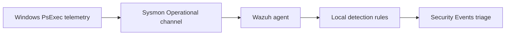

# Detecting PsExec with Wazuh

## 1. Lab Overview

This lab uses Wazuh and Sysmon to detect traces of PsExec on a Windows server. You configure event collection and review registry, service, and named pipe indicators. By the end, you can explain which alerts support those findings and where further evidence is needed.

## 2. Lab Environment

| Machine | Role |
| --- | --- |
| Ubuntu 20.04 SOC machine | Wazuh manager and dashboard at https://localhost |
| Windows Server 2019 | Monitored endpoint running Sysmon and the Wazuh agent |
| Kali Linux | Listed in the solution environment |

The example manager IP is `10.0.28.182`. The notes specify no numeric agent port.

## 3. Workflow Diagram



## 4. Tools Used

| Tool | Purpose |
| --- | --- |
| Sysmon | Record Windows registry and named pipe activity |
| Wazuh agent | Collect Sysmon Operational events |
| Wazuh manager and dashboard | Apply detection rules and investigate alerts |
| PowerShell and Firefox | Configure Windows services and access the dashboard |
| PsExec | Sysinternals administration utility whose telemetry is investigated |

## 5. Task-by-Task Walkthrough

Findings come from the [redacted solution notes](lab-source.md). The uploaded screenshot contains a dashboard password and was excluded. The solution links to task images, which were not added.

### T1: Connect the Wazuh agent to the server

**Goal.** Make the Windows endpoint visible in Wazuh.

**Steps**

1. On the SOC machine, open Wazuh and identify the manager address.
2. On Windows, enter that address in Wazuh Agent Manager and start the service.
3. Refresh the dashboard to verify agent status.

**Commands**

```bash
ip addr
```

```powershell
Start-Service -Name WazuhSvc
```

**Command explained.** ip addr lists the manager interfaces. Start-Service starts WazuhSvc.

**Expected result / Finding.** The notes report an active agent after refresh.

### T2: Configure Sysmon collection

**Goal.** Send Sysmon Operational events to Wazuh.

**Steps**

1. Add the channel stanza to C:\Program Files (x86)\ossec-agent\ossec.conf.
2. On Windows, install Sysmon with the provided configuration and restart WazuhSvc.
3. Check the Operational channel in Event Viewer and verify the forwarding path.

**Commands and configuration**

```xml
<localfile>
  <location>Microsoft-Windows-Sysmon/Operational</location>
  <log_format>eventchannel</log_format>
</localfile>
```

```powershell
cd .\Downloads\Sysmon
.\Sysmon64.exe -accepteula -i sysmonconfig.xml
Restart-Service -Name WazuhSvc
```

**Command explained.** The stanza selects the Windows event channel. The Sysmon installer uses -accepteula to accept the license and -i to install with the lab configuration. Restart-Service reloads the agent settings.

**Expected result / Finding.** Sysmon starts and the agent can read the configured channel.

### T3: Add the PsExec rules

**Goal.** Detect PsExec-related registry and named pipe activity.

**Steps**

1. On the manager, add the rule group below to /var/ossec/etc/rules/local_rules.xml.
2. Restart the manager to load the rules.

**Commands and configuration**

```xml
<group name="windows,sysmon">
  <rule id="160010" level="10">
    <if_group>windows,sysmon</if_group>
    <field name="win.eventdata.eventType" type="pcre2" >SetValue</field>
    <field name="win.eventdata.targetObject" type="pcre2" >\\\\SOFTWARE\\\\Sysinternals\\\\PsExec\\\\EulaAccepted</field>
    <options>no_full_log</options>
    <description>PsExec EULA registry found on $(win.system.computer)</description>
      <mitre>
        <id>T1112</id>
      </mitre>
  </rule>

  <rule id="160011" level="10">
    <if_group>windows,sysmon</if_group>
    <field name="win.eventdata.targetObject" type="pcre2" >HKLM\\\\System\\\\CurrentControlSet\\\\Services\\\\PSEXESVC</field>
    <field name="win.eventdata.eventType" type="pcre2" >^SetValue$</field>
    <field name="win.eventdata.user" type="pcre2" >NT AUTHORITY\\\\SYSTEM</field>
    <options>no_full_log</options>
    <description>PsExec service running as $(win.eventdata.user) has been created on $(win.system.computer)</description>
      <mitre>
        <id>T1543.003</id>
      </mitre>
  </rule>

  <rule id="160012" level="10">
    <if_group>windows,sysmon</if_group>
    <field name="win.eventdata.targetObject" type="pcre2" >HKLM\\\\System\\\\CurrentControlSet\\\\Services\\\\PSEXESVC</field>
    <field name="win.eventdata.eventType" type="pcre2" >^DeleteKey$</field>
    <field name="win.eventdata.user" type="pcre2" >NT AUTHORITY\\\\SYSTEM</field>
    <options>no_full_log</options>
    <description>PsExec service running as $(win.eventdata.user) has been deleted on $(win.system.computer)</description>
      <mitre>
        <id>T1543.003</id>
      </mitre>
  </rule>

  <rule id="160013" level="10">
    <if_group>windows,sysmon</if_group>
    <field name="win.eventdata.eventType" type="pcre2" >CreatePipe</field>
    <field name="win.eventdata.image" type="pcre2" >\\\\PSEXESVC.exe</field>
    <match type="pcre2">(?i)(PSEXESVC|stdin|stdout|stderr)</match>
    <field name="win.eventdata.user" type="pcre2" >NT AUTHORITY\\\\SYSTEM</field>
    <options>no_full_log</options>
    <description>PsExec named pipe running as $(win.eventdata.user) has been found on $(win.system.computer)</description>
      <mitre>
        <id>T1570</id>
      </mitre>
  </rule>
</group>
```

```bash
systemctl restart wazuh-manager
```

**Command explained.** The rule group checks the decoded event type, registry object, process image, and account. The restart reloads the manager rules. The XML retains the source's regex escaping. Compare those patterns with decoded field values if a rule misses an event.

**Expected result / Finding.** Rule 160010 matches an EULA registry value change, 160011 matches a PSEXESVC service registry value change, 160012 matches deletion of its registry key, and 160013 matches named pipe activity involving PSEXESVC. The custom rules use level 10.

### T4: Review the recorded privilege context

**Goal.** Identify the account context reported for the PowerShell process.

**Steps**

1. Note the endpoint and exercise window.
2. Compare the reported effective account with associated service and pipe records.

**Command recorded in the solution**

```powershell
whoami
```

**Command explained.** whoami reports the account running the current shell.

**Expected result / Finding.** The notes report NT AUTHORITY\SYSTEM. That identifies the process context. Review service and process records to establish what led to it.

### T5: Investigate PsExec alerts in Wazuh

**Goal.** Correlate reported PsExec artifacts across alerts.

**Steps**

1. In **Security Events**, scope the review to the Windows agent and exercise window.
2. Expand rule IDs 160011, 160012, and 160013. Compare host, time, registry object, event type, process image, and account.
3. Check whether the sequence shows the service registry change, pipe activity, and service key deletion.

**Commands.** Use the dashboard filters and alert details.

**Expected result / Finding.** The solution explicitly discusses alerts 160011, 160012, and 160013. An alert for 160010 is not shown in the supplied text. PsExec also has legitimate administrative uses, so check context before deciding whether the activity was unauthorized.

## 6. Key Concepts (Beginner-Friendly)

- **Windows service.** A program managed by Windows that can run under a service account such as SYSTEM.
- **Named pipe.** A communication channel that processes can use to exchange information.
- **Registry telemetry.** Records of changes to Windows settings, including service-related keys and values.
- **Correlation.** Matching host, process, account, and time across records to understand how activity fits together.

## 7. SOC / Real-World Relevance

A SOC analyst can compare short-lived service and pipe artifacts with approved administration activity. Looking at several related signals helps determine whether an individual alert warrants escalation.

## 8. Quick Command Cheat Sheet

| Command | What it does |
| --- | --- |
| `ip addr` | List manager interface addresses. |
| `Start-Service -Name WazuhSvc` | Start the Windows agent. |
| `cd .\Downloads\Sysmon` | Open the Sysmon directory. |
| `.\Sysmon64.exe -accepteula -i sysmonconfig.xml` | Install Sysmon with the lab configuration. |
| `Restart-Service -Name WazuhSvc` | Reload agent settings. |
| `systemctl restart wazuh-manager` | Reload manager rules. |
| `whoami` | Identify the current shell account. |

## 9. Common Mistakes & Troubleshooting

| Symptom | What to check |
| --- | --- |
| Agent does not appear | Check the manager address and WazuhSvc state. |
| Events exist locally only | Check the channel name and agent restart. |
| A rule misses an event | Verify group membership, event type, decoded field values, and regex escaping. |
| Only one alert matches | Check the time range and whether Sysmon captured the related event types. |

## 10. Conclusion

- I connected the Windows agent and enabled Sysmon collection.
- I reviewed rules for registry, service, and named pipe evidence.
- I correlated reported PsExec alerts and documented the limits of the evidence.
