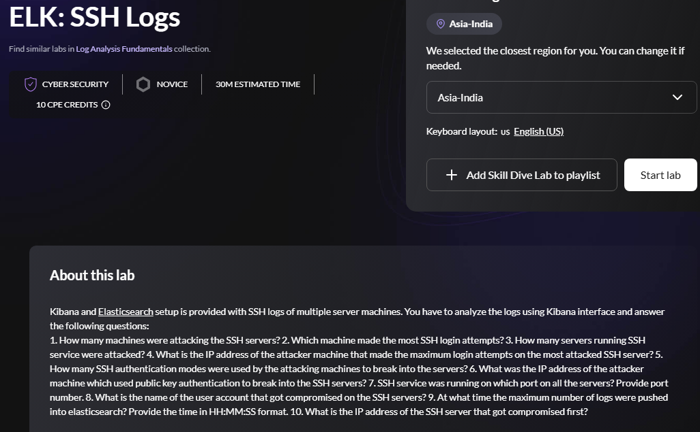
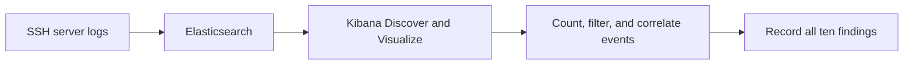

# ELK: SSH Logs

## 1. Lab Overview

This lab uses Kibana to investigate SSH authentication records from several servers. You count clients and servers, compare authentication methods, and reconstruct the order of successful logons. By the end, you can answer the ten lab questions from event fields and visualizations.



## 2. Lab Environment

- Kibana and Elasticsearch are supplied with a preloaded SSH dataset.
- The PDF screenshots show the `ssh-logs*` index pattern. The prose uses `ssh-log*`.
- The solution identifies TCP `3603` as the SSH listener port in its dataset. The manual says addresses may vary by lab session.

## 3. Workflow Diagram



## 4. Tools Used

| Tool | Purpose |
| --- | --- |
| Elasticsearch | Store and search the preloaded records |
| Kibana Discover | Filter SSH events and inspect fields |
| Kibana Visualize | Group event counts by client and server |
| Timelion | Locate the highest event-count time bucket in the lab |

## 5. Task-by-Task Walkthrough

The findings come from the [PDF source notes](lab-source.md). No live lab dataset was supplied. Q2's prose says `ssh_client_ip.keyword`, while the field shown in the visualization is `sshd_client_ip.keyword`. The steps below follow the screenshot.

### T1: Count attacking clients

**Goal.** Count distinct source machines in failed SSH authentication records.

**Steps**

1. Apply the filter in Discover, then inspect the distinct values of sshd_client_ip.

**Commands**

```kql
sshd_conn_stat : "authentication failure"
```

**Command explained.** The filter selects recorded authentication failures.

**Expected result / Finding.** 3 clients: 192.148.107.6, 192.148.107.7, and 192.148.107.8.

### T2: Rank clients by attempts

**Goal.** Find the busiest source machine.

**Steps**

1. Create a Vertical Bar visualization on ssh-logs*. Use Count and a Terms aggregation on sshd_client_ip.keyword, ordered by count descending. Confirm that the selected events represent the activity you intend to count.

**Commands.** Use the Kibana visualization controls.

**Command explained.** Terms groups events by client address. Count ranks the groups by recorded events.

**Expected result / Finding.** 192.148.107.6.

### T3: Count attacked servers

**Goal.** Identify the distinct SSH servers represented in the attack records.

**Steps**

1. Filter for the listener address, then compare the resulting addresses with records tied to the identified client IPs.

**Commands**

```kql
sshd_listen_ip : *
```

**Command explained.** The existence filter finds records containing a listener IP. Correlating client records distinguishes attacked hosts from service startup entries.

**Expected result / Finding.** 3 servers.

### T4: Find the leading client on the busiest server

**Goal.** Rank clients within the most attacked SSH server.

**Steps**

1. Create a Pie visualization using Terms on sshd_listen_ip.keyword. Exclude wildcard listener addresses 0.0.0.0 and :: from the server count. Add a nested Terms aggregation on sshd_client_ip.keyword.

**Commands.** Use the Kibana visualization controls.

**Command explained.** The outer grouping by server and nested grouping by client show which source contributes the most events for a given server.

**Expected result / Finding.** 192.148.107.6 made the most attempts against the busiest server, 192.148.107.4.

### T5: Count authentication modes

**Goal.** Identify the recorded SSH methods.

**Steps**

1. Apply the filter and inspect sshd_auth_type. Compare with accepted records if you need to establish successful use of each mode.

**Commands**

```kql
sshd_auth_type : * AND not sshd_auth_type : none
```

**Command explained.** The existence check keeps events with a method. The negative clause removes none.

**Expected result / Finding.** 2 modes: password and public key.

### T6: Find the public-key source

**Goal.** Identify the client tied to successful public-key authentication.

**Steps**

1. Apply the filter, then inspect the message and sshd_client_ip. Check the accepted outcome in the event.

**Commands**

```kql
sshd_auth_type : "publickey"
```

**Command explained.** The filter selects records that identify the publickey authentication method.

**Expected result / Finding.** 192.148.107.8.

### T7: Find the SSH listening port

**Goal.** Verify the endpoint service port.

**Steps**

1. Apply the filter and inspect the distinct values of sshd_listen_port across servers.

**Commands**

```kql
sshd_listen_port : *
```

**Command explained.** The filter selects events with a listener-port field. Use that field rather than the client source port.

**Expected result / Finding.** 3603.

### T8: Identify the compromised account

**Goal.** Find the account shown in accepted SSH logons.

**Steps**

1. Apply the filter. Inspect sshd_user and the raw message. Compare the source with the investigated clients.

**Commands**

```kql
sshd_conn_stat : "Accepted"
```

**Command explained.** The filter selects records where sshd reports accepted authentication.

**Expected result / Finding.** administrator.

### T9: Find the busiest second

**Goal.** Read the peak event volume as HH:MM:SS.

**Steps**

1. Open the lab Timelion visualization and zoom into the peak region. Read the busiest second in the same time display as the manual.

**Commands.** Use the Kibana visualization controls.

**Command explained.** The time-series chart counts events in time buckets. It establishes the peak for the chart timestamp. The manual does not identify a separate ingestion timestamp.

**Expected result / Finding.** 16:17:58 in the manual's display.

### T10: Find the first compromised SSH server

**Goal.** Resolve the earliest accepted logon to a server address.

**Steps**

1. Use the accepted filter from T8 and sort by time ascending. Open the earliest relevant record and read host.name. Use the host filter below to find its listener IP.

**Commands**

```kql
host.name : "ssh-server-3" and sshd_listen_ip : *
```

**Command explained.** The filter selects records for ssh-server-3 that contain the listener address.

**Expected result / Finding.** 192.148.107.3.

## 6. Key Concepts (Beginner-Friendly)

- **Client and listener.** The client initiates the connection. The listener identifies the SSH service on the server.
- **Terms aggregation.** Group records by a field value and count the events in each group.
- **Authentication outcome and method.** The outcome says whether the server accepted access. The method says how the client tried to authenticate.
- **Time bucket.** A group of records in one interval. Smaller buckets help locate a short burst.

## 7. SOC / Real-World Relevance

An analyst can use failed logons to identify sources worth investigating, then compare accepted events by account, server, and time. This provides a timeline for scoping confirmed access and helps keep routine service records out of attack counts.

## 8. Quick Command Cheat Sheet

| Kibana filter | What it finds |
| --- | --- |
| `sshd_conn_stat : "authentication failure"` | Count distinct source machines in failed SSH authentication records. |
| `sshd_listen_ip : *` | Identify the distinct SSH servers represented in the attack records. |
| `sshd_auth_type : * AND not sshd_auth_type : none` | Identify the recorded SSH methods. |
| `sshd_auth_type : "publickey"` | Identify the client tied to successful public-key authentication. |
| `sshd_listen_port : *` | Verify the endpoint service port. |
| `sshd_conn_stat : "Accepted"` | Find the account shown in accepted SSH logons. |
| `host.name : "ssh-server-3" and sshd_listen_ip : *` | Resolve the earliest accepted logon to a server address. |

## 9. Common Mistakes & Troubleshooting

| Symptom | What to check |
| --- | --- |
| Discover shows no logs | Verify the SSH index pattern and historical time range. |
| A client field is missing | Check the actual data mapping for `sshd_client_ip.keyword`. |
| The server count includes extra addresses | Exclude wildcard bind addresses from the count of distinct servers. |
| The peak time differs | Compare the time zone, chart timestamp, and bucket size with the manual. |
| The first login looks too recent | Sort accepted records ascending and verify that it belongs to the investigated activity. |

## 10. Conclusion

- I identified the clients, servers, authentication methods, port, and compromised account.
- I compared event volume and the earliest accepted logon.
- I checked the PDF's findings against the displayed fields and documented the timestamp limitation.
