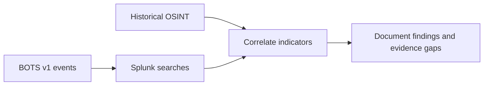

# Effectively Using Splunk (Scenario 1)

## 1. Lab Overview

Investigate reported activity against the fictional Wayne Enterprises website using Splunk and the Boss of the SOC v1 dataset. Follow six stages of the Cyber Kill Chain and compare network, host, and historical intelligence evidence. By the end, you can explain how each finding was identified and what evidence is still missing.

## 2. Lab Environment

- Analyst workstation with Firefox. The solution identifies it as Kali.
- Splunk Search & Reporting at http://demo.ine.local:8000 with index `botsv1`.
- Investigated website `imreallynotbatman.com` and internal target `192.168.250.70`.
- Available records include Stream HTTP and DNS, Suricata, IIS, Sysmon, Windows events, and Fortinet firewall logs.

## 3. Workflow Diagram



## 4. Tools Used

| Tool | Purpose |
| --- | --- |
| Splunk and SPL | Search, filter, and summarize indexed evidence |
| Firefox | Open Splunk and the lab's reference material |
| Stream HTTP and DNS, IIS, and Fortinet | Review traffic, requests, and domain activity |
| Suricata | Compare network activity with IDS signatures and file records |
| Sysmon | Check process creation and file hashes recorded on the host |
| Historical OSINT | Correlate infrastructure and sample metadata |

## 5. Task-by-Task Walkthrough

Findings below are from the [redacted solution notes](lab-source.md) and [original overview](lab-overview-source.md). No task screenshots were uploaded. Historical OSINT findings come from the supplied solution. The walkthrough preserves the SPL used for defensive searches.

### T1: Reconnaissance

**Goal.** Identify the likely scanner and target.

**Steps**

1. Identify the relevant data source or historical intelligence record.
2. Open Search & Reporting, set All time, and verify the botsv1 data. Search for the site, rank source IPs, and compare the leading source with Suricata signatures. Inspect src_headers, destination, and URI fields.

**Commands**

```spl
index="botsv1" earliest=0
index=botsv1 imreallynotbatman.com
index=botsv1 imreallynotbatman.com sourcetype=stream:http
index=botsv1 imreallynotbatman.com sourcetype=stream* | stats count(src_ip) as Requests by src_ip | sort - Requests
index=botsv1 imreallynotbatman.com src_ip=40.80.148.42 sourcetype=suricata
index=botsv1 src_ip=40.80.148.42 sourcetype=stream:http
index=botsv1 dest_ip=192.168.250.70 sourcetype=stream:http
index=botsv1 dest_ip=192.168.250.70 sourcetype=stream:http| timechart count by uri limit=10
index=botsv1 sourcetype=iis sc_status=200 | stats values(cs_uri_stem)
index=botsv1 sourcetype=iis
```

**Command explained.** stats count ranks source activity. The Suricata filter checks alerts tied to the same source. The URI time chart counts all matching requests. IIS status 200 narrows the IIS results to successful responses.

**Expected result / Finding.** 40.80.148.42 accounts for about 95% of the HTTP traffic in the cited results. The notes describe Acunetix indicators and identify 192.168.250.70 as the target, with IIS host we1149srv.

### T2: Weaponization

**Goal.** Identify infrastructure associated with the second source IP.

**Steps**

1. Identify the relevant data source or historical intelligence record.
2. Review historical passive DNS and registration evidence for 23.22.63.114. Compare associated names with the organization and pivot on registrant details where available.

**Commands.** Review the historical OSINT evidence in the solution notes.

**Command explained.** This task uses historical OSINT evidence rather than SPL.

**Expected result / Finding.** The notes identify wayncorpinc.com as a domain examined through registration records. Shared hosting and name similarity are leads to corroborate.

### T3: Delivery

**Goal.** Look for malware metadata linked to the infrastructure.

**Steps**

1. Identify the relevant data source or historical intelligence record.
2. Review the solution's historical IP-to-sample pivot. Use metadata such as filenames and hashes to compare reports without retrieving samples.

**Commands.** Review the historical OSINT evidence in the solution notes.

**Command explained.** This task uses passive sample metadata rather than SPL.

**Expected result / Finding.** The notes describe possible sample associations, but the sample hashes and filenames appear only in missing screenshots. An infrastructure association alone does not establish delivery.

### T4: Exploitation

**Goal.** Identify the web server and the likely source of repeated login attempts.

**Steps**

1. Identify the relevant data source or historical intelligence record.
2. Use HTTP POST events to compare source IPs. Review request paths and compare with IIS evidence. Correlate authentication outcomes separately.

**Commands**

```spl
index=botsv1 sourcetype=stream:http dest_ip="192.168.250.70" http_method=POST
index=botsv1 sourcetype=stream:http dest_ip="192.168.250.70" http_method=POST src_ip="40.80.148.42"
index=botsv1 sourcetype=stream:http dest_ip="192.168.250.70" http_method=POST src_ip="23.22.63.114"
index=botsv1 sourcetype=stream:http dest_ip="192.168.250.70" http_method=POST form_data=*username*passwd* | stats count by src_ip
```

**Command explained.** The POST filters narrow candidates for login activity. The form field pattern and stats count compare the volume by source without displaying submitted password values.

**Expected result / Finding.** The notes identify 23.22.63.114 as the password-guessing source against 192.168.250.70. The text does not name the CMS. Repeated POSTs alone do not prove a successful login.

### T5: Installation

**Goal.** Identify the uploaded executable and look for host evidence.

**Steps**

1. Identify the relevant data source or historical intelligence record.
2. Look for executables in HTTP and Suricata records. Inspect part_filename{} and fileinfo.filename. Pivot into Sysmon and compare Hashes, CommandLine, and ParentCommandLine.

**Commands**

```spl
index=botsv1 sourcetype=stream:http dest_ip="192.168.250.70" *.exe
index=botsv1 sourcetype=suricata (dest=imreallynotbatman.com OR dest="192.168.250.70") http.http_method=POST .exe
index=botsv1 sourcetype=suricata dest_ip="192.168.250.70" http.http_method=POST .exe
index=botsv1 3791.exe
index=botsv1 3791.exe sourcetype=XmlWinEventLog:Microsoft-Windows-Sysmon/Operational
index=botsv1 3791.exe sourcetype=XmlWinEventLog:Microsoft-Windows-Sysmon/Operational EventCode=1
index=botsv1 3791.exe CommandLine=3791.exe | stats values(md5)
```

**Command explained.** The HTTP and Suricata searches find candidate upload records. Sysmon EventCode 1 narrows to process creation, and stats values lists distinct extracted MD5 values.

**Expected result / Finding.** The notes identify 3791.exe. The actual MD5 value is absent from the supplied text.

### T6: Command and Control

**Goal.** Find a suspicious domain associated with the investigated address.

**Steps**

1. Identify the relevant data source or historical intelligence record.
2. Search DNS events for 23.22.63.114. Review the returned names and compare the relevant DNS answers with HTTP and firewall activity if available.

**Commands**

```spl
index=botsv1 sourcetype=stream:dns 23.22.63.114 | stats values("name{}")
```

**Command explained.** stats values lists distinct DNS names extracted in name{}. Check the raw DNS record to verify the relationship between the address and the name.

**Expected result / Finding.** The notes identify prankglassinebracket.jumpingcrab.com and associate it with the defacement. DNS alone does not confirm C2. The prose also transposes the first two IP octets. The SPL uses 23.22.63.114.

## 6. Key Concepts (Beginner-Friendly)

- **Index and sourcetype.** The index contains searchable records. The sourcetype helps distinguish types of telemetry within it.
- **Splunk architecture.** Forwarders collect data, indexers store it, and search heads run and display searches.
- **Pivot.** Use an indicator from one source, such as an IP or filename, to look for related evidence in another.
- **Evidence strength.** Traffic volume, reputation, and DNS associations are leads. Logs showing an action or outcome can strengthen a finding.

## 7. SOC / Real-World Relevance

SOC analysts often start with one domain or alert, then compare network and endpoint records. Historical intelligence can provide context, while timestamps, host records, and authentication outcomes help establish what happened in the monitored environment.

## 8. Quick Command Cheat Sheet

| Command | What it does |
| --- | --- |
| `index="botsv1" earliest=0` | Verify the dataset. |
| `index=botsv1 imreallynotbatman.com` | Find site-related events. |
| `index=botsv1 imreallynotbatman.com sourcetype=stream:http` | Review HTTP traffic for the site. |
| `index=botsv1 imreallynotbatman.com sourcetype=stream* \| stats count(src_ip) as Requests by src_ip \| sort - Requests` | Rank observed source IPs. |
| `index=botsv1 imreallynotbatman.com src_ip=40.80.148.42 sourcetype=suricata` | Check IDS evidence for the leading source. |
| `index=botsv1 src_ip=40.80.148.42 sourcetype=stream:http` | Inspect HTTP requests from the leading source. |
| `index=botsv1 dest_ip=192.168.250.70 sourcetype=stream:http` | Review traffic to the target. |
| `index=botsv1 dest_ip=192.168.250.70 sourcetype=stream:http\| timechart count by uri limit=10` | Chart URI volume over time. |
| `index=botsv1 sourcetype=iis sc_status=200 \| stats values(cs_uri_stem)` | List successful IIS request paths. |
| `index=botsv1 sourcetype=iis` | Inspect IIS events. |
| `index=botsv1 sourcetype=stream:http dest_ip="192.168.250.70" http_method=POST` | Find POST traffic to the target. |
| `index=botsv1 sourcetype=stream:http dest_ip="192.168.250.70" http_method=POST src_ip="40.80.148.42"` | Inspect POSTs from the scanner source. |
| `index=botsv1 sourcetype=stream:http dest_ip="192.168.250.70" http_method=POST src_ip="23.22.63.114"` | Inspect POSTs from the second source. |
| `index=botsv1 sourcetype=stream:http dest_ip="192.168.250.70" http_method=POST form_data=*username*passwd* \| stats count by src_ip` | Count login-like HTTP requests by source. |
| `index=botsv1 sourcetype=stream:http dest_ip="192.168.250.70" *.exe` | Find executable references in HTTP. |
| `index=botsv1 sourcetype=suricata (dest=imreallynotbatman.com OR dest="192.168.250.70") http.http_method=POST .exe` | Find executable references in Suricata POSTs. |
| `index=botsv1 sourcetype=suricata dest_ip="192.168.250.70" http.http_method=POST .exe` | Identify the upload source in Suricata. |
| `index=botsv1 3791.exe` | Find records for the executable. |
| `index=botsv1 3791.exe sourcetype=XmlWinEventLog:Microsoft-Windows-Sysmon/Operational` | Look up the executable in Sysmon. |
| `index=botsv1 3791.exe sourcetype=XmlWinEventLog:Microsoft-Windows-Sysmon/Operational EventCode=1` | Check Sysmon process creation. |
| `index=botsv1 3791.exe CommandLine=3791.exe \| stats values(md5)` | List recorded MD5 values. |
| `index=botsv1 sourcetype=stream:dns 23.22.63.114 \| stats values("name{}")` | List DNS names associated with the IP search. |

## 9. Common Mistakes & Troubleshooting

| Symptom | What to check |
| --- | --- |
| No results appear | Confirm the botsv1 index, time range, and sourcetype. |
| A field is missing | Check the raw record or add the field in Splunk's field picker. |
| A POST or DNS record looks conclusive | Check additional sources for the authentication outcome, transfer, or connection. |
| A historical OSINT lookup has changed | Record the dataset-era evidence and distinguish it from any later lookup. |

## 10. Conclusion

- I used Splunk to investigate activity across six stages of the Cyber Kill Chain.
- I correlated HTTP, IDS, DNS, and host evidence to identify related indicators.
- I recorded which findings require more evidence before drawing a conclusion.
