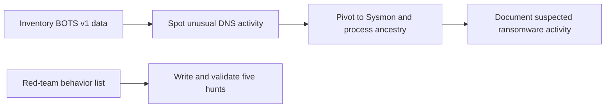

# Effectively Using Splunk (Scenario 2)

## 1. Lab Overview

Investigate a simulated incident at Wayne Enterprises in the Splunk Boss of the SOC v1 dataset. Start with DNS, follow the evidence into Sysmon, and then turn five red-team behaviors into searches. By the end, you can explain what each search finds and where to look for corroborating evidence.

## 2. Lab Environment

- The solution identifies Kali as the analyst machine. Use Chrome or Firefox to open Splunk Search & Reporting at http://demo.ine.local:8000.
- The dataset is in the `botsv1` index. It includes Stream DNS, Sysmon, Windows registry, Fortigate UTM, and Suricata records.
- The DNS investigation involves endpoint `192.168.250.100` and apparent resolver `192.168.250.20`.
- The DNS entropy search requires the URL Toolbox lookup and macro used in the lab.

## 3. Workflow Diagram



## 4. Tools Used

| Tool | Purpose |
| --- | --- |
| Splunk and SPL | Inventory, search, and summarize telemetry |
| Stream DNS | Trace domain queries and identify candidate endpoints |
| Sysmon | Inspect network activity, process ancestry, and hashes |
| Windows registry logs | Look for device friendly names |
| URL Toolbox | Parse domain components and calculate subdomain entropy |

## 5. Task-by-Task Walkthrough

Findings come from the [original solution notes](lab-source.md). The source references screenshots that were absent from the upload.

### T1: Investigate suspicious activity before consulting the red-team TTPs

**Goal.** Start with DNS and find endpoint evidence consistent with a successful compromise.

**Steps**

1. Set the time picker to **All time**. Inventory the available sourcetypes, sources, and hosts.
2. Inspect DNS fields and rank distinct query names by count. Pivot from the unusual domain to the source endpoint and inspect nearby activity.
3. Check Sysmon records for the same time window. Inspect the application, destination port, and command-line fields.
4. Follow the temporary file and VBS filename through process ancestry. Expand the window if needed to find the recorded MD5.

**Commands**

```spl
| metadata type=sourcetypes index="botsv1"
| metadata type=sources index="botsv1"
| metadata type=sources index="botsv1" | convert ctime(firstTime) as firstTime | convert ctime(lastTime) as lastTime | convert ctime(recentTime) as recentTime
| metadata type=hosts index="botsv1" | convert ctime(firstTime) as firstTime | convert ctime(lastTime) as lastTime | convert ctime(recentTime) as recentTime
index=botsv1 sourcetype=stream:dns | fieldsummary
index=botsv1 sourcetype=stream:dns | fieldsummary | table field values
index=botsv1 sourcetype=stream:dns | stats count by query{} | sort count
index=botsv1 sourcetype=stream:dns query{}=cerberhhyed5frqa.xmfir0.win | table _time src_ip dest_ip query{}
index=botsv1 sourcetype=stream:dns src_ip=192.168.250.100 earliest=08/24/2016:0:0:0 | table _time src_ip dest_ip query{} | dedup query{}
index=botsv1 source="WinEventLog:Microsoft-Windows-Sysmon/Operational" SourceIp="192.168.250.100"
index=botsv1 source="WinEventLog:Microsoft-Windows-Sysmon/Operational" SourceIp="192.168.250.100" | stats count by app
index=botsv1 source="WinEventLog:Microsoft-Windows-Sysmon/Operational" app="C:\\Users\\bob.smith.WAYNECORPINC*"
index=botsv1 source="WinEventLog:Microsoft-Windows-Sysmon/Operational" app="C:\\Users\\bob.smith.WAYNECORPINC*" app="C:\\Users\\bob.smith.WAYNECORPINC\\AppData\\Roaming\\121214.tmp"
index=botsv1 source="WinEventLog:Microsoft-Windows-Sysmon/Operational" "121214.tmp" AND (ParentCommandLine=* OR CommandLine=*) | table _time process process_id ParentProcessId ParentImage CommandLine ParentCommandLine
index=botsv1 source="WinEventLog:Microsoft-Windows-Sysmon/Operational" "20429.vbs" AND (ParentCommandLine=* OR CommandLine=*) | table _time process process_id ParentProcessId ParentImage CommandLine ParentCommandLine
index=botsv1 source="WinEventLog:Microsoft-Windows-Sysmon/Operational" "121214.tmp"
```

**Command explained.** The metadata searches inventory data and convert epoch timestamps into readable form. The DNS searches summarize available fields, rank query names, and pivot by name and source address. The Sysmon searches inspect applications, then narrow to the temporary file and script. The tables show process IDs, parent processes, and command-line context.

**Expected result / Finding.** The notes show `192.168.250.100` querying `cerberhhyed5frqa.xmfir0.win` through `192.168.250.20`. Sysmon records show an unusual `osk.exe` under AppData Roaming, `121214.tmp`, and a `wscript.exe` to `cmd.exe` relationship involving `20429.vbs`. The notes associate MD5 `EE0828A4E4C195D97313BFC7D4B531F1` with Cerber. The combined evidence supports suspicious script execution and a likely endpoint compromise. It leaves the initial access mechanism unresolved.

### T2: Translate red-team behaviors into Splunk searches

**Goal.** Write five hunts that turn the supplied behaviors into searchable evidence.

**Steps**

1. Look for drive letters in Sysmon and friendly names in registry records. Confirm that the device was removable and correlate its use with the host and time.
2. Parse DNS names and rank subdomains by entropy. Review uncommon high-entropy names with endpoint context.
3. Search for VBS references in parent or child command lines.
4. Search for process creation involving attempts to delete shadow copies.
5. Rank command lines by length and inspect unusual results in context.

**Commands**

```spl
index=botsv1 sourcetype="xmlwineventlog:microsoft-windows-sysmon/operational" "d:\\" | stats count by Computer,CommandLine
index=botsv1 sourcetype=winregistry friendlyname | table host object data
index=botsv1 sourcetype=stream:dns | table query{} | lookup ut_parse_extended_lookup url as query{} | search ut_domain!=None NOT (ut_domain_without_tld=microsoft OR ut_domain_without_tld=msn OR ut_domain_without_tld=akamaiedge OR ut_domain_without_tld=akadns OR ut_domain=nsatc.net OR ut_domain=quest.net OR ut_domain=windows.com OR ut_domain=arin.net) | `ut_shannon(ut_subdomain)` | stats count by query{} ut_subdomain ut_domain ut_domain_without_tld ut_tld ut_shannon | sort - ut_shannon
index=botsv1 source="WinEventLog:Microsoft-Windows-Sysmon/Operational" "*.vbs" AND (ParentCommandLine=* OR CommandLine=*) | table _time process process_id ParentProcessId ParentImage CommandLine ParentCommandLine
index="botsv1" source="wineventlog:microsoft-windows-sysmon/operational" EventCode=1 process=*\\vssadmin.exe | search CommandLine="*vssadmin*" CommandLine="*Delete *" CommandLine="*Shadows*"
index="botsv1" source="wineventlog:microsoft-windows-sysmon/operational" | eval len=len(CommandLine) | table User, len, CommandLine | sort - len
```

**Command explained.** The first two searches look for drive and device evidence. The entropy search parses DNS names, excludes the listed common domains, calculates Shannon entropy, and ranks high-scoring names. The VBS search displays command lines and process ancestry. The shadow-copy hunt matches relevant process and command-line strings in recorded events. The final search measures command-line length and sorts from longest to shortest.

**Expected result / Finding.** Each search should return leads to review. A D: path can belong to a fixed disk, high entropy can be legitimate, and long commands can be benign. Validate candidates with process, user, host, and time context. The supplied solution does not include result counts.

## 6. Key Concepts (Beginner-Friendly)

- **Pivot.** Use a value found in one search to investigate related events in another.
- **Process ancestry.** The relationship between parent and child processes shows how an action started.
- **Shannon entropy.** A measure of character unpredictability that helps rank unusual-looking names.
- **TTP.** A tactic, technique, or procedure describes a behavior that analysts can turn into a search.

## 7. SOC / Real-World Relevance

DNS can reveal an endpoint worth investigating. Sysmon then helps explain what ran and how it started. Turning known behaviors into hunts lets analysts find evidence across many hosts while preserving room to evaluate false positives.

## 8. Quick Command Cheat Sheet

| Command | What it does |
| --- | --- |
| `metadata` and `convert ctime(...)` | Inventory the dataset and display readable times |
| `fieldsummary`, `table`, and `dedup` | Inspect extracted DNS fields and organize results |
| `stats count by` and `sort` | Rank activity by field value |
| `lookup ut_parse_extended_lookup` and `ut_shannon` | Parse names and score subdomain entropy |
| `eval len=len(CommandLine)` | Measure command-line length |

## 9. Common Mistakes & Troubleshooting

| Symptom | What to check |
| --- | --- |
| No results appear | Confirm the botsv1 index and selected time window. |
| The entropy search fails | Check that the lab's URL Toolbox lookup and macro are available. |
| The VBS result misses parent process IDs | The original query contains a malformed field name. This walkthrough uses ParentProcessId, as shown in T1. |
| A search returns many candidates | Compare parent process, device, user, timestamp, and endpoint context before deciding what is suspicious. |

## 10. Conclusion

- I used a DNS lead to find related endpoint activity.
- I followed process ancestry and recorded the file hash reported in Sysmon.
- I translated five red-team behaviors into Splunk hunts.
