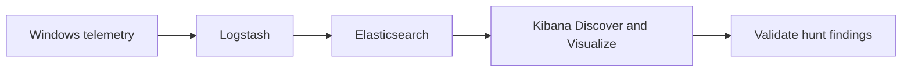

# Effectively Using the ELK Stack

## 1. Lab Overview

This lab uses Kibana to explore Windows telemetry, visualize failed authentication, and build searches for suspicious endpoint behavior. You review the results in Discover and learn which fields to check before drawing a conclusion.

## 2. Lab Environment

- Kali analyst machine with Firefox and Kibana at http://demo.ine.local:5601.
- Lab documents are available under logstash-*.
- Sources include Windows Security and System logs, Sysmon, and Autoruns.
- The exercises use the field names and legacy Lucene-style syntax shown in the solution. Check field mappings and query mode if your interface differs.

## 3. Workflow Diagram



## 4. Tools Used

| Tool | Purpose |
| --- | --- |
| Logstash | Collect and transform event data |
| Elasticsearch | Index and search documents |
| Kibana Discover and Visualize | Inspect records and show counts and trends |
| Sysmon, Windows logs, and Autoruns | Supply endpoint and service evidence |

## 5. Task-by-Task Walkthrough

The [original solution notes](lab-source.md) supply the queries and reported hit counts. No screenshots were uploaded. Run each search separately.


### T1: Add useful Discover fields

**Goal.** Make the event table easier to read.

**Steps**

1. Set the lab time picker to Last 15 years, submit an empty search, and add event_id and computer_name from Available Fields. Open a record to identify any other useful fields.

**Commands.** Use Discover with an empty query.

**Command explained.** This task uses the Discover field picker.

**Expected result / Finding.** The selected fields appear as columns. If the relative range misses the historical dataset, select an absolute range that covers it.

### T2: Visualize users and failed authentication

**Goal.** Create a table for usernames and a time chart for failed authentication.

**Steps**

1. In Visualize select a Data Table on logstash-*. Filter for user records and split rows by winlog.event_data.User.keyword using Terms. Increase Size from 5 to 50. For the second visualization, use Area and a monthly Date Histogram on @timestamp.

**Commands**

```lucene
event_data.User:*
```

```lucene
(event_id:4776 AND -keywords:"Audit Success") OR event_id:4625
```

**Command explained.** The first query finds records with a User field. The second includes failed logons (4625) and credential validation records (4776) that lack the Audit Success keyword.

**Expected result / Finding.** The table shows the selected top terms. The chart helps locate months with more authentication failures. Check audit outcomes and error codes in raw records.

### T3: Find files named like system processes

**Goal.** Find familiar Windows filenames in unexpected locations.

**Steps**

1. Search the image and target filename fields. Add both fields to Discover and inspect the paths.

**Commands**

```lucene
( event_data.Image:("*\\rundll32.exe" "*\\svchost.exe"
"*\\wmiprvse.exe" "*\\wmiadap.exe" "*\\smss.exe" "*\\wininit.exe" "*\\taskhost.exe" "*\\lsass.exe" "*\\winlogon.exe" "*\\csrss.exe" "*\\services.exe" "*\\svchost.exe" "*\\lsm.exe" "*\\conhost.exe" "*\\dllhost.exe" "*\\dwm.exe" "*\\spoolsv.exe" "*\\wuauclt.exe" "*\\taskhost.exe" "*\\taskhostw.exe" "*\\fontdrvhost.exe" "*\\searchindexer.exe" "*\\searchprotocolhost.exe" "*\\searchfilterhost.exe" "*\\sihost.exe") AND -event_data.Image:("*\\system32\\*" "*\\syswow64\\*" "*\\winsxs\\*") ) OR ( event_data.TargetFilename:("*\\rundll32.exe" "*\\svchost.exe" "*\\wmiprvse.exe" "*\\wmiadap.exe" "*\\smss.exe" "*\\wininit.exe" "*\\taskhost.exe" "*\\lsass.exe" "*\\winlogon.exe" "*\\csrss.exe" "*\\services.exe" "*\\svchost.exe" "*\\lsm.exe" "*\\conhost.exe" "*\\dllhost.exe" "*\\dwm.exe" "*\\spoolsv.exe" "*\\wuauclt.exe" "*\\taskhost.exe" "*\\taskhostw.exe" "*\\fontdrvhost.exe" "*\\searchindexer.exe" "*\\searchprotocolhost.exe" "*\\searchfilterhost.exe" "*\\sihost.exe") AND -event_data.TargetFilename:("*\\system32\\*" "*\\syswow64\\*" "*\\winsxs\\*") )
```

**Command explained.** The two branches look at the executing image and the target file. The exclusions filter paths containing system32, syswow64, or winsxs.

**Expected result / Finding.** The solution reports 6 hits. Validate the full path and the process or file involved.

### T4: Find suspicious service executable references

**Goal.** Identify service-related records that reference an executable under the Windows root.

**Steps**

1. Review the matching Security, System, and Autoruns records. Inspect the service name and executable command line.

**Commands**

```lucene
(event_id:("4697" "7045") OR (log_name:Autoruns AND event_data.Category:Services) ) AND
event_data.CommandLine.keyword:/.*%[s|S][y|Y][s|S][t|T][e|E][m|M][r|R][o|O][o|O][t|T]%\\[^\\]*\.exe/ AND -event_data.CommandLine:(*paexe* *psexesvc* *winexesvc* *remcomsvc*)
```

**Command explained.** Events 4697 and 7045 capture service installation. The Autoruns branch selects service records. The regex looks for an executable beneath %SystemRoot%, and the last clause excludes the listed tool names.

**Expected result / Finding.** The solution reports 7 hits. Review the account, path, and service history before classifying them.

### T5: Find possible code injection

**Goal.** Review remote-thread creation between processes.

**Steps**

1. Search Sysmon Event 8 and add SourceImage, TargetImage, and StartFunction. Review matches after the two exclusions.

**Commands**

```lucene
event_id:8 AND source_name:"Microsoft-Windows-Sysmon" AND -(event_data.SourceImage:"*\\VBoxTray.exe" AND event_data.TargetImage:"*\\csrss.exe") AND -(event_data.StartFunction:EtwpNotificationThread AND event_data.SourceImage:"*\\rundll32.exe")
```

**Command explained.** The query looks for remote thread creation and excludes the lab's VirtualBox and EtwpNotificationThread patterns.

**Expected result / Finding.** The solution reports 53 hits and references wce in SourceImage. A remote thread is an investigation lead. Legitimate tools can also create them.

### T6: Find possible abuse of service permissions

**Goal.** Identify service-control activity worth investigating.

**Steps**

1. Review the filtered sc.exe records. Check the account, parent process, service name, and related configuration changes.

**Commands**

```lucene
event_data.Image:"*\\sc.exe" AND (event_data.CommandLine:(*start* *sdshow*) OR (event_data.CommandLine:*config* AND event_data.CommandLine:*binPath*)) AND event_data.IntegrityLevel:Medium
```

**Command explained.** The query matches recorded service-control arguments and limits the results to Medium integrity.

**Expected result / Finding.** The solution reports 3 hits. Medium integrity and a command-line match alone do not prove weak permissions or elevated execution.

### T7: Find potential session hijacking

**Goal.** Look for tscon.exe running in a SYSTEM context.

**Steps**

1. Run either search. Compare the result with session activity, parent process, and account.

**Commands**

```lucene
event_data.Image:"*\\tscon.exe" AND event_data.User:"NT AUTHORITY\\SYSTEM"
```

```lucene
event_data.Image:"*\\tscon.exe" AND (event_data.LogonId:0x3e7 OR event_data.SubjectLogonId:0x3e7 OR event_data.User:"NT AUTHORITY\\SYSTEM")
```

**Command explained.** The first search checks the SYSTEM user string. The second also considers the SYSTEM-associated logon ID 0x3e7.

**Expected result / Finding.** The solution reports 1 hit. Look for corroborating session records before concluding hijacking.

### T8: Find whoami running as SYSTEM

**Goal.** Identify account-discovery activity in a SYSTEM context.

**Steps**

1. Run the search and compare the parent process, host, and timestamp.

**Commands**

```lucene
event_data.Image:"*\\whoami.exe" AND (event_data.LogonId:0x3e7 OR event_data.SubjectLogonId:0x3e7 OR event_data.User:"NT AUTHORITY\\SYSTEM")
```

**Command explained.** The image filter selects whoami.exe. The account and logon ID clauses look for SYSTEM context.

**Expected result / Finding.** The solution reports 4 hits. Administrative activity may also produce this pattern.

### T9: Find non-Microsoft library loads in LSASS

**Goal.** Review LSASS image loads whose recorded signature does not match Microsoft.

**Steps**

1. Open Sysmon Event 7 candidates and inspect the library path, signature, and parent image.

**Commands**

```lucene
event_id:7 AND event_data.Image:"*\\lsass.exe" AND -event_data.Signature:*Microsoft*
```

**Command explained.** The query matches LSASS and excludes signatures containing Microsoft. Review missing signature fields and signer details in the raw event.

**Expected result / Finding.** The solution reports 54 hits and identifies wceaux.dll as related to the tool discussed in T5. A non-Microsoft or missing signature alone does not establish malicious activity.

## 6. Key Concepts (Beginner-Friendly)

- **Field.** A named part of an event, such as the computer name or executable path.
- **Terms aggregation.** A count grouped by field value. The size setting controls how many groups appear.
- **Date histogram.** A count grouped into time buckets.
- **Detection lead.** An unusual result that needs supporting details before it becomes an incident finding.

## 7. SOC / Real-World Relevance

SOC analysts use visualizations to spot changes in activity and then inspect raw events to explain them. Endpoint hunts can narrow the review to a process, service, account, or loaded library.

## 8. Quick Command Cheat Sheet

| Search pattern | What to look for |
| --- | --- |
| User field exists | Accounts in the dataset |
| 4776 without Audit Success, or 4625 | Possible failed authentication |
| System process name outside expected locations | Possible executable masquerading |
| 4697, 7045, or Autoruns service | Service installation or startup evidence |
| Sysmon 8 | Remote thread creation |
| sc.exe at Medium integrity | Service-control activity |
| tscon.exe or whoami.exe with SYSTEM context | Session activity or account discovery |
| Sysmon 7 and lsass.exe | Libraries loaded into LSASS |

## 9. Common Mistakes & Troubleshooting

| Symptom | What to check |
| --- | --- |
| Discover is empty | Check the selected index and historical time range. |
| Query syntax is rejected | Check Lucene mode and whether the lab fields exist. |
| The user table stops at a few names | Increase Terms size and check for remaining buckets. |
| Counts differ from the notes | Compare time ranges, field extractions, and query mode. |

## 10. Conclusion

- I configured Discover and visualized authentication activity.
- I wrote Kibana searches for suspicious Windows behaviors.
- I used raw event context to evaluate the results.
