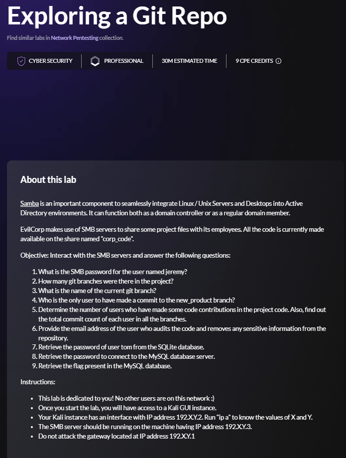
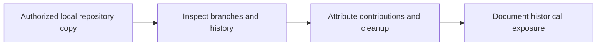
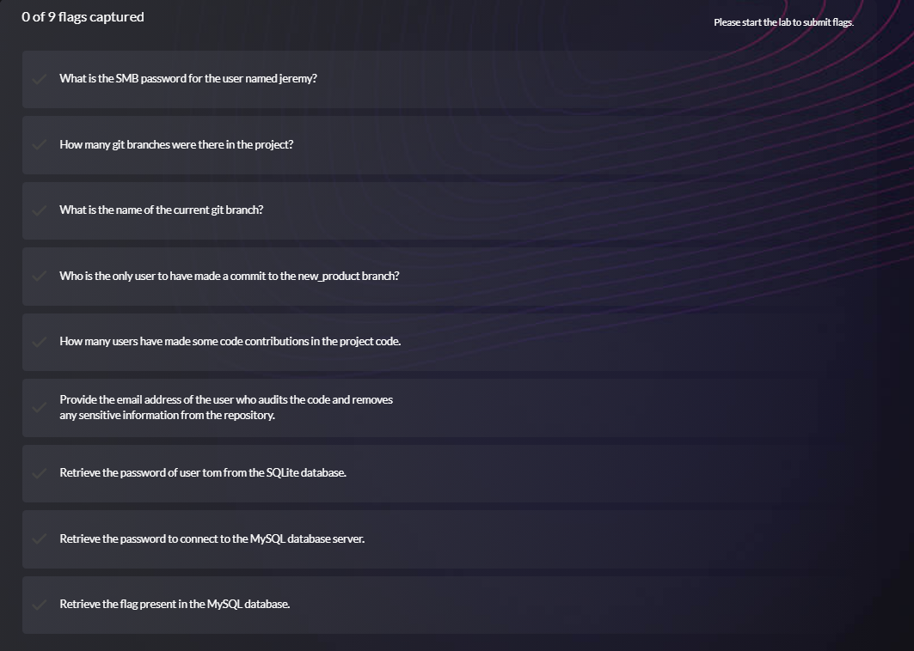

# Exploring a Git Repo

## 1. Lab Overview

Review the Git metadata of a project shared over SMB. Identify branches, contributors, and commits that mention sensitive-data cleanup. The lab shows why removing secrets from the latest files leaves older repository history relevant to incident response.



## 2. Lab Environment

| Component | Role |
| --- | --- |
| Kali GUI | Analyst workstation |
| SMB server | The manual shows example address 192.21.230.3 and the corp_code share |
| Git repository | Local project history, branches, and authors |
| SQLite and MySQL | Databases referenced by the manual's historical exposure findings |

The manual reports TCP 139 and 445 for SMB, UDP 137 for NetBIOS, and TCP 3306 for MySQL.

## 3. Workflow Diagram



## 4. Tools Used

| Tool | Purpose |
| --- | --- |
| Git | Inspect branches, authors, and commit messages |
| Samba / SMB | Share project files in the source scenario |
| SQLite and MySQL | Provide context for the reported credential exposures |

## 5. Task-by-Task Walkthrough

The [PDF source notes](lab-source.md) summarize the supplied manual. The commands below review metadata in an authorized local project copy. The screenshots show the overview and the questions.



### T1: Review the SMB exposure

**Goal.** Understand what the initial access finding means.

**Steps**

1. Review the reported SMB service and share details. Record which account was affected without recording the password.

**Commands.** Review the recorded evidence in the manual summary.

**Expected result / Finding.** The manual reports exposure of a weak SMB password for jeremy and access to the corp_code share.

### T2: Count local branches

**Goal.** Inventory the branches in an authorized local copy.

**Steps**

1. From the local project directory, list the branches and count the entries.

**Commands**

```bash
git branch
```

**Command explained.** git branch lists local branch names.

**Expected result / Finding.** Four local branches: development, master, new_product, and production.

### T3: Identify the checked-out branch

**Goal.** Read which branch the working tree is using.

**Steps**

1. Run the branch listing and identify the entry marked with an asterisk. Cross-check the HEAD annotation in the log.

**Commands**

```bash
git log
```

**Command explained.** git log displays commit metadata; its decorations can point to HEAD.

**Expected result / Finding.** The current branch is new_product.

### T4: Identify the new_product contributor

**Goal.** Read the author of the reported branch-specific work.

**Steps**

1. Inspect the commit attributed to new_product in the manual. Distinguish the branch's unique work from commits inherited from its base.

**Commands.** Review the recorded evidence in the manual summary.

**Expected result / Finding.** Bob Willson is the contributor identified for the branch-specific commit.

### T5: Summarize contributions

**Goal.** Report the authors and their commit counts.

**Steps**

1. Use the manual command for the checked-out history. Use the all-ref variant to check a wider history when you have the authorized local repository.

**Commands**

```bash
git shortlog -s
git shortlog -s --all
```

**Command explained.** git shortlog -s counts commits by author for the selected history. --all broadens it to all refs.

**Expected result / Finding.** The PDF screenshot shows five authors: Alice Jane (3), Bob Willson (1), John Doe (1), Kevin Willams (3), and Tom Matthew (1). These counts come from the shown command without --all.

### T6: Identify the repository auditor

**Goal.** Attribute the cleanup to its recorded author.

**Steps**

1. Read the author and subject fields in the manual's log evidence. Review metadata without opening historical file contents.

**Commands.** Review the recorded evidence in the manual summary.

**Expected result / Finding.** The reported auditor email is kev.will@devops.evilcorp.com.

### T7: Review the historical SQLite exposure

**Goal.** Explain why removing a database from the current checkout does not remove its history.

**Steps**

1. Review the development branch commit messages for the reported database removal. Record the affected component and the exposure category.

**Commands**

```bash
git log development
```

**Command explained.** The branch argument selects commits reachable from development.

**Expected result / Finding.** The PDF describes a historical SQLite database containing account password hashes, including one for tom. Password and hash values are omitted.

### T8: Review the historical MySQL credential exposure

**Goal.** Identify which change reduced exposure in the production branch.

**Steps**

1. Review production branch commit messages and record the reported cleanup.

**Commands**

```bash
git log production
```

**Command explained.** The branch argument selects commits reachable from production.

**Expected result / Finding.** The PDF describes a production settings file that previously held database credentials. The cleanup removed them from the current file. Older commits may retain prior contents.

### T9: Record the reported database outcome

**Goal.** Document the impact of credentials surviving in repository history.

**Steps**

1. Record the result from the manual as historical lab evidence.

**Commands.** Review the recorded evidence in the manual summary.

**Expected result / Finding.** The manual reports that a flag was retrieved from MySQL. Database access steps and the flag value are omitted.

## 6. Key Concepts (Beginner-Friendly)

- **Branch.** A named reference to a commit.
- **HEAD.** The reference to the current checkout. It usually points to the checked-out branch.
- **Reachability.** Commits connected to the selected references. A count from the current branch may differ from a count over all refs.
- **Historical exposure.** A later deletion can leave earlier objects that contain sensitive data.

## 7. SOC / Real-World Relevance

An analyst can link a secret exposure to repository access and the commits that introduced or removed it. Remediation can include credential rotation and reviewing forks, clones, and backups where older history may persist.

## 8. Quick Command Cheat Sheet

| Command | Purpose |
| --- | --- |
| git branch | List local branches and show the current one |
| git log | Read commit metadata |
| git shortlog -s | Count authors for the selected history |
| git shortlog -s --all | Count authors across commits reachable from all refs |
| git log development | Inspect development history |
| git log production | Inspect production history |

## 9. Common Mistakes & Troubleshooting

| Symptom | What to check |
| --- | --- |
| Git reports this is not a repository | Confirm you are in the authorized local project copy. |
| Author totals differ | Check which refs the command includes and how Git groups author names. |
| The branch appears to have several authors | Distinguish inherited commits from work specific to that branch. |
| A secret was deleted in a later commit | Check incident scope and rotation status. Deletion from the latest file leaves historical exposure to review. |

## 10. Conclusion

- I identified the local branches, checked-out branch, and contributors.
- I attributed the reported cleanup to its recorded author.
- I learned why older Git history matters during a credentials incident.
