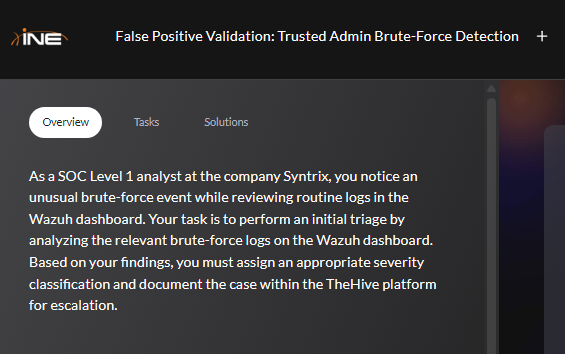
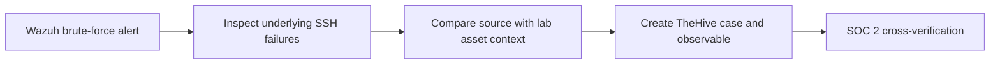

# False Positive Validation: Trusted Admin Brute-Force Detection

## 1. Lab Overview

Triage a Wazuh brute-force alert for failed SSH logons. Compare the original events with the known administrator workstation and document the initial assessment in TheHive. Hand the case to SOC Level 2 to verify that the activity matches approved maintenance.

## 2. Lab Environment

| Component | Role |
| --- | --- |
| Ubuntu machine 1 | Wazuh Dashboard at https://wazuh.ine.local |
| Ubuntu machine 2 | TheHive at http://localhost:9000 |
| Wazuh agent 001 | Disconnected agent with historical records for 10.0.0.100 |
| Syntrix administrator workstation | Source address 10.0.0.11, identified by the lab briefing |

The event date is 7 December 2025. The solution records a sighting time of 18:13 without specifying a time zone.

## 3. Workflow Diagram

## 4. Tools Used

| Tool | Purpose |
| --- | --- |
| Firefox | Open the two lab dashboards |
| Wazuh | Review agent history and the original alert |
| MITRE ATT&CK view | Locate the Brute Force technique and its events |
| TheHive | Document the case, observable, task, and owner |

## 5. Task-by-Task Walkthrough

The [source notes](lab-source.md) summarize the inline solution. The overview screenshot is included. The environment screenshot displays a password and was excluded. The source's individual solution images were not added.

### T1: Open the historical Wazuh alert

**Goal.** Find the SSH alert for the correct endpoint and date.

**Steps**

1. Open Wazuh in the lab and use the provided sign-in details.
2. In **Agents Summary**, select the disconnected agent with ID 001.
3. Go to **More > MITRE ATT&CK > Framework**. Set the timeline to 7 December 2025 and hide techniques with no alerts.
4. Open **Brute Force** and expand the relevant alert.

**Commands.** Use the dashboard controls.

**Expected result / Finding.** The solution shows a brute-force alert supported by repeated failed authentication records.

### T2: Assess the source and activity

**Goal.** Decide how to classify the alert for initial triage.

**Steps**

1. Read the underlying SSH records and note the account, source, destination, and timestamp.
2. Compare the source with the known administrator workstation in the lab briefing.
3. Record the maintenance explanation as an initial assessment. Retain the event details for independent verification.

**Commands.** Inspect the alert details and underlying log records.

**Expected result / Finding.** The source reports failed SSH attempts targeting root on 10.0.0.100 from 10.0.0.11. The lab identifies that source as the administrator workstation. The pattern is consistent with maintenance, but a trusted asset alone does not establish authorization.

### T3: Create the case and observable

**Goal.** Record the initial assessment and the source address in TheHive.

**Steps**

1. On the second machine, open TheHive. Select **Create case > Empty case**.
2. Use the lab title **Failed SSH Brute-Force Login Attempt from Internal Admin Host (False Positive)**. Set severity to **Low**, use the case creation date and time, and record the lab's TLP:CLEAR and PAP:CLEAR labels. Add the tags brute-force, false-positive, ssh, and internal-activity.
3. In the description, record the endpoints, account, known workstation assignment, and maintenance assessment pending SOC 2 review.
4. Add an observable of type ip with value 10.0.0.11. Mark it sighted on 7 December 2025 at 18:13. Use the lab's TLP:CLEAR and PAP:CLEAR labels and the internal, admin-workstation, false-positive, and brute-force tags.

**Commands.** Use TheHive case and observable forms.

**Expected result / Finding.** The case records the initial low-severity assessment and the source IP as a sighted observable.

### T4: Hand the case to SOC Level 2

**Goal.** Assign independent validation and ownership.

**Steps**

1. Add a mandatory task in the default group titled **Cross-verify False Positive SSH Brute-Force Login Attempt from internal admin host**.
2. Assign it to the lab SOC 2 analyst. Ask them to verify the approved maintenance window and check for evidence of compromise before closing the case.
3. Change the case owner to the SOC 2 analyst.

**Commands.** Use TheHive's task and case-owner controls.

**Expected result / Finding.** The notes report that the task and case were assigned to SOC Level 2 for formal validation. They do not show a completed review or closure.

## 6. Key Concepts (Beginner-Friendly)

- **Alert versus incident.** An alert groups activity that matches a rule. Investigation determines the outcome.
- **Observable.** A value found in evidence, such as the source IP. Its meaning depends on context.
- **Independent validation.** A second analyst checks the initial explanation against approved activity and related telemetry.
- **Handling labels.** TLP and PAP describe sharing and permitted handling. This walkthrough records the lab's chosen labels.

## 7. SOC / Real-World Relevance

SOC Level 1 can preserve evidence, document why an alert appears benign, and hand off remaining checks. Change records, source ownership, and related logons can help SOC Level 2 decide whether the case should be closed.

## 8. Quick Command Cheat Sheet

| Dashboard control | Purpose |
| --- | --- |
| Agents Summary > Disconnected > 001 | Open the endpoint's historical records |
| More > MITRE ATT&CK > Framework | Find the alert for the stated date |
| TheHive > Create case > Empty case | Record the triage assessment |
| Observables > Add | Record the sighted source IP |
| Tasks and case owner | Assign review and ownership to SOC Level 2 |

## 9. Common Mistakes & Troubleshooting

| Symptom | What to check |
| --- | --- |
| The alert is missing | Check the agent ID, date range, and technique visibility. |
| The agent is disconnected | Review the historical records for the stated incident date. |
| The source belongs to an admin workstation | Verify approved maintenance and related activity before formal closure. |
| The case timestamp differs from the event | Record case creation and event sighting as separate times. |

## 10. Conclusion

- I reviewed the historical Wazuh alert and identified its endpoints and target account.
- I recorded an initial false-positive assessment and the observable in TheHive.
- I handed the case to SOC Level 2 for validation.
