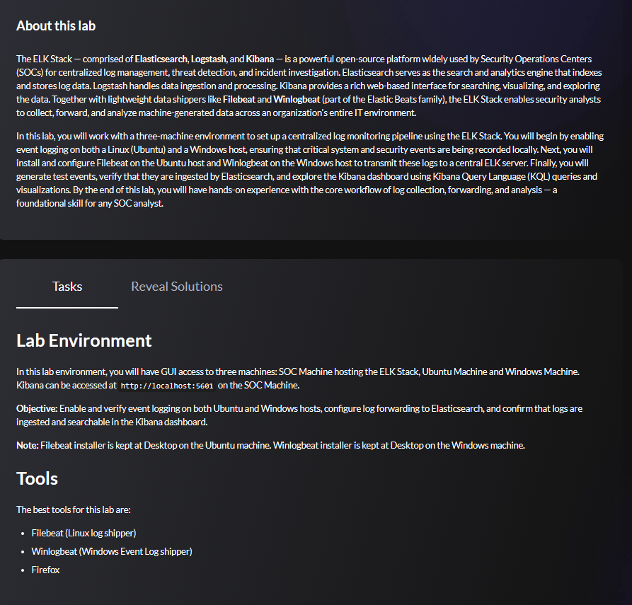
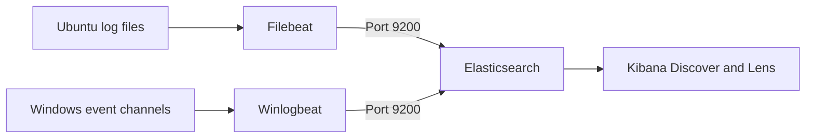

# Introduction to ELK

## 1. Lab Overview

This lab centralizes Ubuntu and Windows logs in Elasticsearch. You configure Filebeat and Winlogbeat, generate test events, and confirm they arrive in Kibana. You then use Kibana Query Language (KQL) and Lens to compare activity across both hosts.



## 2. Lab Environment

| Machine | Role |
| --- | --- |
| SOC machine | Runs Elasticsearch on port `9200` and Kibana at `http://localhost:5601`. |
| Ubuntu | Uses rsyslog and auditd to record logs and Filebeat to send them. |
| Windows | Records event logs and uses Winlogbeat to send selected channels. |

Both Beats packages are on the monitored hosts' Desktops. Replace `<ELK_IP>` with the SOC machine address for the current session. The lab sends events directly to Elasticsearch. Logstash is described in the overview as an ELK component.

## 3. Workflow Diagram



## 4. Tools Used

| Tool | Purpose |
| --- | --- |
| Elasticsearch | Index and store events for search. |
| Kibana and Firefox | Search and visualize indexed events on the SOC machine. |
| Filebeat | Collect and ship Ubuntu log files. |
| Winlogbeat | Collect and ship Windows event channels. |
| rsyslog and auditd | Record Ubuntu system and audit logs. |
| Event Viewer and policy editors | Review Windows logs and configure auditing. |
| PowerShell and Command Prompt | Manage Winlogbeat and generate Windows test events. |

## 5. Task-by-Task Walkthrough

Findings come from the [original lab notes](lab-source.md). The attached screenshot covers the overview and environment. The source's task images were absent. The YAML examples below correct list indentation in both Beats configurations. The source copy preserves the original formatting.

### T1: Check the ELK services

**Goal.** Confirm the SOC machine is ready to receive and display logs.

**Steps**

1. Launch the SOC, Ubuntu, and Windows machines.
2. On the SOC machine, check Elasticsearch and Kibana, then open `http://localhost:5601` in Firefox.
3. Record the SOC machine address for `<ELK_IP>`.

**Commands and configuration**

```bash
systemctl status elasticsearch
systemctl status kibana
ip addr
```

**Command explained.** `systemctl status` shows service state. `ip addr` lists interfaces and addresses.

**Expected result / Finding.** Both services should be active and Kibana should open on the SOC machine.

### T2: Enable Ubuntu logs

**Goal.** Verify the files Filebeat will collect.

**Steps**

1. Check rsyslog. If needed, start and enable it.
2. Check the system, authentication, and kernel logs. Start and enable the preinstalled audit daemon, then verify its status and log file.

**Commands and configuration**

```bash
systemctl status rsyslog
systemctl start rsyslog
systemctl enable rsyslog
ls -la /var/log/syslog
ls -la /var/log/auth.log
ls -la /var/log/kern.log
systemctl start auditd
systemctl enable auditd
systemctl status auditd
ls -la /var/log/audit/audit.log
```

**Command explained.** `status` reports state, `start` activates a service now, and `enable` configures it to start at boot. `ls -la` checks each path and shows its metadata.

**Expected result / Finding.** The two services should be active and all four log files should be present.

### T3: Install and configure Filebeat

**Goal.** Send Ubuntu log files directly to Elasticsearch.

**Steps**

1. Install the Desktop package and open `/etc/filebeat/filebeat.yml`.
2. Replace the default inputs with the four file inputs below. Use the current SOC IP in the Elasticsearch output and keep the Logstash output commented out. The Kibana endpoint is optional.
3. Test the configuration and output. After both pass, start and enable Filebeat and check its status.

**Commands and configuration**

```bash
cd Desktop
dpkg -i filebeat-9.0.0-amd64.deb
nano /etc/filebeat/filebeat.yml
```

```yaml
filebeat.inputs:
  - type: filestream
    id: syslog
    enabled: true
    paths:
      - /var/log/syslog
  - type: filestream
    id: authlog
    enabled: true
    paths:
      - /var/log/auth.log
  - type: filestream
    id: kernlog
    enabled: true
    paths:
      - /var/log/kern.log
  - type: filestream
    id: auditlog
    enabled: true
    paths:
      - /var/log/audit/audit.log

output.elasticsearch:
  hosts: ["<ELK_IP>:9200"]

setup.kibana:
  host: "<ELK_IP>:5601"
```

```bash
filebeat test config
filebeat test output
systemctl start filebeat
systemctl enable filebeat
systemctl status filebeat
```

**Command explained.** `dpkg -i` installs the local package, and `nano` edits the configuration. Each enabled `filestream` input has its own ID and log path. `test config` validates configuration, and `test output` checks the configured destination.

**Expected result / Finding.** The configuration and output tests should succeed and Filebeat should be running.

### T4: Find Ubuntu test events in Kibana

**Goal.** Trace local Linux events into Elasticsearch.

**Steps**

1. On Ubuntu, generate a local failed SSH sign-in, sudo activity, and a recognizable syslog message. Check the local log tails.
2. In Kibana Stack Management, create a data view for `filebeat-*` using `@timestamp`. The notes call it an index pattern.
3. Open Discover, select that data view, and filter by the current host. The targeted examples use the hostname from the notes.

**Commands and configuration**

```bash
ssh invaliduser@localhost
sudo ls /root
logger "ELK Test Event: This is a test log entry from Ubuntu Machine"
tail -5 /var/log/auth.log
tail -5 /var/log/syslog
```

```kql
host.name: "<ubuntu-hostname>"
host.name: "ip-10-0-20-21" and message: "invaliduser"
host.name: "ip-10-0-20-21" and message: "ls /root"
host.name: "ip-10-0-20-21" and message: "ELK Test Event"
```

**Command explained.** `ssh` generates a local sign-in attempt. `sudo ls /root` produces sudo activity. `logger` writes the custom message. `tail -5` reads the last five lines. The KQL examples match a host and, where specified, message text.

**Expected result / Finding.** The notes report finding the failed sign-in, sudo activity, and custom Ubuntu message in Discover.

### T5: Enable Windows logging

**Goal.** Verify Windows event channels and configure the lab auditing settings.

**Steps**

1. Use Win+R to open Event Viewer and verify Application, Security, System, and Setup.
2. Open Local Security Policy. Under **Security Settings > Local Policies > Audit Policy**, enable Success and Failure for account logon, account management, logon, process tracking, and system events.
3. Open Group Policy Editor. Under **Computer Configuration > Administrative Templates > Windows Components > Windows PowerShell**, enable **Turn on PowerShell Script Block Logging**.

**Commands and configuration**

```cmd
eventvwr.msc
secpol.msc
gpedit.msc
```

**Command explained.** The three Run commands open Event Viewer, Local Security Policy, and Group Policy Editor.

**Expected result / Finding.** The relevant channels are visible and the lab audit and script block policies are configured. Setup is checked locally and is outside the Winlogbeat input list.

### T6: Install and configure Winlogbeat

**Goal.** Send Windows event channels directly to Elasticsearch.

**Steps**

1. Extract the Desktop archive to `C:\Program Files\Winlogbeat`. Open PowerShell as Administrator and enter the extracted folder.
2. Edit `winlogbeat.yml` to collect the four channels below. Use the actual SOC address and leave the Logstash output commented out.
3. Test configuration and output. Install the service, start it, and verify its state. The notes give a process-scoped execution-policy command for use if the lab installer is blocked.

**Commands and configuration**

```powershell
cd "C:\Program Files\Winlogbeat\winlogbeat-9.0.0-windows-x86_64"
notepad winlogbeat.yml
```

```yaml
winlogbeat.event_logs:
  - name: Application
  - name: Security
  - name: System
  - name: Microsoft-Windows-PowerShell/Operational

output.elasticsearch:
  hosts: ["<ELK_IP>:9200"]

setup.kibana:
  host: "<ELK_IP>:5601"
```

```powershell
.\winlogbeat.exe test config
.\winlogbeat.exe test output
.\install-service-winlogbeat.ps1
Start-Service winlogbeat
Get-Service winlogbeat
```

```powershell
Set-ExecutionPolicy -ExecutionPolicy RemoteSigned -Scope Process
```

**Command explained.** `cd` enters the extracted directory and Notepad edits the YAML. `test config` validates settings and `test output` checks the destination. The install script registers the service. `Start-Service` starts it and `Get-Service` shows the state. `-Scope Process` limits the policy change to the current session.

**Expected result / Finding.** Both tests should pass and the service should report Running. If the lab-approved install script requires the optional policy command, rerun the install script before starting the service.

### T7: Find Windows test events in Kibana

**Goal.** Verify Security, System, and Application ingestion.

**Steps**

1. In Command Prompt, perform the failed local sign-in test and stop and restart Print Spooler.
2. In PowerShell, write the custom Application log event.
3. Create a `winlogbeat-*` data view with `@timestamp`, select it in Discover, and search using the observed host value.

**Commands and configuration**

```cmd
runas /user:fakeuser cmd
net stop spooler
net start spooler
```

```powershell
Write-EventLog -LogName Application -Source "Application" -EventId 9999 -EntryType Information -Message "ELK Test Event: This is a test log entry from Windows Machine"
```

```kql
host.name: "<windows-hostname>"
host.name: "attackdefense" and message: "ELK Test Event"
host.name: "attackdefense" and message: "spooler"
host.name: "attackdefense" and winlog.event_id: "4625" and message: "fakeuser"
```

**Command explained.** `runas` produces a failed sign-in with the test account. The `net` commands create service activity. `Write-EventLog` writes informational event `9999` to Application. KQL matches the sample host, message, or failed-logon event `4625`.

**Expected result / Finding.** The notes report finding the custom event, Spooler activity, and failed logon. The custom event exercises Application ingestion. PowerShell Operational ingestion needs a separate check.

### T8: Explore and visualize both hosts

**Goal.** Compare Linux and Windows events from a single Kibana view.

**Steps**

1. Create a `*beat-*` data view with `@timestamp`, then select it in Discover.
2. Inspect `host.name`, `log.file.path`, and `winlog.channel`.
3. In Visualize Library, build a Lens bar chart with `@timestamp` on the horizontal axis, Count of records on the vertical axis, and `host.name` as the breakdown. Save it.
4. Return to Discover and run the cross-platform authentication filter.

**Commands and configuration**

```kql
log.file.path: "/var/log/auth.log" or winlog.channel: "Security"
```

**Command explained.** `or` keeps events matching either the Ubuntu authentication log path or the Windows Security channel.

**Expected result / Finding.** The combined view should show both hosts and the saved chart should display event volume over time by host.

## 6. Key Concepts (Beginner-Friendly)

- **Log shipper.** A small agent converts local logs into events and sends them to a central destination.
- **Elasticsearch and Kibana.** Elasticsearch stores and searches events. Kibana gives you a way to explore and visualize them.
- **Data view.** A named pattern lets Kibana work with events from matching Elasticsearch indices or data streams.
- **KQL.** Kibana Query Language filters events by field values and text.
- **Local and indexed evidence.** A recognizable test event helps you see whether data reaches each stage of the pipeline.

## 7. SOC / Real-World Relevance

A SOC analyst can use one Kibana view to review Ubuntu authentication activity alongside Windows Security events. When a search comes back empty, checking the source event, shipper, destination, and time filter helps locate the gap.

## 8. Quick Command Cheat Sheet

| Command | What it does |
| --- | --- |
| `systemctl status elasticsearch` | Show status for the named service. |
| `systemctl status kibana` | Show status for the named service. |
| `ip addr` | Check the ELK services. |
| `systemctl status rsyslog` | Show status for the named service. |
| `systemctl start rsyslog` | Start the named service. |
| `systemctl enable rsyslog` | Enable the named service at boot. |
| `ls -la /var/log/syslog` | Enable Ubuntu logs. |
| `ls -la /var/log/auth.log` | Enable Ubuntu logs. |
| `ls -la /var/log/kern.log` | Enable Ubuntu logs. |
| `systemctl start auditd` | Start the named service. |
| `systemctl enable auditd` | Enable the named service at boot. |
| `systemctl status auditd` | Show status for the named service. |
| `ls -la /var/log/audit/audit.log` | Enable Ubuntu logs. |
| `cd Desktop` | Install and configure Filebeat. |
| `dpkg -i filebeat-9.0.0-amd64.deb` | Install and configure Filebeat. |
| `nano /etc/filebeat/filebeat.yml` | Install and configure Filebeat. |
| `filebeat test config` | Validate the Beat configuration. |
| `filebeat test output` | Test connectivity to the configured destination. |
| `systemctl start filebeat` | Start the named service. |
| `systemctl enable filebeat` | Enable the named service at boot. |
| `systemctl status filebeat` | Show status for the named service. |
| `ssh invaliduser@localhost` | Find Ubuntu test events in Kibana. |
| `sudo ls /root` | Find Ubuntu test events in Kibana. |
| `logger "ELK Test Event: This is a test log entry from Ubuntu Machine"` | Find Ubuntu test events in Kibana. |
| `tail -5 /var/log/auth.log` | Find Ubuntu test events in Kibana. |
| `tail -5 /var/log/syslog` | Find Ubuntu test events in Kibana. |
| `host.name: "<ubuntu-hostname>"` | Filter by host and any specified event details. |
| `host.name: "ip-10-0-20-21" and message: "invaliduser"` | Filter by host and any specified event details. |
| `host.name: "ip-10-0-20-21" and message: "ls /root"` | Filter by host and any specified event details. |
| `host.name: "ip-10-0-20-21" and message: "ELK Test Event"` | Filter by host and any specified event details. |
| `eventvwr.msc` | Enable Windows logging. |
| `secpol.msc` | Enable Windows logging. |
| `gpedit.msc` | Enable Windows logging. |
| `cd "C:\Program Files\Winlogbeat\winlogbeat-9.0.0-windows-x86_64"` | Install and configure Winlogbeat. |
| `notepad winlogbeat.yml` | Install and configure Winlogbeat. |
| `.\winlogbeat.exe test config` | Validate the Beat configuration. |
| `.\winlogbeat.exe test output` | Test connectivity to the configured destination. |
| `.\install-service-winlogbeat.ps1` | Install and configure Winlogbeat. |
| `Start-Service winlogbeat` | Install and configure Winlogbeat. |
| `Get-Service winlogbeat` | Install and configure Winlogbeat. |
| `Set-ExecutionPolicy -ExecutionPolicy RemoteSigned -Scope Process` | Install and configure Winlogbeat. |
| `runas /user:fakeuser cmd` | Find Windows test events in Kibana. |
| `net stop spooler` | Find Windows test events in Kibana. |
| `net start spooler` | Find Windows test events in Kibana. |
| `Write-EventLog -LogName Application -Source "Application" -EventId 9999 -EntryType Information -Message "ELK Test Event: This is a test log entry from Windows Machine"` | Find Windows test events in Kibana. |
| `host.name: "<windows-hostname>"` | Filter by host and any specified event details. |
| `host.name: "attackdefense" and message: "ELK Test Event"` | Filter by host and any specified event details. |
| `host.name: "attackdefense" and message: "spooler"` | Filter by host and any specified event details. |
| `host.name: "attackdefense" and winlog.event_id: "4625" and message: "fakeuser"` | Filter by host and any specified event details. |
| `log.file.path: "/var/log/auth.log" or winlog.channel: "Security"` | Explore and visualize both hosts. |

## 9. Common Mistakes & Troubleshooting

| Symptom | What to check |
| --- | --- |
| A Beat rejects its YAML | Align sibling list entries and indent properties beneath the corresponding entry. |
| The Beat configuration test passes but the output test fails | Check the current SOC address, port `9200`, and Elasticsearch service state. |
| Kibana opens but Discover shows no results | Check the data view pattern, `@timestamp` time range, host value, and local event. |
| The Windows custom event is absent from PowerShell Operational | Search the Application channel for event `9999`. Check Operational with separate evidence. |
| A Lens chart shows one host | Verify the combined view, time range, and that both shipper outputs are delivering data. |

## 10. Conclusion

- I configured Filebeat and Winlogbeat to ship endpoint logs into Elasticsearch.
- I used test events and KQL to check log ingestion in Kibana.
- I combined Windows and Linux data in Discover and charted event volume by host.
