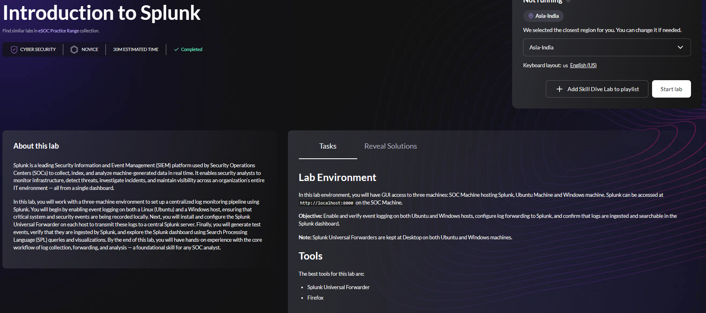
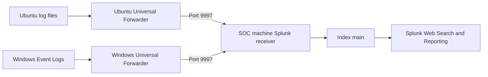

# Introduction to Splunk

## 1. Lab Overview

This lab builds a centralized logging pipeline with Splunk. You enable logging on Ubuntu and Windows, configure a Universal Forwarder on each host, and generate test events. You then verify ingestion and compare events by host, source, and time in Splunk Web.



## 2. Lab Environment

| Machine | Role |
| --- | --- |
| SOC machine | Hosts Splunk Web at `http://localhost:8000` and receives forwarded data on port `9997` |
| Ubuntu | Records system, authentication, kernel, and audit logs |
| Windows | Records Windows events and has PowerShell Script Block Logging configured |

The Universal Forwarder installers are on the Desktop of both monitored hosts. The receiving address and host field values are specific to the lab session.

## 3. Workflow Diagram



## 4. Tools Used

| Tool | Purpose |
| --- | --- |
| Splunk Enterprise and SPL | Receive, index, search, and visualize events |
| Splunk Universal Forwarder | Collect and send logs from each host |
| Firefox | Open Splunk Web on the SOC machine |
| rsyslog and auditd | Record Ubuntu system and security events |
| Event Viewer and Windows policy editors | Inspect event channels and configure auditing |
| PowerShell and Command Prompt | Generate Windows test events and manage the forwarder |

## 5. Task-by-Task Walkthrough

The findings come from the [original lab notes](lab-source.md). The supplied screenshot shows the overview, environment, and completion status. Task screenshots referenced as “Content Image” were absent from the upload.

### T1: Verify the Splunk server

**Goal.** Confirm that Splunk Web is available and identify the receiver address.

**Steps**

1. Launch the SOC, Ubuntu, and Windows machines.
2. On the SOC machine, open Firefox and visit `http://localhost:8000`.
3. Identify the SOC machine address and substitute it for `<SPLUNK_IP>` in the forwarding settings.

**Commands**

```bash
ip addr
```

**Command explained.** Splunk Web should load on the SOC machine. `ip addr` lists interface addresses. The notes give a lab-specific receiver address, which can change between sessions.

**Expected result / Finding.** Splunk Web opens from the SOC machine and the notes identify a receiver address.

### T2: Enable Ubuntu event logging

**Goal.** Check that the Ubuntu host records system and audit events.

**Steps**

1. Check `rsyslog`. Use the start and enable commands if the lab service needs them.
2. Check the system, authentication, and kernel log files. Start and enable the preinstalled `auditd` service, then verify its status and log file.

**Commands**

```bash
systemctl status rsyslog
systemctl start rsyslog
systemctl enable rsyslog
ls -la /var/log/syslog
ls -la /var/log/auth.log
ls -la /var/log/kern.log
systemctl start auditd
systemctl enable auditd
systemctl status auditd
ls -la /var/log/audit/audit.log
```

**Command explained.** `status` checks service state, `start` starts a service now, and `enable` configures startup. `ls -la` shows whether each path exists and displays file metadata. The four files cover system messages, authentication, kernel messages, and Linux audit records.

**Expected result / Finding.** The logging services should be active and the four monitored files should exist.

### T3: Forward Ubuntu logs and configure the receiver

**Goal.** Send the Ubuntu log files to the Splunk receiver.

**Steps**

1. On the SOC machine, open **Settings > Forwarding and receiving > Configure receiving > New Receiving Port**. Save port `9997`.
2. On Ubuntu, install the Desktop package. Review the license, then start the forwarder and create its administrator credentials when prompted.
3. Add the destination and four file inputs. Replace `<SPLUNK_IP>` with the SOC address before running the command.
4. Edit the syslog input using the stanza below. Save the file, then restart the forwarder.

**Commands**

```bash
cd Desktop
dpkg -i splunkforwarder-linux-amd64.deb
/opt/splunkforwarder/bin/splunk start --accept-license
/opt/splunkforwarder/bin/splunk add forward-server <SPLUNK_IP>:9997
/opt/splunkforwarder/bin/splunk add monitor /var/log/syslog -index main
/opt/splunkforwarder/bin/splunk add monitor /var/log/auth.log -index main
/opt/splunkforwarder/bin/splunk add monitor /var/log/kern.log -index main
/opt/splunkforwarder/bin/splunk add monitor /var/log/audit/audit.log -index main
nano /opt/splunkforwarder/etc/apps/search/local/inputs.conf
```

```ini
[monitor:///var/log/syslog]
disabled = false
index = main
crcSalt = <SOURCE>
```

```bash
/opt/splunkforwarder/bin/splunk restart
```

**Command explained.** `dpkg -i` installs the local package. `start --accept-license` starts the forwarder and accepts its license. `add forward-server` sets the destination, and each `add monitor` sends the selected file to `main`. `nano` opens the input configuration. The literal `<SOURCE>` includes the source path in the file identity check. The restart applies the settings.

**Expected result / Finding.** The receiver is configured on port 9997 and the Ubuntu forwarder has four inputs targeting `main`.

### T4: Generate and find Ubuntu test events

**Goal.** Trace a local event from Ubuntu into Splunk.

**Steps**

1. On Ubuntu, generate a local failed SSH sign-in, a sudo event, and a custom syslog message.
2. Review the recent local log entries. On the SOC machine, open **Search & Reporting**.
3. Search by the current Ubuntu host value. The targeted searches retain the example host from the notes.

**Commands**

```bash
ssh invaliduser@localhost
sudo ls /root
logger "Splunk Test Event: This is a test log entry from Ubuntu Machine"
tail -5 /var/log/auth.log
tail -5 /var/log/syslog
```

```spl
index=main host=<ubuntu-hostname>
index=main host=ip-10-0-28-202 "invaliduser"
index=main host=ip-10-0-28-202 "ls /root"
index=main host=ip-10-0-28-202 "Splunk Test Event"
```

**Command explained.** `ssh` attempts a local sign-in, `sudo ls /root` generates sudo activity, `logger` writes a recognizable message, and `tail -5` shows the final five lines. The SPL searches narrow `main` by host and, where supplied, by quoted text.

**Expected result / Finding.** The notes report matching the failed sign-in, sudo activity, and custom message in Splunk.

### T5: Enable Windows logging

**Goal.** Check Windows event channels and enable the lab’s audit settings.

**Steps**

1. Open Event Viewer from the Run dialog and check Application, Security, System, and Setup under **Windows Logs**.
2. Open Local Security Policy. In **Security Settings > Local Policies > Audit Policy**, review and enable the lab’s Success and Failure settings for account logon, account management, logon, process tracking, and system events.
3. Open Group Policy Editor. Under **Computer Configuration > Administrative Templates > Windows Components > Windows PowerShell**, enable **Turn on PowerShell Script Block Logging**.

**Commands**

```cmd
eventvwr.msc
secpol.msc
gpedit.msc
```

**Command explained.** The three Run commands open the event, security policy, and group policy consoles. Event Viewer should show the Windows logs. Script block logging is configured separately from the Application channel used by the custom test event.

**Expected result / Finding.** The Windows channels are visible and the lab audit and Script Block Logging policies are configured.

### T6: Forward Windows event logs

**Goal.** Send the selected Windows channels to the same receiver.

**Steps**

1. Run the Desktop MSI. Review the license, set the forwarder credentials, and leave the Deployment Server blank for this lab.
2. On the Receiving Indexer screen, supply the SOC address and port `9997`. Finish installation.
3. In Command Prompt, open `inputs.conf` in Notepad, add the four stanzas, and save it. Check the forward-server list and restart the forwarder.

**Commands**

```cmd
notepad "C:\Program Files\SplunkUniversalForwarder\etc\system\local\inputs.conf"
```

```ini
[WinEventLog://Security]
index = main
disabled = false
renderXml = false

[WinEventLog://System]
index = main
disabled = false
renderXml = false

[WinEventLog://Application]
index = main
disabled = false
renderXml = false

[WinEventLog://Microsoft-Windows-PowerShell/Operational]
index = main
disabled = false
renderXml = false
```

```cmd
cd "C:\Program Files\SplunkUniversalForwarder\bin"
splunk list forward-server
splunk restart
```

**Command explained.** Notepad edits the local input file. Each stanza enables one channel, targets `main`, and selects non-XML rendering. `list forward-server` shows the configured destination and its connection state. `restart` applies the configuration.

**Expected result / Finding.** The forwarder lists the receiving destination and monitors the four configured channels. Setup is visible in Event Viewer and has no input stanza in the notes.

### T7: Generate and find Windows test events

**Goal.** Confirm Windows Security, System, and Application events reach Splunk.

**Steps**

1. From Command Prompt on the lab host, run the failed sign-in test and stop and start the Print Spooler.
2. In PowerShell, write the custom Application event.
3. In Splunk Search & Reporting, use the current Windows host value and compare the three targeted searches with the local activity.

**Commands**

```cmd
runas /user:fakeuser cmd
net stop spooler
net start spooler
```

```powershell
Write-EventLog -LogName Application -Source "Application" -EventId 9999 -EntryType Information -Message "Splunk Test Event: This is a test log entry from Windows Machine"
```

```spl
index=main host=<windows-hostname>
index=main "Splunk Test Event" host="ATTACKDEFENSE"
index=main host="ATTACKDEFENSE" *spooler*
index=main EventCode=4625 host="ATTACKDEFENSE" "fakeuser"
```

**Command explained.** `runas /user:fakeuser` attempts a sign-in as the test account. The two `net` commands change the Spooler state. `Write-EventLog` writes an Information entry with event ID `9999` to Application. The SPL searches look for the message, Spooler activity, and failed logon event `4625`.

**Expected result / Finding.** The notes report finding the custom Application message, Spooler activity, and failed logon. The Application test gives no direct evidence of PowerShell Operational ingestion.

### T8: Explore the Splunk dashboard

**Goal.** Compare ingested events by host, source, and time.

**Steps**

1. Run the broad search and inspect `host` and `source` in the Fields sidebar.
2. Run the time chart and open the **Visualization** tab. Compare it with the top-sources search.
3. Search Linux authentication and Windows Security events together.

**Commands**

```spl
index=main
index=main | timechart count by host
index=main | top source
index=main (source="/var/log/auth.log" OR source="WinEventLog:Security")
```

**Command explained.** `index=main` selects the lab index. `timechart count by host` groups events into time buckets for each host. `top source` ranks frequent sources. `OR` matches either authentication source.

**Expected result / Finding.** The notes describe seeing both hosts and their sources, then charting event counts over time.

## 6. Key Concepts (Beginner-Friendly)

- **SIEM.** A security information and event management platform brings logs from different systems into one place for investigation.
- **Universal Forwarder.** A small agent reads selected data on a host and ships it to a receiving Splunk instance.
- **Index and source.** An index is a searchable collection. A source identifies where an event came from, such as a file or Windows event channel.
- **Test event.** A message with a recognizable phrase helps you check each leg of the pipeline, from local logging to search.
- **File identity.** The forwarder uses an initial checksum to track monitored files. The syslog stanza adds the path to distinguish files with similar beginnings.

## 7. SOC / Real-World Relevance

A SOC analyst needs to know whether a missing search result means an event never happened or whether a logging stage failed. Checking the local event, the forwarder, and the receiver makes that distinction easier. Searching Linux and Windows authentication logs in one place helps build a timeline across hosts.

## 8. Quick Command Cheat Sheet

| Command | What it does |
| --- | --- |
| `ip addr` | Verify the Splunk server. |
| `systemctl status rsyslog` | Enable Ubuntu event logging. |
| `systemctl start rsyslog` | Enable Ubuntu event logging. |
| `systemctl enable rsyslog` | Enable Ubuntu event logging. |
| `ls -la /var/log/syslog` | Enable Ubuntu event logging. |
| `ls -la /var/log/auth.log` | Enable Ubuntu event logging. |
| `ls -la /var/log/kern.log` | Enable Ubuntu event logging. |
| `systemctl start auditd` | Enable Ubuntu event logging. |
| `systemctl enable auditd` | Enable Ubuntu event logging. |
| `systemctl status auditd` | Enable Ubuntu event logging. |
| `ls -la /var/log/audit/audit.log` | Enable Ubuntu event logging. |
| `cd Desktop` | Forward Ubuntu logs and configure the receiver. |
| `dpkg -i splunkforwarder-linux-amd64.deb` | Forward Ubuntu logs and configure the receiver. |
| `/opt/splunkforwarder/bin/splunk start --accept-license` | Forward Ubuntu logs and configure the receiver. |
| `/opt/splunkforwarder/bin/splunk add forward-server <SPLUNK_IP>:9997` | Configure or check the receiving destination |
| `/opt/splunkforwarder/bin/splunk add monitor /var/log/syslog -index main` | Add the indicated Ubuntu log to the main index |
| `/opt/splunkforwarder/bin/splunk add monitor /var/log/auth.log -index main` | Add the indicated Ubuntu log to the main index |
| `/opt/splunkforwarder/bin/splunk add monitor /var/log/kern.log -index main` | Add the indicated Ubuntu log to the main index |
| `/opt/splunkforwarder/bin/splunk add monitor /var/log/audit/audit.log -index main` | Add the indicated Ubuntu log to the main index |
| `nano /opt/splunkforwarder/etc/apps/search/local/inputs.conf` | Forward Ubuntu logs and configure the receiver. |
| `/opt/splunkforwarder/bin/splunk restart` | Apply forwarder configuration changes |
| `ssh invaliduser@localhost` | Generate and find Ubuntu test events. |
| `sudo ls /root` | Generate and find Ubuntu test events. |
| `logger "Splunk Test Event: This is a test log entry from Ubuntu Machine"` | Generate and find Ubuntu test events. |
| `tail -5 /var/log/auth.log` | Generate and find Ubuntu test events. |
| `tail -5 /var/log/syslog` | Generate and find Ubuntu test events. |
| `index=main host=<ubuntu-hostname>` | Search the indexed lab events |
| `index=main host=ip-10-0-28-202 "invaliduser"` | Search the indexed lab events |
| `index=main host=ip-10-0-28-202 "ls /root"` | Search the indexed lab events |
| `index=main host=ip-10-0-28-202 "Splunk Test Event"` | Search the indexed lab events |
| `eventvwr.msc` | Enable Windows logging. |
| `secpol.msc` | Enable Windows logging. |
| `gpedit.msc` | Enable Windows logging. |
| `notepad "C:\Program Files\SplunkUniversalForwarder\etc\system\local\inputs.conf"` | Forward Windows event logs. |
| `cd "C:\Program Files\SplunkUniversalForwarder\bin"` | Forward Windows event logs. |
| `splunk list forward-server` | Configure or check the receiving destination |
| `splunk restart` | Apply forwarder configuration changes |
| `runas /user:fakeuser cmd` | Generate and find Windows test events. |
| `net stop spooler` | Generate and find Windows test events. |
| `net start spooler` | Generate and find Windows test events. |
| `Write-EventLog -LogName Application -Source "Application" -EventId 9999 -EntryType Information -Message "Splunk Test Event: This is a test log entry from Windows Machine"` | Generate and find Windows test events. |
| `index=main host=<windows-hostname>` | Search the indexed lab events |
| `index=main "Splunk Test Event" host="ATTACKDEFENSE"` | Search the indexed lab events |
| `index=main host="ATTACKDEFENSE" *spooler*` | Search the indexed lab events |
| `index=main EventCode=4625 host="ATTACKDEFENSE" "fakeuser"` | Search the indexed lab events |
| `index=main` | Search the indexed lab events |
| `index=main \| timechart count by host` | Chart event volume by host |
| `index=main \| top source` | Rank sources by frequency |
| `index=main (source="/var/log/auth.log" OR source="WinEventLog:Security")` | Search both authentication sources |

## 9. Common Mistakes & Troubleshooting

| Symptom | What to check |
| --- | --- |
| Splunk Web is unreachable | Open it on the SOC machine using port `8000`. Port `9997` receives forwarded data. |
| The forwarder has no active receiver | Verify the current SOC address, port `9997`, and the receiving setting in Splunk. |
| Ubuntu logs are missing | First check that the files exist and are readable by the forwarder. Review the syslog `crcSalt` stanza if file identity is the issue. |
| A targeted search returns no events | Check the host field, selected time range, index, and whether the event exists locally. |
| The PowerShell test is missing from Operational | Look for event `9999` in Application. Test the Operational channel separately. |
| A Windows channel is missing in Splunk | Check the exact channel name in `inputs.conf` and whether the forwarder was restarted. |

## 10. Conclusion

- I checked local logging on Ubuntu and Windows.
- I configured both forwarders to send events to the SOC machine.
- I traced test events from the endpoints into Splunk searches.
- I compared sources and visualized events by host.
