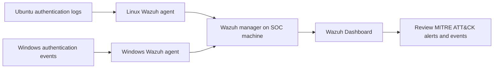

# Introduction to Wazuh

## 1. Lab Overview

This lab connects Ubuntu and Windows endpoints to a central Wazuh manager. You verify that both agents are active and use the dashboard to investigate authentication alerts from the lab. By the end, you can trace a security event back to the endpoint that reported it.

## 2. Lab Environment

| Machine | Role |
| --- | --- |
| SOC machine (Ubuntu) | Hosts the Wazuh manager and dashboard. Open `https://localhost` on this machine. |
| Target Ubuntu machine | Runs the Linux Wazuh agent and reports SSH activity. |
| Target Windows machine | Runs the Windows Wazuh agent and reports RDP-related activity. |
| Kali Linux | Identified in the lab environment as the source of simulated authentication traffic. |

The notes give `10.0.18.138` for the SOC machine, `10.0.31.185` for Ubuntu, and `10.0.20.137` for Windows. These are example lab addresses. The dashboard uses HTTPS. The notes provide no numeric agent or registration ports.

## 3. Workflow Diagram



## 4. Tools Used

| Tool | Purpose |
| --- | --- |
| Wazuh manager | Receives endpoint telemetry and evaluates it for alerts. |
| Wazuh agent | Collects endpoint activity and reports it to the manager. |
| Wazuh Dashboard | Shows agent status, alerts, and event details. |
| MITRE ATT&CK view | Groups mapped alerts by technique and exposes related events. |
| Bash and PowerShell | Configure the Linux and Windows lab agents. |

## 5. Task-by-Task Walkthrough

The findings below come from the [sanitized source notes](lab-source.md). Use the SOC machine address from your own lab session in place of the example address in the commands. The supplied screenshot and linked solution images are excluded from this repository.

### T1: Open the Wazuh Dashboard

**Goal.** Establish the starting agent count.

**Steps**

1. Launch the lab and select the SOC Machine tab.
2. Open `https://localhost` in the browser and sign in with the dashboard credentials provided by INE.
3. Check the agent count on the dashboard.

**Commands.** This task uses the browser.

**Expected result / Finding.** The notes report zero connected agents before configuration.

### T2: Connect and verify the Linux agent

**Goal.** Register the Ubuntu endpoint with the Wazuh manager.

**Steps**

1. On the SOC machine, identify its interface address.
2. On Target Ubuntu, replace the manager placeholder in `ossec.conf` and review the result.
3. Start the agent and check its service status. Compare the Ubuntu address with the active entry in the dashboard.
4. Open the agent’s **More > MITRE ATT&CK > Framework** view and inspect the timeline. Use **Hide techniques with no alerts** to narrow the view.

**Command on the SOC machine**

```bash
ip addr
```

**Commands on Target Ubuntu**

```bash
sed -i 's/MANAGER_IP/10.0.18.138/g' /var/ossec/etc/ossec.conf
cat /var/ossec/etc/ossec.conf
/etc/init.d/wazuh-agent start
/etc/init.d/wazuh-agent status
```

**Command explained.** `ip addr` lists interfaces and addresses. `sed -i` edits the file in place, and the `g` flag replaces every match on a line. `cat` displays the resulting configuration. The service script starts the agent and reports its local status.

**Expected result / Finding.** The dashboard shows one active agent. The example Ubuntu address is `10.0.31.185`.

### T3: Investigate the Ubuntu authentication alert

**Goal.** Interpret the alert that links repeated SSH authentication failures to a later success.

**Steps**

1. Refresh the Wazuh dashboard and open the Ubuntu agent’s MITRE ATT&CK view.
2. Open **Brute Force** and expand **Multiple authentication failures followed by a success**.
3. Inspect the full log and record the time, monitored endpoint, source address, and authentication outcome.

**Commands.** This task uses the dashboard to review the supplied scenario’s detections.

**Expected result / Finding.** The notes report multiple alerts, including one that correlates repeated failures with a subsequent successful sign-in. The correlation is a lead to investigate against the underlying logs.

### T4: Connect and verify the Windows agent

**Goal.** Register the Windows endpoint with the same Wazuh manager.

**Steps**

1. Open PowerShell on Target Windows and go to the Desktop, where the lab MSI is located.
2. Install the agent using the example manager and registration server values below. Start the service after installation.
3. Reconnect to the lab session if it drops. Check the Windows address and match it to the active agent in the dashboard.

**Commands**

```powershell
cd Desktop
msiexec.exe /i wazuh-agent.msi /q WAZUH_MANAGER=10.0.18.138 WAZUH_REGISTRATION_SERVER=10.0.18.138 WAZUH_AGENT_GROUP=default
Start-Service -Name WazuhSvc
ipconfig
```

**Command explained.** `cd` changes the working directory. `msiexec.exe /i` installs the MSI, and `/q` runs it quietly. The MSI properties set the manager, registration server, and default group. `Start-Service` starts the Wazuh service, and `ipconfig` shows the endpoint’s network settings.

**Expected result / Finding.** The dashboard shows two active agents. The example Windows address is `10.0.20.137`.

### T5: Investigate Windows authentication events

**Goal.** Locate the Windows agent’s RDP-related activity in Wazuh.

**Steps**

1. Open the Windows agent and go to **More > MITRE ATT&CK > Events**.
2. Refresh the events view. Match the agent and time range to the simulated activity.
3. Open the relevant events and inspect source, endpoint, and authentication outcome where available.

**Commands.** This task uses the dashboard to review the supplied scenario’s detections.

**Expected result / Finding.** The notes report new events in the Windows agent’s view. The pasted text gives no event ID, rule ID, or full Windows alert payload.

## 6. Key Concepts (Beginner-Friendly)

- **Agent and manager.** Think of an agent as a reporter on each endpoint. The manager receives those reports and evaluates them centrally.
- **Event and alert.** An event records activity. An alert is raised when Wazuh rules identify activity that should be reviewed.
- **Authentication correlation.** Several failures followed by a success on the same endpoint give an analyst a sequence to investigate.
- **MITRE ATT&CK.** A framework for describing adversary behavior. Wazuh uses technique mappings to help analysts navigate related alerts.

## 7. SOC / Real-World Relevance

An analyst can first verify endpoint coverage, then review suspicious sign-ins across Linux and Windows from one dashboard. An alert about failures followed by a success helps prioritize investigation. The underlying authentication logs can clarify which account signed in, where it came from, and when it happened.

## 8. Quick Command Cheat Sheet

| Command | What it does |
| --- | --- |
| `ip addr` | Show SOC machine interface addresses. |
| `sed -i 's/MANAGER_IP/10.0.18.138/g' /var/ossec/etc/ossec.conf` | Set the Linux agent’s manager in the example lab. |
| `cat /var/ossec/etc/ossec.conf` | Review the Linux agent configuration. |
| `/etc/init.d/wazuh-agent start` | Start the Linux agent. |
| `/etc/init.d/wazuh-agent status` | Check the Linux agent service status. |
| `cd Desktop` | Enter the Windows installer directory. |
| `msiexec.exe /i wazuh-agent.msi /q WAZUH_MANAGER=10.0.18.138 WAZUH_REGISTRATION_SERVER=10.0.18.138 WAZUH_AGENT_GROUP=default` | Install and configure the Windows agent. |
| `Start-Service -Name WazuhSvc` | Start the Windows agent. |
| `ipconfig` | Identify the Windows endpoint address. |

## 9. Common Mistakes & Troubleshooting

| Symptom | What to check |
| --- | --- |
| The dashboard does not open | Confirm the browser is open on the SOC machine and points to its HTTPS dashboard. |
| The Linux agent never appears | Check the manager address in `ossec.conf`, the local service status, and the dashboard refresh. |
| The Windows agent remains inactive | Check the MSI location, the manager and registration values, and whether `WazuhSvc` started. |
| The Windows desktop disconnects | Reconnect to the lab session, then verify the service and dashboard status. |
| The alert or event is missing | Check the selected agent, dashboard time range, and whether the endpoint reported the underlying authentication activity. |

## 10. Conclusion

- I configured Ubuntu and Windows agents to report to Wazuh.
- I verified the agents using dashboard status and endpoint addresses.
- I used the MITRE ATT&CK views to review authentication alerts and events.
