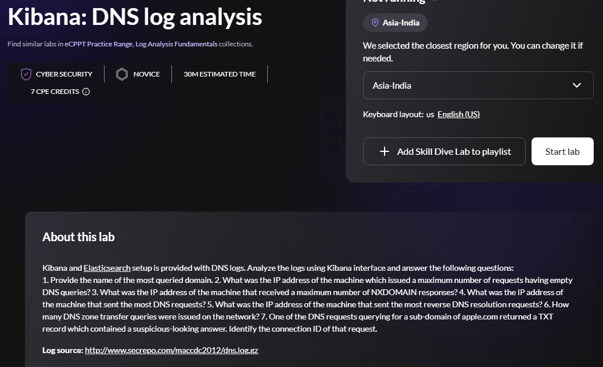
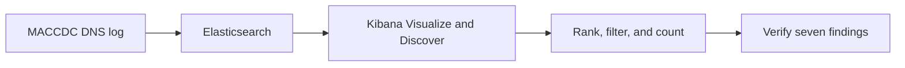

# Kibana: DNS Log Analysis

## 1. Lab Overview

This lab uses Kibana to investigate DNS activity in the MACCDC 2012 capture. You rank queries and clients, count zone transfer requests, and trace an unusual TXT response back to its connection ID.



## 2. Lab Environment

- Kibana and Elasticsearch with DNS records under logstash-*.
- The [MACCDC 2012 DNS log](https://www.secrepo.com/maccdc2012/dns.log.gz) is the source dataset.
- The PDF includes a supplemental NXDOMAIN investigation. The walkthrough follows the seven questions shown in the lab UI.

## 3. Workflow Diagram



## 4. Tools Used

| Tool | Purpose |
| --- | --- |
| Kibana Visualize | Rank exact field values and inspect counts |
| Kibana Discover | Inspect a matching DNS record and its connection ID |
| Elasticsearch | Store and search indexed DNS records |
| Compressed DNS log | Check the underlying source independently |

## 5. Task-by-Task Walkthrough

The [source notes](lab-source.md) document the manual and the raw-log verification. The quoted filters follow the syntax in the PDF.


### T1: Find the most queried domain

**Goal.** Rank DNS names by request count.

**Steps**

1. Create a Data Table on logstash-* and use Terms on query.keyword, sorted by Count descending. Read the first domain.

**Commands.** Use the Kibana visualization controls described above.

**Command explained.** Terms groups records by exact query name.

**Expected result / Finding.** teredo.ipv6.microsoft.com.

### T2: Find the source of the most empty queries

**Goal.** Rank clients whose query field is marked empty.

**Steps**

1. Apply the filter, then use Terms on sender_ip.keyword in a Data Table.

**Commands**

```text
query : "(empty)"
```

**Command explained.** The filter selects the lab's literal empty-query marker. In the raw log, check how missing query data is represented.

**Expected result / Finding.** 192.168.202.78.

### T3: Find the client receiving the most NXDOMAIN responses

**Goal.** Rank original requesters by NXDOMAIN response count.

**Steps**

1. Apply the filter and group by sender_ip.keyword. The supplemental PDF question also checks target_ip and response codes for a resolver investigated in the manual.

**Commands**

```text
resp_code_desc : "NXDOMAIN"
```

**Command explained.** NXDOMAIN is a response code indicating that the requested name does not exist according to the response. The sender field identifies the requester in the indexed record.

**Expected result / Finding.** 192.168.202.103.

### T4: Find the host sending the most DNS requests

**Goal.** Rank all requester addresses.

**Steps**

1. Clear the filters and create a Vertical Bar visualization. Use Terms on sender_ip.keyword for the X-axis and sort by count descending.

**Commands.** Use the Kibana visualization controls described above.

**Command explained.** The Terms buckets count records attributed to each requester.

**Expected result / Finding.** 10.10.117.210.

### T5: Find the top reverse DNS requester

**Goal.** Rank clients looking up IPv4 addresses by reverse name.

**Steps**

1. Apply the filter and group the matching records by sender_ip.keyword.

**Commands**

```text
query : "*in-addr.arpa"
```

**Command explained.** The source's legacy filter matches names ending in in-addr.arpa. Check wildcard behavior in the lab query mode if the filter returns no results.

**Expected result / Finding.** 192.168.202.83.

### T6: Count full DNS zone transfer queries

**Goal.** Find the number of AXFR records.

**Steps**

1. Create a Pie visualization and group by query_type_desc.keyword. Select the AXFR bucket and read its count.

**Commands.** Use the Kibana visualization controls described above.

**Command explained.** The query type distinguishes AXFR requests. An AXFR record does not by itself show that a transfer succeeded.

**Expected result / Finding.** 440 AXFR records.

### T7: Identify the suspicious TXT record's connection

**Goal.** Find the connection ID associated with the unusual Apple subdomain answer.

**Steps**

1. Find time.apple.com with Terms on query.keyword. Narrow to TXT using query_type_desc.keyword, inspect answers.keyword, then open the matching record in Discover and read conn_id.

**Commands.** Use the Kibana visualization controls described above.

**Command explained.** Grouping by name, type, and answer narrows the search before opening the original record. The connection identifier is a correlation field.

**Expected result / Finding.** CmjiklOm3bnHgctw.

## 6. Key Concepts (Beginner-Friendly)

- **Terms aggregation.** Groups records that share a value so you can compare counts.
- **NXDOMAIN.** A DNS response indicating that the name was reported as nonexistent.
- **Reverse DNS.** A lookup from an IP address to a name. IPv4 reverse names use in-addr.arpa.
- **AXFR.** The query type for a full DNS zone transfer.
- **Connection ID.** A value that lets you pivot to records associated with a connection.

## 7. SOC / Real-World Relevance

DNS logs can reveal unusual request volume, repeated response errors, and unexpected response content. Analysts can compare client and resolver behavior before deciding whether an anomaly reflects misconfiguration or suspicious activity.

## 8. Quick Command Cheat Sheet

| Field or filter | Purpose |
| --- | --- |
| query.keyword | Rank DNS names |
| query : "(empty)" | Find the lab's empty-query records |
| resp_code_desc : "NXDOMAIN" | Find name errors |
| sender_ip.keyword | Rank original requesters |
| query : "*in-addr.arpa" | Match IPv4 reverse lookups |
| query_type_desc.keyword | Find AXFR and TXT buckets |
| answers.keyword and conn_id | Inspect the response and locate the original connection |

## 9. Common Mistakes & Troubleshooting

| Symptom | What to check |
| --- | --- |
| No records appear | Check the historical time range and selected index pattern. |
| Request and response addresses seem reversed | Compare the raw originator and responder fields with the lab's sender and target mappings. |
| Empty queries are missing | Verify how the import represents missing fields. |
| Results carry over between tasks | Clear filters that do not apply to the current task. |
| A TXT record looks unusual | Save the relevant fields and inspect the response as text. |

## 10. Conclusion

- I ranked DNS names and clients and counted full zone transfer queries.
- I identified the TXT record and traced it to its connection ID.
- I checked record interpretation against the log fields and visualizations.
