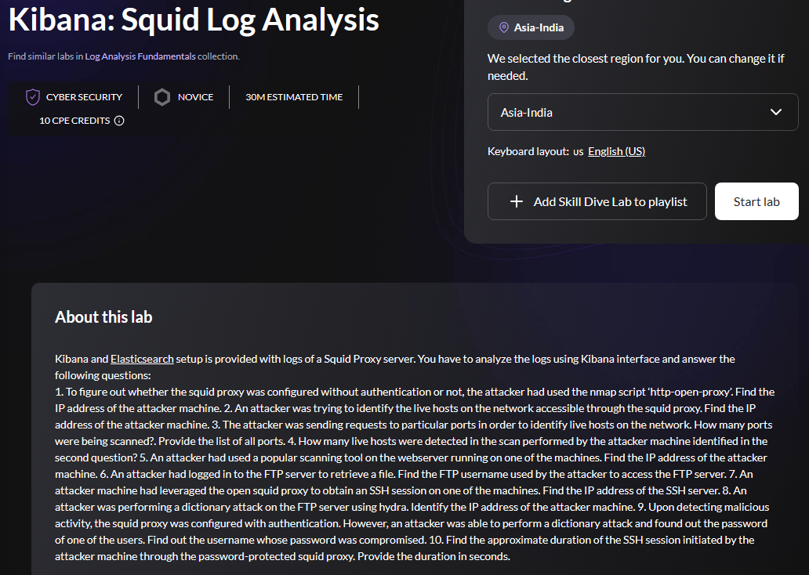
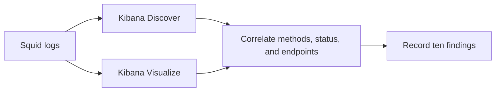

# Kibana: Squid Log Analysis

## 1. Lab Overview

This lab uses Kibana to investigate Squid proxy activity from historical logs. You compare request methods, response codes, ports, accounts, and durations to answer ten questions. The walkthrough distinguishes proxy records from evidence that requires endpoint or service logs.



## 2. Lab Environment

- Kibana and Elasticsearch with Squid proxy data under `squid-logs*`.
- The PDF screenshots use August 2019 historical data.
- The lab includes web, FTP, and SSH-related traffic. Ports `21`, `22`, `80`, and `443` appear in the investigation. No proxy or Kibana listener port is specified.

## 3. Workflow Diagram



## 4. Tools Used

| Tool | Purpose |
| --- | --- |
| Squid logs | Supply proxy request and transaction details |
| Kibana Discover | Filter records and read event fields |
| Kibana Visualize | Group activity by destination port |
| Elasticsearch | Index and search the lab data |

## 5. Task-by-Task Walkthrough

The [PDF source notes](lab-source.md) explain the evidence and source discrepancies. These are searches against recorded data. Use the lab's historical time range. The original logs were not supplied.

### T1: Find the open-proxy probe source

**Goal.** Identify the source of the recorded proxy probe.

**Steps**

1. Filter the destination and inspect the methods and timestamps for the first matching burst.

**Commands**

```text
destination_host:www.google.com
```

**Command explained.** The filter selects records for the destination host. The PDF connects the rapid GET, HEAD, and CONNECT sequence with the named probe.

**Expected result / Finding.** 192.161.225.4.

### T2: Find the host-discovery source

**Goal.** Identify which client contacted many destinations behind the proxy.

**Steps**

1. Filter for server errors. Inspect the source addresses and look for repeated 503 responses across the same destination range.

**Commands**

```text
response_status>500
```

**Command explained.** The greater-than comparison selects status values above 500. A burst across destinations is a lead for discovery activity.

**Expected result / Finding.** 192.161.225.4. The screenshot and answer key agree. The prose gives 192.161.255.4 once.

### T3: Count the scanned ports

**Goal.** Determine how many destination ports appeared in the scan evidence.

**Steps**

1. Create a Vertical Bar chart on squid-logs*. Use Terms on port.keyword, set Size to 20, and apply the filter as a split-series filter.

**Commands**

```text
response_status:[500 TO 599] AND source_ip:192.161.225.4
```

**Command explained.** The range selects 5xx responses for the investigated source. The Terms buckets group records by port.

**Expected result / Finding.** 11 ports: 21, 80, 139, 443, 445, 1433, 1521, 1723, 3389, 8080, and 9100.

### T4: Count the reported live hosts

**Goal.** Identify destinations that the PDF counted from scan results.

**Steps**

1. Use the subnet-wide filter shown on page 10. Compare destination IP, port, and response status in the three matches.

**Commands**

```text
response_status<500 and destination_ip:192.170.46.* and source_ip:192.161.225.4
```

**Command explained.** The filter selects the investigated source and subnet and retains status values below 500. Status 000 does not prove an open port.

**Expected result / Finding.** 3 reported hosts: 192.170.46.1, 192.170.46.4, and 192.170.46.5. The screenshot shows port 21 on .4 and port 80 on .5 with status 200. The .1 record has status 000.

### T5: Find the web-scanning source

**Goal.** Identify the client associated with suspicious web requests.

**Steps**

1. Use the supplied filter to identify the web server. Then inspect 404 records for that server and compare paths and source addresses.

**Commands**

```text
response_status:200 and (port:80 or port:443) and result_code:TCP_MISS
```

**Command explained.** The filter finds 200 responses on web ports with a cache miss. A cluster of 404s for unusual paths is a lead to correlate.

**Expected result / Finding.** 192.161.225.5. The investigated web server is 192.170.46.5.

### T6: Identify the FTP username

**Goal.** Find the account associated with file retrieval.

**Steps**

1. Filter FTP records, then narrow to successful responses and inspect the request for /flag and its username.

**Commands**

```text
protocol:ftp
```

```text
protocol:ftp and response_status:200
```

**Command explained.** The filters select FTP records and then status 200 within those records.

**Expected result / Finding.** billy.

### T7: Identify the SSH server behind the open proxy

**Goal.** Find the destination of the accepted tunnel.

**Steps**

1. Filter CONNECT records for port 22 and status 200. Inspect destination_ip and confirm that the proxy user field is empty.

**Commands**

```text
http_method:CONNECT and port:22 and response_status:200
```

**Command explained.** Status 200 shows that the proxy accepted the tunnel. It does not by itself prove SSH authentication.

**Expected result / Finding.** 192.170.46.3.

### T8: Find the source of the FTP attempt burst

**Goal.** Identify the client associated with rapid FTP tunnel attempts.

**Steps**

1. Filter for CONNECT on port 21. Compare consecutive timestamps and check the source address.

**Commands**

```text
http_method:CONNECT and port:21
```

**Command explained.** The search locates proxy CONNECT records for the FTP control port. The pattern gives a lead for authentication abuse.

**Expected result / Finding.** 192.161.225.6. The PDF reports around 33 requests in under one second.

### T9: Identify the compromised proxy username

**Goal.** Correlate proxy authentication failures with later accepted activity.

**Steps**

1. Review the 407 burst and note timestamps and destination. Compare it with the successful request to the same destination and read the proxy user field.

**Commands**

```text
response_status:407
```

```text
destination_host:scanme.nmap.org and response_status:200
```

**Command explained.** Status 407 records a proxy authentication challenge or failure. The second filter finds the subsequent successful request.

**Expected result / Finding.** admin.

### T10: Estimate the authenticated SSH tunnel duration

**Goal.** Convert the recorded proxy duration to seconds.

**Steps**

1. Filter for the authenticated user and accepted SSH tunnel. Open the matching record and read duration.

**Commands**

```text
http_method:CONNECT and port:22 and response_status:200 and user:admin
```

**Command explained.** The filter selects the accepted CONNECT to port 22 for admin. Divide 28,202 milliseconds by 1,000.

**Expected result / Finding.** Approximately 28 seconds. The metric measures the proxy transaction duration.

## 6. Key Concepts (Beginner-Friendly)

- **Proxy record.** Describes a request as seen by Squid, including status and destination.
- **HTTP CONNECT.** A method used to request a tunnel through a proxy.
- **Status and evidence.** A proxy status describes its transaction. Other logs may be needed to establish the service outcome.
- **Terms aggregation.** Groups matching records by values such as port.

## 7. SOC / Real-World Relevance

Analysts can use proxy records to connect clients to destinations, detect bursts of authentication failures, and identify accepted tunnels for further review. Comparing timestamps and fields across records helps separate discovery activity from ordinary errors.

## 8. Quick Command Cheat Sheet

| Search | Purpose |
| --- | --- |
| `destination_host:www.google.com` | Find the open-proxy probe source. |
| `response_status>500` | Find the host-discovery source. |
| `response_status:[500 TO 599] AND source_ip:192.161.225.4` | Count the scanned ports. |
| `response_status<500 and destination_ip:192.170.46.* and source_ip:192.161.225.4` | Count the reported live hosts. |
| `response_status:200 and (port:80 or port:443) and result_code:TCP_MISS` | Find the web-scanning source. |
| `protocol:ftp` | Identify the FTP username. |
| `protocol:ftp and response_status:200` | Identify the FTP username. |
| `http_method:CONNECT and port:22 and response_status:200` | Identify the SSH server behind the open proxy. |
| `http_method:CONNECT and port:21` | Find the source of the FTP attempt burst. |
| `response_status:407` | Identify the compromised proxy username. |
| `destination_host:scanme.nmap.org and response_status:200` | Identify the compromised proxy username. |
| `http_method:CONNECT and port:22 and response_status:200 and user:admin` | Estimate the authenticated SSH tunnel duration. |

## 9. Common Mistakes & Troubleshooting

| Symptom | What to check |
| --- | --- |
| No results appear | Check the historical time range and index pattern. |
| The range filter does not parse | Check the lab query mode. The bracketed range uses Lucene-style syntax. |
| Only one host appears in T4 | Use the subnet wildcard shown in the screenshot. The prose filter ends in .5. |
| A 503 or 000 status seems conclusive | Inspect the result code and related records before assigning host or port state. |
| The duration appears too high | Confirm that the source field is in milliseconds. |

## 10. Conclusion

- I used Squid logs to reconstruct proxy probing and traffic through tunnels.
- I identified source addresses, accounts, and destination patterns reported in the lab.
- I converted the authenticated proxy tunnel duration to seconds and noted the evidence limits.
