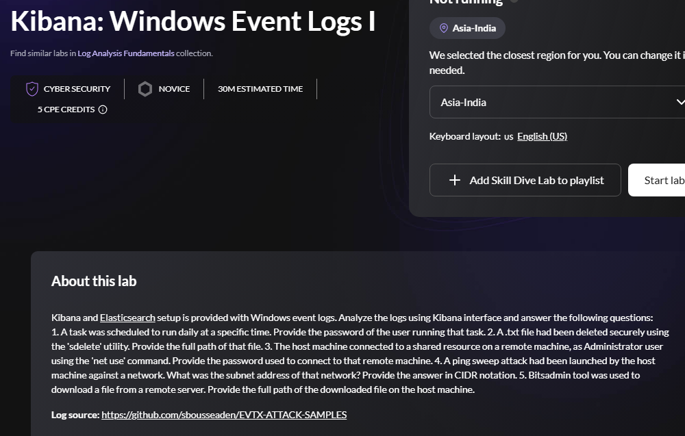
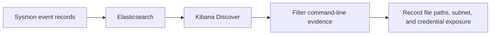

# Kibana: Windows Event Logs I

## 1. Lab Overview

This lab uses Kibana to investigate five activities in a Windows event dataset. You examine scheduled tasks, file deletion, SMB share access, ping activity, and a BITS download. By the end, you can find relevant process records and document their evidence without exposing passwords.



## 2. Lab Environment

- Preloaded Windows Sysmon sample analyzed in Kibana and Elasticsearch.
- Original log source is the [EVTX-ATTACK-SAMPLES capture](https://github.com/sbousseaden/EVTX-ATTACK-SAMPLES/blob/master/AutomatedTestingTools/PanacheSysmon_vs_AtomicRedTeam01.evtx).
- The ping sweep evidence names the lab network `192.168.1.0/24`. The notes specify no Kibana endpoint or port.

## 3. Workflow Diagram



## 4. Tools Used

| Tool | Purpose |
| --- | --- |
| Kibana Discover | Filter events and inspect the original fields |
| Elasticsearch | Index the Windows event dataset |
| Sysmon | Record process creation and command-line evidence |
| EVTX sample | Provide the recorded exercise activity |

## 5. Task-by-Task Walkthrough

The [PDF source notes](lab-source.md) summarize the solution. The search examples are Kibana filters for recorded telemetry. Matching Sysmon Event ID 1 records were independently located in the linked EVTX. Multiple process records can describe related activity, so these are not action counts.

### T1: Review daily scheduled-task activity

**Goal.** Locate the daily task and identify exposure of a credential in process telemetry.

**Steps**

1. In Kibana Discover, apply the filter. Review the four matches reported by the PDF and identify the entry with a daily schedule. Record the host, time, task name, and account where visible.

**Commands**

```kql
EventData.CommandLine : "schtasks"
```

**Command explained.** EventData.CommandLine is the process command-line field. This filter finds records that mention schtasks.

**Expected result / Finding.** The manual reports a scheduled task whose command line includes a plaintext credential. The value is omitted.

### T2: Identify the securely deleted file

**Goal.** Recover the full file path from the SDelete evidence.

**Steps**

1. Filter for SDelete and expand the relevant process record. Read the target path in the command-line field.

**Commands**

```kql
EventData.CommandLine : sdelete*
```

**Command explained.** The wildcard searches for terms beginning with sdelete.

**Expected result / Finding.** The recorded target was C:\some\file.txt. The process record identifies the intended target. Check file telemetry if you need to confirm the deletion outcome.

### T3: Review the SMB share connection

**Goal.** Locate Administrator share activity and document the credential exposure.

**Steps**

1. In Discover, look for the net use activity described in the solution. Review the matching records for the account, host, share, and timestamp. Mask any credential value when recording the evidence.

**Commands**

```kql
EventData.CommandLine : "net use"
```

**Command explained.** The filter matches the net use phrase in recorded command-line text. The PDF reports three matching records.

**Expected result / Finding.** The manual reports Administrator share activity with a plaintext credential in the command line. The value is omitted.

### T4: Identify the subnet in the ping sweep

**Goal.** Record the targeted network in CIDR form.

**Steps**

1. Find ping-related records and compare the target address pattern in the matching event.

**Commands**

```kql
EventData.CommandLine : "ping"
```

**Command explained.** The filter searches recorded command-line text for ping.

**Expected result / Finding.** The lab subnet was 192.168.1.0/24.

### T5: Identify the BITS download destination

**Goal.** Recover the local target path from BITSAdmin telemetry.

**Steps**

1. Filter for BITSAdmin and inspect the destination recorded in the matching event.

**Commands**

```kql
EventData.CommandLine : bitsadmin*
```

**Command explained.** The wildcard searches for terms beginning with bitsadmin.

**Expected result / Finding.** The recorded destination was C:\Windows\Temp\bitsadmin_flag.ps1. Review file or transfer records separately if confirming completion.

## 6. Key Concepts (Beginner-Friendly)

- **Process command line.** A record of the executable and arguments supplied when a process started.
- **Credential exposure.** A password passed as an argument can appear in endpoint telemetry and downstream search systems.
- **CIDR.** A notation for a network prefix. A `/24` uses the first 24 bits as the network portion.
- **Recorded intent and outcome.** A process record can show the requested action. File, network, or service records can corroborate its result.

## 7. SOC / Real-World Relevance

A SOC analyst can use command-line telemetry to connect utilities with files, remote shares, and network targets. When reviewing or sharing alert evidence, record the fact of credential exposure and mask the value.

## 8. Quick Command Cheat Sheet

| Kibana filter | Purpose |
| --- | --- |
| `EventData.CommandLine : "net use"` | Find SMB share command-line evidence. |
| `EventData.CommandLine : "schtasks"` | Locate the daily task and identify exposure of a credential in process telemetry. |
| `EventData.CommandLine : sdelete*` | Recover the full file path from the SDelete evidence. |
| `EventData.CommandLine : "ping"` | Record the targeted network in CIDR form. |
| `EventData.CommandLine : bitsadmin*` | Recover the local target path from BITSAdmin telemetry. |

## 9. Common Mistakes & Troubleshooting

| Symptom | What to check |
| --- | --- |
| Discover returns no events | Verify the index, historical time range, and exact field mapping. |
| Several records match a tool name | Compare the image, timestamp, host, and command-line context. |
| A process log names a destination | Look for corresponding file or transfer evidence to confirm the action completed. |

## 10. Conclusion

- I located five kinds of Windows activity using Kibana.
- I recorded the deleted file path, the subnet, and the BITS download path.
- I documented the evidence of password exposure with the values masked.
