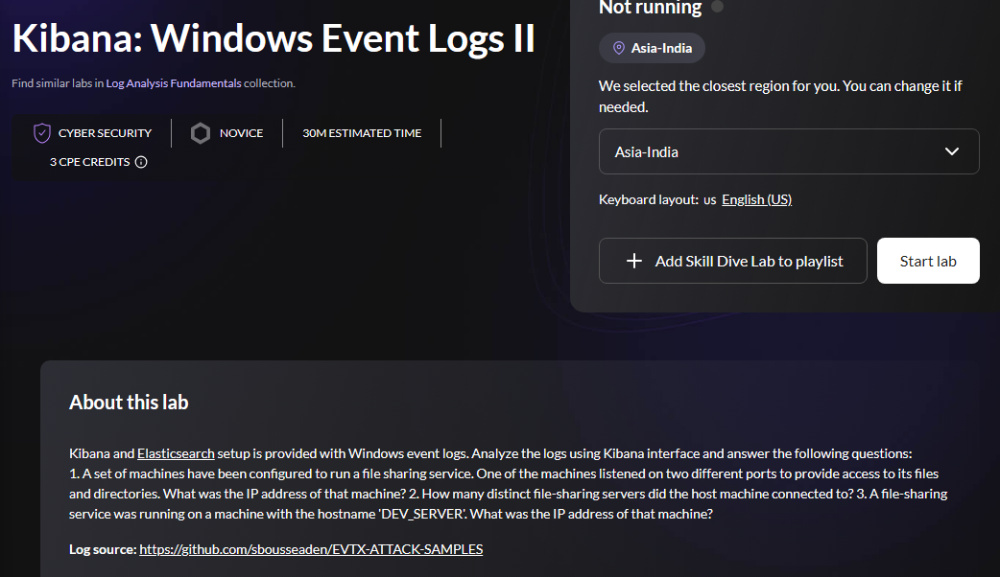
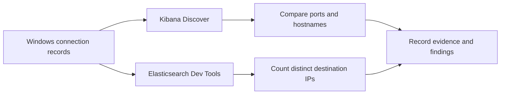

# Kibana: Windows Event Logs II

## 1. Lab Overview

Use Kibana to examine Windows network connection records. Compare destinations by port, count distinct destination addresses, and resolve a hostname to an IP. By the end, you can explain which records support all three lab answers.



## 2. Lab Environment

- Kibana Discover and Dev Tools with a preloaded Elasticsearch index named event-logs.
- The PDF shows connection records from source host alice.insecurebank.local at 10.59.4.20.
- The destination ports shown are TCP 389 and 445. The PDF displays the service labels ldap and microsoft-ds, respectively.
- The lab credits the [EVTX-ATTACK-SAMPLES repository](https://github.com/sbousseaden/EVTX-ATTACK-SAMPLES).

## 3. Workflow Diagram



## 4. Tools Used

| Tool | Purpose |
| --- | --- |
| Kibana Discover | Filter by destination port or hostname and inspect records |
| Kibana Dev Tools | Run the Elasticsearch aggregation |
| Elasticsearch | Store network records and count destination addresses |

## 5. Task-by-Task Walkthrough

The [PDF source notes](lab-source.md) record the lab evidence and upstream source check. Use the lab's preloaded data for the searches below.

### T1: Find the destination seen on two ports

**Goal.** Identify the IP address common to both destination-port groups.

**Steps**

1. Open Discover. Add EventData.DestinationPort, EventData.DestinationPortName, and EventData.DestinationIp.
2. Filter for port 389 from the field values and record its destination IPs. Remove the filter and repeat for 445.
3. Compare the two sets of addresses.

**Commands.** Apply the port filters using the Discover field controls.

**Expected result / Finding.** **10.59.4.11** appears on both ports. Port 445 is labeled microsoft-ds and is associated with SMB. Port 389 is labeled ldap in the PDF screenshot. The overlap establishes connections to both ports on the same host. It does not establish file sharing on port 389.

### T2: Count distinct destination addresses

**Goal.** Count the distinct servers represented in the dataset.

**Steps**

1. Open Kibana Dev Tools and run the query below.
2. Read aggregations.ip_count.value. Cross-check against the distinct destination IPs in Discover.

**Command**

```http
GET event-logs/_search
{
  "size": 0,
  "aggs": {
    "ip_count": {
      "cardinality": {
        "field": "EventData.DestinationIp.keyword"
      }
    }
  }
}
```

**Command explained.** size 0 suppresses individual hits. The cardinality aggregation estimates the number of distinct values in the address field. The source also verifies the count manually, and the port-445 screenshot alone shows seven distinct addresses.

**Expected result / Finding.** **7 distinct destinations** in the supplied lab data. This query counts the entire index. In a mixed dataset, scope the records to the source host and relevant protocol before using the result as a server count.

### T3: Resolve DEV_SERVER to an IP address

**Goal.** Identify the destination IP in the records for this hostname.

**Steps**

1. Apply the filter in Kibana Discover.
2. Open the matching event and read EventData.DestinationIp.

**Command**

```kql
EventData.DestinationHostname  : "DEV_SERVER"
```

**Command explained.** The filter restricts results to events with the recorded destination hostname DEV_SERVER. The address comes from the event fields.

**Expected result / Finding.** **10.59.4.12**. The PDF shows one matching event on port 445.

## 6. Key Concepts (Beginner-Friendly)

- **Destination address and port.** An address identifies the target host. A port identifies the network endpoint used on that host.
- **Cardinality.** The number of distinct values. Several events can refer to the same address.
- **Protocol evidence.** A port and its label help interpret a connection. They provide limited evidence about what the session did.

## 7. SOC / Real-World Relevance

Analysts can use these steps to map which servers a workstation contacted and identify hosts with activity on multiple ports. Comparing hostname, address, port, and event context helps distinguish file-sharing traffic from other network activity.

## 8. Quick Command Cheat Sheet

| Query or control | Purpose |
| --- | --- |
| EventData.DestinationPort field filter | Compare destinations for ports 389 and 445 |
| GET event-logs/_search with cardinality | Count distinct destination addresses |
| EventData.DestinationHostname : "DEV_SERVER" | Find records for the named destination |

## 9. Common Mistakes & Troubleshooting

| Symptom | What to check |
| --- | --- |
| No records match the second port | Remove the first port filter before applying the second. |
| The count appears too high | Check the source host, protocol, index, and whether you counted records or addresses. |
| Dev Tools rejects the aggregation field | Verify the actual Elasticsearch mapping and keyword subfield. |
| The hostname search is empty | Check the data view, time range, and exact field name. |

## 10. Conclusion

- I identified the one destination seen on both TCP ports.
- I verified the distinct destination count using the lab evidence.
- I recovered the recorded IP address for DEV_SERVER.
