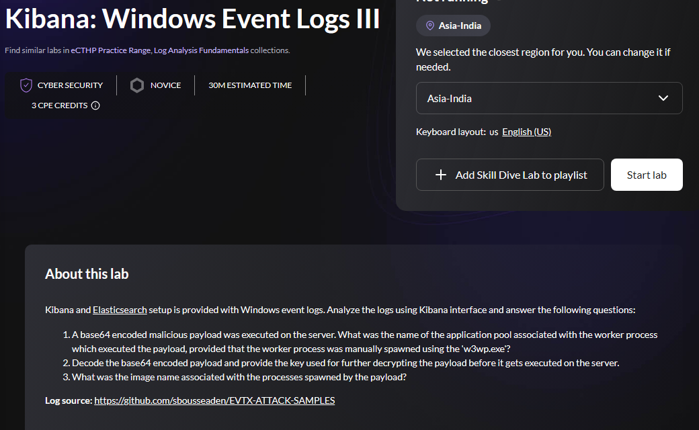
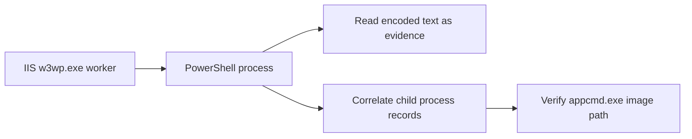

# Kibana: Windows Event Logs III

## 1. Lab Overview

Use Kibana to investigate the process chain behind suspicious PowerShell activity on an IIS server. Identify the IIS application pool, verify a key embedded in an encoded command, and trace the processes PowerShell started. The findings are cross-checked against the original Sysmon capture.



## 2. Lab Environment

- Kibana and Elasticsearch with preloaded Windows event logs.
- Sysmon Event ID 1 supplies process creation, command-line, and parent-process fields.
- The source gives no Kibana URL or port for this exercise.

## 3. Workflow Diagram



## 4. Tools Used

| Tool | Purpose |
| --- | --- |
| Kibana Discover | Filter records and inspect event fields |
| Elasticsearch | Store and search the Windows event dataset |
| Sysmon EVTX | Supply the original process creation records |
| Offline text decoding | Inspect encoded arguments as data |

## 5. Task-by-Task Walkthrough

The [source notes](lab-source.md) identify the matching upstream capture and verification method. The searches below are read-only Kibana filters.

### T1: Identify the IIS application pool

**Goal.** Find the application pool associated with the worker process that launched PowerShell.

**Steps**

1. In Kibana Discover, run the filter below.
2. Open the matching process creation record and check ParentImage and ParentCommandLine.
3. Read the application-pool name in the worker's command-line arguments.

**Command**

```kql
EventData.ParentCommandLine : "w3wp.exe"
```

**Command explained.** This filter finds records whose parent command line mentions the IIS worker executable.

**Expected result / Finding.** **DefaultAppPool**. The upstream capture contains one matching IIS-to-PowerShell process creation record.

### T2: Identify the embedded key

**Goal.** Verify the key shown in the decoded command text.

**Steps**

1. Review the encoded argument in the same PowerShell process record.
2. Inspect the Base64 text offline as UTF-16LE and compare the key literal with the manual.

**Commands.** Use the filter from T1 to locate the recorded evidence.

**Command explained.** Base64 decoding reveals the outer text and the key it contains. This verification does not require decrypting or running the embedded payload.

**Expected result / Finding.** The embedded key matches the PDF.

```text
8d969eef6ecad3c29a3a629280e686cf0c3f5d5a86aff3ca12020c923adc6c92
```

### T3: Identify the child process image

**Goal.** Determine which executable the identified PowerShell process launched.

**Steps**

1. Use the PowerShell parent-command-line filter below.
2. Match the PowerShell record's ProcessGuid to the candidate records' ParentProcessGuid.
3. Inspect EventData.Image in the matching records.

**Command**

```kql
EventData.ParentCommandLine : "powershell.exe"
```

**Command explained.** This filter finds candidate child records. The GUID comparison ties them to the PowerShell instance identified in T1.

**Expected result / Finding.** **C:\Windows\System32\inetsrv\appcmd.exe**. The upstream capture shows 39 direct child records with that image.

## 6. Key Concepts (Beginner-Friendly)

- **Application pool.** An IIS grouping that determines which worker process serves an application.
- **Encoding and encryption.** Base64 changes how bytes are represented. Decoding it does not decrypt the data that the script may contain.
- **Process GUID.** An identifier for a particular process instance. ParentProcessGuid links a child event to the process that launched it.

## 7. SOC / Real-World Relevance

An analyst can trace unexpected scripting from an IIS worker to its child processes. Matching process GUIDs helps avoid mixing unrelated PowerShell sessions that use the same executable name.

## 8. Quick Command Cheat Sheet

| Kibana filter | What it does |
| --- | --- |
| EventData.ParentCommandLine : "w3wp.exe" | Find events associated with the IIS worker |
| EventData.ParentCommandLine : "powershell.exe" | Find candidate children of PowerShell |

## 9. Common Mistakes & Troubleshooting

| Symptom | What to check |
| --- | --- |
| No records match | Check the data view, historical time range, and field mapping. |
| Decoded command text appears garbled | Check the expected UTF-16LE character encoding. |
| Many PowerShell records match | Compare process GUIDs and the relevant time window. |

## 10. Conclusion

- I identified the IIS application pool and verified the embedded key.
- I used Sysmon process GUIDs to identify the direct child executable.
- I cross-checked the three findings against the upstream capture.
