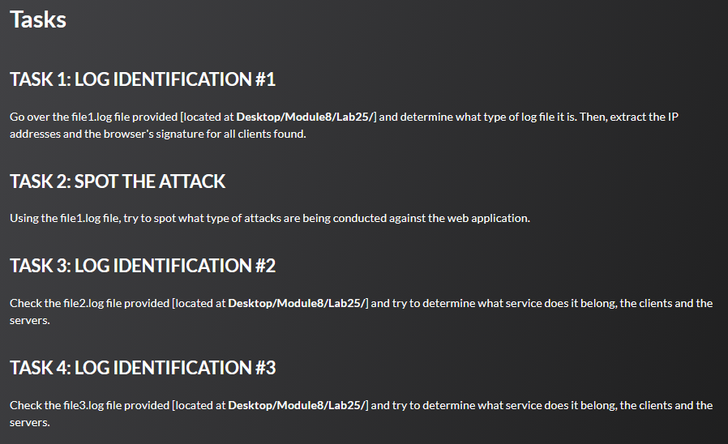
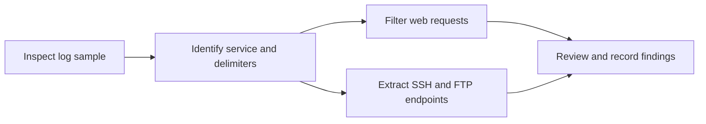

# Log Analysis Using Linux

## 1. Lab Overview

Identify three log files by their contents and use Linux utilities to extract useful fields. The exercise covers Apache-style web requests, SSH endpoint records, and FTP activity. It also shows how to use keywords to find web requests worth investigating.


## 2. Lab Environment

- Linux shell with the lab evidence in Desktop/Module8/Lab25/.
- Input files are file1.log, file2.log, and file3.log.
- The supplied materials do not give exact client addresses or port values.



## 3. Workflow Diagram



## 4. Tools Used

| Tool | Purpose |
| --- | --- |
| more and cat | Page through or print log files |
| cut | Select space-delimited fields |
| sort | Sort and deduplicate selected values |
| grep | Find records matching text |
| awk | Format selected columns from tab-delimited records |

## 5. Task-by-Task Walkthrough

The [source notes](lab-source.md) summarize the pasted solution. The raw logs and individual output screenshots were not uploaded, so the reported findings could not be independently replayed.

### T1: Identify the web access log

**Goal.** Identify the service and extract client addresses and browser signature fields.

**Steps**

1. Open file1.log with a pager and inspect the request method, timestamp, and field layout.
2. Extract the specified fields and deduplicate the resulting pairs.

**Commands**

```bash
more file1.log
cat file1.log | cut -d " " -f 1,12 | sort -u
```

**Command explained.** more pages through the file. cat passes the text to cut, which splits on literal spaces and selects fields 1 and 12. sort -u returns unique pairs.

**Expected result / Finding.** The notes identify an Apache-style access log from the request format. The command returns client IPs and the selected browser-signature token. A full User-Agent may contain spaces, so field 12 alone may capture only part of it.

### T2: Spot suspicious web requests

**Goal.** Find records consistent with XSS or SQL injection attempts.

**Steps**

1. Search the web log with the two case-sensitive filters.
2. Inspect matching request paths and logged signatures in context.

**Commands**

```bash
cat file1.log | grep script
cat file1.log | grep AND
```

**Command explained.** grep prints lines containing the supplied pattern. These broad patterns produce candidates for review.

**Expected result / Finding.** The notes report XSS-like script strings and SQL injection indicators, including encoded query text and a sqlmap signature. Request strings and tool identifiers do not establish that an attempt succeeded.

### T3: Identify the SSH log

**Goal.** Identify client and server endpoints in the tab-delimited SSH file.

**Steps**

1. Inspect file2.log for SSH markers and check that the endpoint columns are tab-delimited.
2. Print source and destination IPs and ports.

**Commands**

```bash
cat file2.log
awk -F "\t" '
BEGIN { printf "%-14s : %-3s | %8s : %8s\n","src_IP","src_port","dst_IP","dst_port" }
{ printf "%-10s : %3d | %10s : %3d\n", $3,$4,$5,$6} ' file2.log
```

**Command explained.** awk uses tabs as separators. BEGIN prints column headers and printf formats fields 3 through 6.

**Expected result / Finding.** The notes identify SSH records and show a source and destination endpoint table. Confirm the connection direction before labeling the client and server.

### T4: Identify the FTP log

**Goal.** Identify the service and report endpoints from the FTP records.

**Steps**

1. Use the FTP identification in the source notes and check the endpoint columns.
2. Print only the IP and port fields. The following adaptation uses the same column positions as the source.

**Command**

```bash
awk -F "\t" '
BEGIN { printf "%-14s : %-3s | %8s : %8s\n","src_IP","src_port","dst_IP","dst_port" }
{ printf "%-10s : %3d | %10s : %3d\n", $3,$4,$5,$6} ' file3.log
```

**Command explained.** This adaptation prints fields 3 through 6. The original solution also displayed credential fields, which are excluded here.

**Expected result / Finding.** The notes identify FTP and report that the log contains credential fields. The adapted output displays just source and destination addresses and ports.

## 6. Key Concepts (Beginner-Friendly)

- **Delimiter.** A character, such as a space or tab, that separates fields.
- **Request indicator.** A string that points to activity worth reviewing.
- **Endpoint.** An IP address and port identifying a side of a connection.
- **Data minimization.** Extract only the fields needed for the investigation.

## 7. SOC / Real-World Relevance

An analyst can use shell utilities when a SIEM is unavailable or when working directly with exported evidence. Parsing fields before sharing output helps avoid including unrelated or sensitive data.

## 8. Quick Command Cheat Sheet

| Command or option | Purpose |
| --- | --- |
| more file1.log | Inspect the web log a screen at a time |
| cut -d " " -f 1,12 | Select the first and twelfth space-delimited fields |
| sort -u | Output unique rows |
| grep script / grep AND | Find candidate web attack indicators |
| awk -F "\t" | Parse tab-delimited endpoint data |

## 9. Common Mistakes & Troubleshooting

| Symptom | What to check |
| --- | --- |
| A browser signature is incomplete | Check whether it spans several space-separated fields. |
| A grep result seems conclusive | Verify the request context and response before attributing success. |
| The endpoint table is misaligned | Check the delimiter and field positions in the raw file. |
| An export contains sensitive columns | Select only the fields you need before printing or saving output. |

## 10. Conclusion

- I identified Apache-style, SSH, and FTP log records.
- I used Linux pipelines to find web indicators and extract endpoints.
- I adapted the FTP output to avoid printing credential fields.
