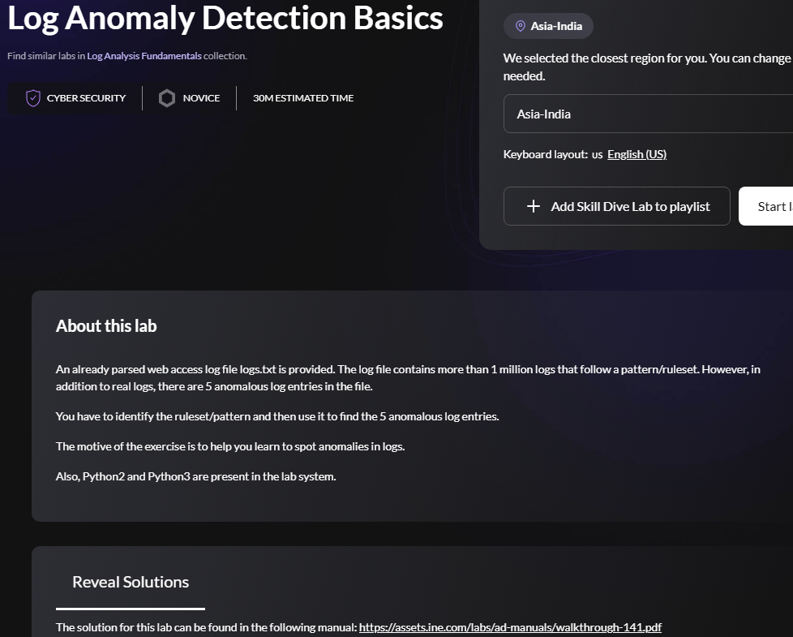
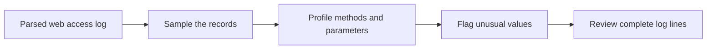

# Log Anomaly Detection Basics

## 1. Lab Overview

This lab uses a parsed web access log with more than one million entries. You build a baseline from the HTTP method and three URL parameters, then identify five entries that break it. By the end, you can explain why each entry stands out.



## 2. Lab Environment

- Input file `logs.txt`, provided inside the lab.
- Python 2 and Python 3 are available according to the lab overview.
- The URLs are strings inside the log. The exercise does not require contacting a web server or using a network port.

## 3. Workflow Diagram



## 4. Tools Used

| Tool | Purpose |
| --- | --- |
| Python | Parse each line and profile the log fields |
| grep | Find complete records containing flagged values |
| logs.txt | Provide the web access records to investigate |

## 5. Task-by-Task Walkthrough

The findings come from the [PDF source notes](lab-source.md). The lab data file was not uploaded.

### T1: Identify the normal log pattern

**Goal.** Understand the structure of a typical entry before looking for exceptions.

**Steps**

1. Inspect about 10 to 15 records in `logs.txt`.
2. Split each record into an HTTP method and a URL. Identify the three query parameters.
3. Compare methods, numbers, prefixes, and date components across the sample.

**Commands.** Inspect the sample in the lab text viewer.

**Expected result / Finding.** `param1` resembles a number in a normal range. `param2` generally starts with `brac`, ignoring case. `param3` contains the date in `DDMMMYYYY` form. The PDF calls it `Param4` once, but its sample URL and code use `param3`.

### T2: Profile the complete file

**Goal.** Find unusual methods and parameter values across the dataset.

**Steps**

1. Save the profiling script as `detect.py` next to `logs.txt`.
2. Run the script from that directory. Review method counts, date days and months, prefix exceptions, and the most extreme numeric values.
3. Compare rare values with the initial baseline. Inspect the original records before deciding which values to report.

**Command shown in the PDF**

```bash
python detect.py
```

**Python 3 adaptation**

```python
from collections import Counter
from heapq import nlargest
from urllib.parse import parse_qs, urlsplit

methods = Counter()
days = Counter()
months = Counter()
years = Counter()
numbers = Counter()

with open("logs.txt", encoding="utf-8") as log:
    for line_number, line in enumerate(log, start=1):
        try:
            method, url = line.split()
            fields = parse_qs(urlsplit(url).query)
            number = int(fields["param1"][0])
            word = fields["param2"][0]
            date = fields["param3"][0]
        except (ValueError, KeyError):
            print(f"Could not parse line {line_number}: {line.rstrip()}")
            continue

        methods[method] += 1
        numbers[number] += 1
        days[date[:2]] += 1
        months[date[2:5]] += 1
        years[date[5:]] += 1

        if not word.lower().startswith("brac"):
            print(f"Unexpected prefix on line {line_number}: {line.rstrip()}")

print("HTTP methods:", methods)
print("Day values:", days)
print("Month values:", months)
print("Year values:", years)
print("Five highest param1 values:", nlargest(5, numbers))
```

**Command explained.** `python detect.py` runs the script in the lab. Use a Python 3 interpreter for the adapted code above. The script reads one line at a time, parses the URL parameters by name, counts observed values, and prints entries with an unexpected prefix. It reports the five highest distinct numeric values for comparison. The PDF's original Python 2 example checks whether `brac` occurs anywhere in the word. This adaptation checks the prefix to match the PDF's stated rule.

**Expected result / Finding.** The PDF reports `HEADER`, day `33`, month `XYZ`, value `8119`, and prefix exception `crachy`. Its sample terminal output also highlights `TRACE`, which is absent from the five-entry answer key. Treat it as a separate lead until the dataset can be inspected.

### T3: Recover and verify all five records

**Goal.** Match each flagged value to a complete record and explain the anomaly.

**Steps**

1. Use `grep` or your text viewer to find the original lines by the flagged strings.
2. Verify the method and all three parameters against the answer key.
3. Record which part of each line breaks the pattern.

| HTTP method | param1 | param2 | param3 | Anomaly |
| --- | --- | --- | --- | --- |
| HEADER | 2828 | brachy | 22JUL2018 | Unexpected method |
| DELETE | 2931 | brachy | 33JAN2013 | Day 33 is invalid |
| DELETE | 2823 | brachi | 20XYZ2019 | XYZ is not a month abbreviation |
| CONNECT | 8119 | brachm | 23JUL2011 | Numeric outlier in this dataset |
| POST | 3970 | crachy | 08SEP2013 | Word starts with crac instead of brac |

**Command explained.** The PDF names `grep` for finding the full line and gives no exact invocation. All five rows use the same example endpoint, `http://example.net/access_object.php`.

**Expected result / Finding.** The five rows above reproduce the values listed in the PDF answer key.

## 6. Key Concepts (Beginner-Friendly)

- **Baseline.** The patterns you observe in typical data.
- **Outlier.** A value that differs sharply from most observed values, such as `8119` in this file.
- **Validation.** Compare a flagged value with the source record and the expected format.
- **Frequency profile.** Count how often each value appears to distinguish common values from rare ones.

## 7. SOC / Real-World Relevance

Analysts can use field baselines to spot malformed requests, unusual methods, or unexpected values in web logs. Reviewing the complete event helps distinguish a data-quality issue from activity that needs an investigation.

## 8. Quick Command Cheat Sheet

| Command or function | What it does |
| --- | --- |
| `python detect.py` | Run the lab profiling script |
| `urlsplit` and `parse_qs` | Split a URL and read named query parameters |
| `Counter` | Count observed values |
| `nlargest` | Show the highest observed numeric values |
| `grep` | Find complete records containing a flagged value |

## 9. Common Mistakes & Troubleshooting

| Symptom | What to check |
| --- | --- |
| The script cannot find logs.txt | Run it from the directory holding the log file. |
| Python rejects the print syntax | The PDF sample uses Python 2. Use Python 3 for the adaptation above. |
| A rare HTTP method appears | Check the local baseline and supporting context before reporting an anomaly. |
| A date has the right shape | Check actual day and month values. Format alone does not validate a calendar date. |

## 10. Conclusion

- I learned to profile a large web access log by field.
- I identified five reported anomalies and explained why their values stood out.
- I compared the terminal output with the answer key before treating a highlighted value as a finding.
