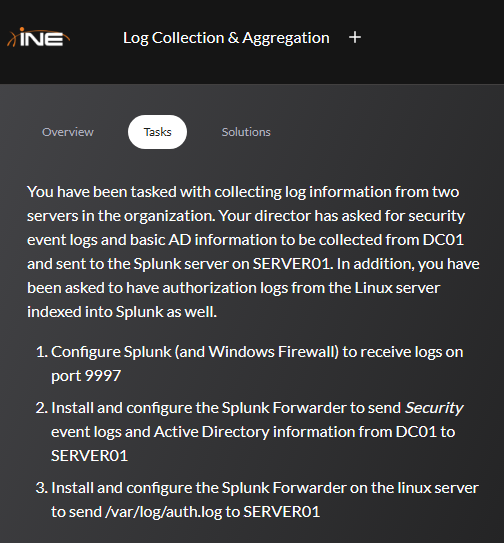
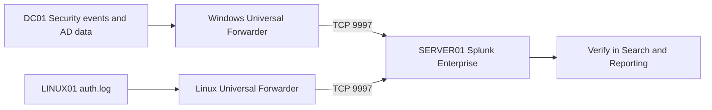

# Log Collection & Aggregation

## 1. Lab Overview

Configure two servers to send logs to a single Splunk receiver. DC01 forwards Windows Security events and Active Directory monitoring data. LINUX01 forwards its authentication log. By the end, you can verify whether Splunk received events from both systems.

## 2. Lab Environment

| Machine | Example lab IP | Role |
| --- | --- | --- |
| DC01 | 172.31.115.100 | Windows Security and Active Directory data source |
| SERVER01 | 172.31.115.110 | Splunk Enterprise receiver on TCP 9997 |
| LINUX01 | 172.31.115.111 | Linux authentication log source |

The solution uses RDP to reach DC01 and PuTTY over SSH to reach LINUX01. The receiver port is explicitly specified. The source gives no service port numbers for RDP or SSH.



## 3. Workflow Diagram



## 4. Tools Used

| Tool | Purpose |
| --- | --- |
| Splunk Enterprise and SPL | Receive, index, and search both sources |
| Splunk Universal Forwarder | Collect and send the endpoint data |
| Windows Firewall | Allow inbound forwarding traffic on SERVER01 |
| RDP and PuTTY | Access DC01 and LINUX01 |
| Bash and dpkg | Install and configure the Linux forwarder |

## 5. Task-by-Task Walkthrough

The [original solution notes](lab-source.md) provide the commands. The task screenshot is included. The overview screenshot displays lab passwords and was excluded. The notes reference individual task screenshots that were absent.

### T1: Configure SERVER01 to receive logs

**Goal.** Allow the forwarders to reach Splunk on TCP 9997.

**Steps**

1. On SERVER01, open Splunk and select **Settings > Forwarding and receiving**.
2. Select **Add new** next to **Configure receiving**, enter port 9997, and save.
3. In Windows Firewall, create an inbound port rule for TCP 9997. Allow the connection, enable the rule for all profiles as directed in the lab, and name it **Splunk Forwarder**.

**Commands.** Use the Splunk and Windows Firewall interfaces.

**Expected result / Finding.** Splunk has a receiving input on TCP 9997, and the Windows Firewall rule permits inbound connections on that port.

### T2: Forward DC01 Security logs and AD data

**Goal.** Send the specified Windows data from DC01 to SERVER01.

**Steps**

1. Connect to DC01 over RDP with the lab-provided account and open the forwarder installer in Desktop > Tools.
2. Select **An on-premises Splunk Enterprise instance**, then **Customize Options**. Use the lab defaults for installation location and certificate screens.
3. Select **Local System**, **Security Logs**, and **Enable AD monitoring**. Set the forwarder's administrator credentials and leave **Deployment Server** blank.
4. On **Receiving Indexer**, enter SERVER01's example address, 172.31.115.110, and port 9997. Finish the installation.
5. On SERVER01, open **Search & Reporting**, select **All time**, and run the search below.

```spl
index=* host=DC01
```

**Command explained.** index=* searches accessible indexes. host=DC01 filters to events tagged with that host.

**Expected result / Finding.** Results confirm that some records from DC01 reached Splunk. Inspect source or sourcetype details to verify Security logs and AD monitoring separately.

### T3: Forward LINUX01 authentication logs

**Goal.** Send /var/log/auth.log to SERVER01 and verify the data in Splunk.

**Steps**

1. Connect to LINUX01 with PuTTY and use the lab-provided credentials. Create the installation owner and directory, install the Desktop package from its location, and set ownership.
2. Enter the forwarder's bin directory. Start Splunk and set the administrator credentials when prompted.
3. Configure the receiver and monitor /var/log/auth.log. Restart the forwarder.
4. In Search & Reporting, use the DC01 query with the Linux host value given in the solution.

```bash
sudo useradd -m splunk
export SPLUNK_HOME="/opt/splunkforwarder"
sudo mkdir $SPLUNK_HOME
sudo dpkg -i splunkforwarder-9.0.4-de405f4a7979-linux-2.6-amd64.deb
sudo chown splunk:splunk $SPLUNK_HOME -R
cd $SPLUNK_HOME/bin
sudo ./splunk start --accept-license
sudo ./splunk add forward-server 172.31.115.110:9997
sudo ./splunk add monitor /var/log/auth.log
sudo ./splunk restart
```

**Linux search from the host substitution described in the notes**

```spl
index=* host=ip-172-31-115-111
```

**Command explained.** useradd -m creates the owner and home directory. export sets the installation path. mkdir creates that directory, dpkg -i installs the package, and chown -R assigns ownership recursively. cd selects the CLI directory. The Splunk CLI starts the forwarder and accepts its license, sets the receiving server, adds the file monitor, and restarts the service.

**Expected result / Finding.** Splunk returns events for the Linux host. Inspect the source field to verify that they came from /var/log/auth.log.

## 6. Key Concepts (Beginner-Friendly)

- **Forwarder.** A small service that collects data on a source system and ships it.
- **Receiver.** The Splunk input that accepts connections from forwarders.
- **Monitor.** A setting that tells the forwarder which file to read.
- **Host and source.** The host identifies where an event came from. The source helps verify the channel or file.

## 7. SOC / Real-World Relevance

Central collection lets a SOC compare Windows account and directory activity with Linux authentication records. Checking both host and source helps identify collection gaps before an investigation depends on those logs.

## 8. Quick Command Cheat Sheet

| Command | What it does |
| --- | --- |
| `sudo useradd -m splunk` | Create an installation owner. |
| `export SPLUNK_HOME="/opt/splunkforwarder"` | Set the installation path. |
| `sudo mkdir $SPLUNK_HOME` | Create the destination directory. |
| `sudo dpkg -i splunkforwarder-9.0.4-de405f4a7979-linux-2.6-amd64.deb` | Install the Linux package. |
| `sudo chown splunk:splunk $SPLUNK_HOME -R` | Set recursive ownership. |
| `cd $SPLUNK_HOME/bin` | Enter the CLI directory. |
| `sudo ./splunk start --accept-license` | Start the forwarder and accept its license. |
| `sudo ./splunk add forward-server 172.31.115.110:9997` | Set SERVER01 as the destination. |
| `sudo ./splunk add monitor /var/log/auth.log` | Monitor the Linux authentication log. |
| `sudo ./splunk restart` | Restart the forwarder. |
| `index=* host=DC01` | Find DC01 records. |
| `index=* host=ip-172-31-115-111` | Find Linux records using the sample host. |

## 9. Common Mistakes & Troubleshooting

| Symptom | What to check |
| --- | --- |
| Neither host reaches Splunk | Verify the receiving input and inbound TCP 9997 on SERVER01. |
| DC01 events appear without the requested evidence | Check the selected inputs and inspect source or sourcetype. |
| The Linux CLI is unavailable | Check the package installation and the SPLUNK_HOME/bin working directory. |
| No Linux events appear | Verify the destination, file monitor, file access, and actual host field. |
| Searches return no results | Use the lab time range and check which indexes are accessible. |

## 10. Conclusion

- I configured SERVER01 to receive logs on TCP 9997.
- I configured DC01 and LINUX01 to send their requested data.
- I checked host searches and identified how to verify each source.
