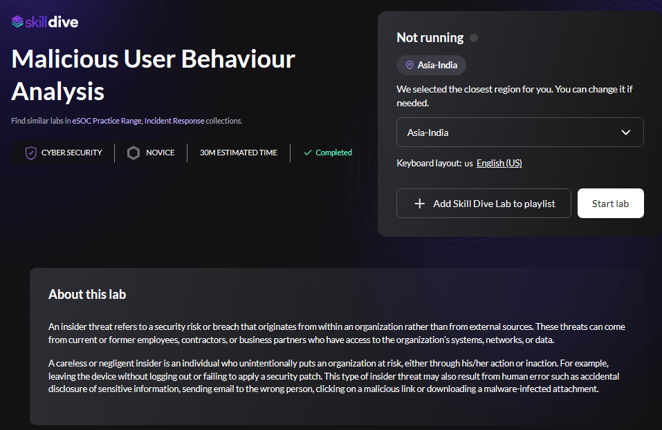
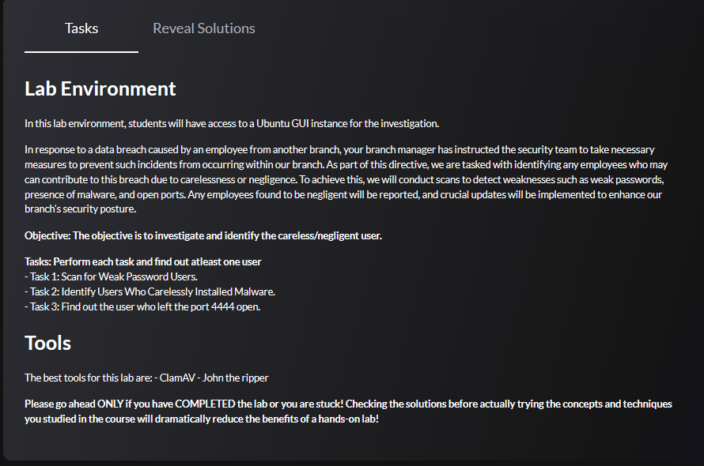
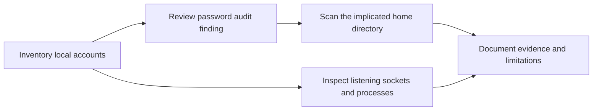

# Malicious User Behaviour Analysis

## 1. Lab Overview

Investigate three risks on an Ubuntu workstation: a weak password, a malware finding, and a listening socket. Compare the reported audit result with local account, file, and process evidence. Record what each finding establishes about the affected account.



## 2. Lab Environment

- Ubuntu GUI workstation with five employee accounts reported in the solution.
- The file scan targets /home/usr1.
- The socket investigation focuses on TCP port 4444.



## 3. Workflow Diagram



## 4. Tools Used

| Tool | Purpose |
| --- | --- |
| cat | Read the local account list |
| John the Ripper | Password-auditing tool named in the source |
| ClamAV | Scan files for malware signatures |
| ss | Inspect local sockets and associated process details |

## 5. Task-by-Task Walkthrough

The [source notes](lab-source.md) summarize the inline solution. Both uploaded screenshots describe the lab. The raw outputs and individual solution screenshots were unavailable for independent verification.

### T1: Review the weak-password finding

**Goal.** Identify the account flagged by the reported audit.

**Steps**

1. List local account entries and distinguish employee accounts from system accounts.
2. Record the audit finding without copying password or hash values.

**Command**

```bash
cat /etc/passwd
```

**Command explained.** cat displays the local account entries. These typically include the username, numeric IDs, home directory, and login shell.

**Expected result / Finding.** The source reports five employee accounts and flags usr1 for a weak password. The walkthrough omits hash extraction and password-cracking commands.

### T2: Check the home directory for malware

**Goal.** Identify whether ClamAV reports a suspicious file under usr1's home directory.

**Steps**

1. Check the ClamAV version.
2. Scan the home directory and record the reported path, detection label, and scan summary where available.

**Commands**

```bash
clamscan --version
clamscan -ir /home/usr1
```

**Command explained.** --version displays the scanner version. -i reports infected files only, and -r recursively scans the directory tree.

**Expected result / Finding.** The pasted solution reports a detection under /home/usr1. The exact path and signature are shown only in linked solution images and are not stated in the pasted text. A file in a home directory alone does not establish who downloaded or executed it.

### T3: Investigate the open port

**Goal.** Identify the process associated with the TCP 4444 listener and review the account attribution.

**Steps**

1. Use ss to find the local address ending in port 4444 and confirm its state is LISTEN.
2. Inspect process information and note the PID if available. Correlate it with authorized process-owner evidence.

**Commands**

```bash
ss -tan
ss -ntaup
```

**Command explained.** -t selects TCP, -u includes UDP, -a shows listening and non-listening sockets, -n displays numeric endpoints, and -p includes process information where permissions allow.

**Expected result / Finding.** The notes link the listener to usr1. The exact PID and process name are unavailable in the pasted text. The original process-environment command is omitted because environment variables may contain secrets.

## 6. Key Concepts (Beginner-Friendly)

- **Password audit.** Identifies accounts whose passwords are vulnerable to guessing.
- **Malware signature.** A pattern a scanner uses to flag suspicious files.
- **Listening socket.** A process endpoint waiting for incoming connections.
- **Attribution.** Links a finding to an account or process using corroborating evidence.

## 7. SOC / Real-World Relevance

Analysts can compare account, file, and process evidence to decide what needs containment or further investigation. Keep observations separate from conclusions about who performed an action or whether it was intentional.

## 8. Quick Command Cheat Sheet

| Command | Purpose |
| --- | --- |
| cat /etc/passwd | List local account entries |
| clamscan --version | Check the ClamAV version |
| clamscan -ir /home/usr1 | Recursively scan the home directory and show detections |
| ss -tan | List TCP sockets with numeric endpoints |
| ss -ntaup | Include TCP, UDP, and available process details |

## 9. Common Mistakes & Troubleshooting

| Symptom | What to check |
| --- | --- |
| More than five accounts appear | The account file includes system accounts as well as employee accounts. |
| ClamAV shows no detections | Check scan coverage, read permissions, and the lab evidence. |
| Port 4444 appears in a remote address | Check the local address and LISTEN state before calling it a listener. |
| ss shows no process details | Check permissions and whether the process is still running. |

## 10. Conclusion

- I recorded the reported weak-password account.
- I reviewed the malware scan under usr1's home directory.
- I used socket and process evidence to investigate TCP port 4444.
