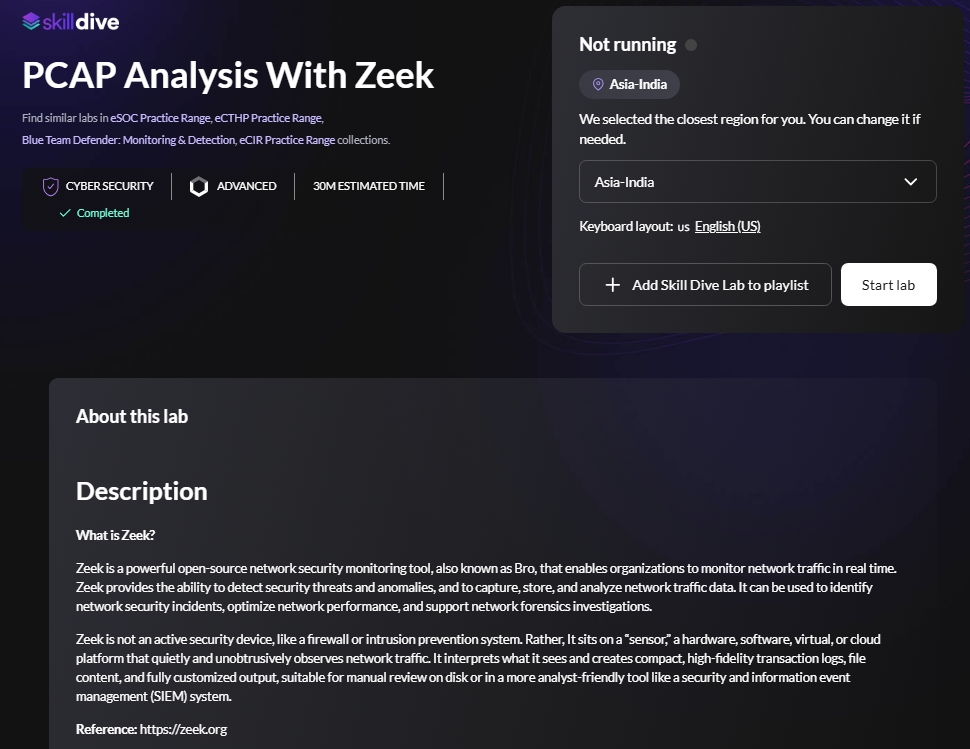
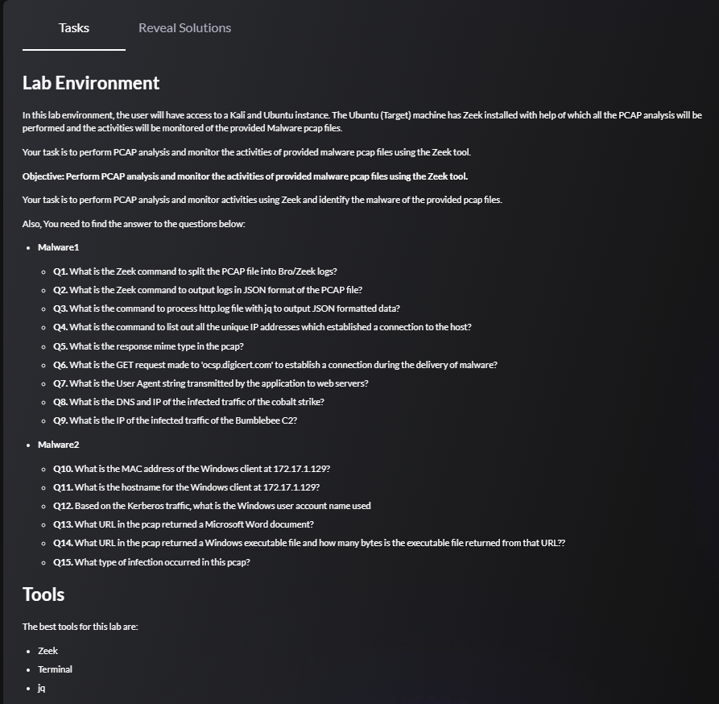
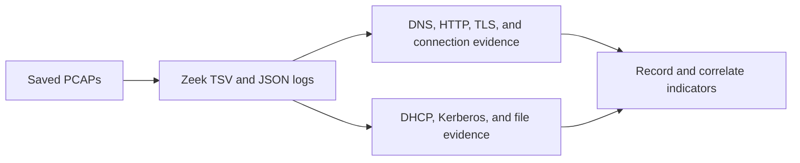

# PCAP Analysis With Zeek

## 1. Lab Overview

Turn two saved packet captures into Zeek logs and use those logs to investigate reported malware activity. Compare DNS, HTTP, TLS, DHCP, and Kerberos evidence to identify network indicators, a Windows client, and files transferred during the second case.



## 2. Lab Environment

- Kali and Ubuntu are available. Zeek runs on Ubuntu.
- The lab supplies Malware1/infected.pcap and Malware2/infected.pcap under ~/Desktop/Investigation along with an IOC directory.
- The notes report HTTPS on TCP 443 for the Cobalt Strike indicator. The original captures, IOC files, and generated logs were not supplied here.



## 3. Workflow Diagram



## 4. Tools Used

| Tool | Purpose |
| --- | --- |
| Zeek | Convert recorded network traffic to structured logs |
| zeek-cut and bro-cut | Select columns from Zeek text logs |
| jq | Read and format JSON logs |
| grep, awk, sort, and uniq | Filter, format, and deduplicate local records |

## 5. Task-by-Task Walkthrough

The [original pasted notes](lab-source.md) supply the commands and answers. The uploaded screenshots show the overview and tasks. Individual output screenshots are represented by placeholders in the notes.

### T1: Generate both log formats and read JSON (Q1-Q3)

**Goal.** Produce independent text and JSON logs from Malware1 and inspect the HTTP JSON.

**Steps**

1. Run the text conversion in the lab's logs directory.
2. Switch to its json subdirectory and run the JSON conversion.
3. Read the JSON HTTP log from that directory.

**Commands**

```bash
cd ~/Desktop/Investigation/tmp/logs
zeek -Cr ~/Desktop/Investigation/Malware1/infected.pcap
cd ~/Desktop/Investigation/tmp/logs/json
zeek -Cr ~/Desktop/Investigation/Malware1/infected.pcap LogAscii::use_json=T
jq . http.log
```

**Command explained.** cd selects where logs are written. Zeek's -C ignores checksums and -r reads a capture offline. LogAscii::use_json=T selects JSON output. jq's identity filter prints each parsed record in readable form.

**Expected result / Finding.** Q1 and Q2 are the two Zeek commands. For Q3, use jq . http.log from the JSON directory. Text and JSON logs have the same filenames, so keep their directories separate.

### T2: Inspect Malware1 destinations and HTTP (Q4-Q7)

**Goal.** Identify responder addresses, response MIME type, the OCSP request, and its User-Agent.

**Steps**

1. Return to the Malware1 text log directory before running these pipelines.
2. Compare the selected connection and HTTP fields with the JSON User-Agent output.

**Commands**

```bash
cat conn.log | zeek-cut id.resp_h | sort | uniq
cat http.log | zeek-cut resp_mime_types | sort | uniq
cat http.log | grep ocsp.digicert.com
jq . json/http.log | grep user_agent
```

**Command explained.** zeek-cut extracts named fields from Zeek text logs. sort and uniq deduplicate addresses or MIME values. grep finds matching HTTP lines or the JSON field name.

**Expected result / Finding.** Q4 lists unique **responders**, not proof that each connection was established. Q5 is application/ocsp-response. Q6 is the GET URI below. Q7 is Microsoft-CryptoAPI/10.0. OCSP activity itself is a certificate-status check.

```text
/MFEwTzBNMEswSTAJBgUrDgMCGgUABBSAUQYBMq2awn1Rh6Doh/sBYgFV7gQUA95QNVbRTLtm8KPiGxvDl7I90VUCEAJ0LqoXyo4hxxe7H/z9DKA=
```

### T3: Correlate Malware1 with the lab IOC list (Q8-Q9)

**Goal.** Match the reported Cobalt Strike and Bumblebee indicators to capture records.

**Steps**

1. Compare TLS server names with the DNS and connection logs.
2. Match the observed indicators against the supplied IOC material. Treat indicator strings as evidence and avoid visiting the named endpoints.

**Commands**

```bash
cat ssl.log | zeek-cut server_name | sort | uniq
cat dns.log | grep ceyuvigi.com
cat conn.log | grep 139.177.146.137
```

**Command explained.** The first pipeline lists unique observed TLS server names. The other commands find matching DNS and connection records in the saved logs.

**Expected result / Finding.** Q8 is ceyuvigi[.]com and 23.108.57.213 on TCP 443. Q9 is 139.177.146.137. The notes attribute these to Cobalt Strike and Bumblebee using the lab IOC list. A connection alone does not establish malware attribution.

### T4: Identify the Windows client in Malware2 (Q10-Q12)

**Goal.** Link 172.17.1.129 to its MAC, hostname, and user account.

**Steps**

1. Generate Malware2 text logs in the separate logs2 output directory.
2. Read the DHCP address and identity fields.
3. Compare Kerberos ticket records with the DHCP evidence and distinguish the user account from the computer account.

**Commands**

```bash
cd ~/Desktop/Investigation/tmp/logs2/
zeek -Cr ~/Desktop/Investigation/Malware2/infected.pcap
cat dhcp.log | zeek-cut mac client_addr
cat dhcp.log | zeek-cut client_addr host_name | sort | uniq
cat kerberos.log | zeek-cut id.orig_h client service | awk '$3~"krbtgt"' | grep -vi nalyvaiko-pc
```

The source also gives a separate JSON run.

```bash
cd ~/Desktop/Investigation/tmp/logs2/json
zeek -Cr ~/Desktop/Investigation/Malware2/infected.pcap LogAscii::use_json=T
```

**Command explained.** The DHCP queries extract address and host metadata. The Kerberos pipeline selects ticket-granting service records and excludes the named machine-account pattern.

**Expected result / Finding.** Q10 is 00:1e:67:4a:d7:5c. Q11 is Nalyvaiko-PC. Q12 is innochka.nalyvaiko.

### T5: Identify Malware2 transfers and reported infection (Q13-Q15)

**Goal.** Locate the Word document and executable in the recorded HTTP evidence.

**Steps**

1. Use the Malware2 text log directory. Find the document filename in files.log and match it to HTTP.
2. Filter the HTTP records for the executable MIME type and read the response body length.
3. Compare the document finding with the classification reported by the solution.

**Commands**

```bash
cat files.log | zeek-cut mime_type filename | grep msword
cat http.log | bro-cut ts id.orig_h id.resp_h method host uri resp_filenames | grep "2018_11Details_zur_Transaktion.doc"
cat http.log | zeek-cut -d ts method host uri resp_filenames resp_mime_types response_body_len | awk '$6=="application/x-dosexec"'
```

**Command explained.** The first command locates Word file records. The second checks the recorded HTTP fields for the filename. The final command selects executable responses and retains the body length. bro-cut is the older command name used in the supplied notes.

**Expected result / Finding.** Q13 is ifcingenieria[.]cl/QpX8It/BIZ/Firmenkunden/. Q14 is timlinger[.]com/nmw/6169583.exe with a reported response body length of 429,056 bytes. Q15 is phishing associated with Emotet, as reported by the solution. These are recorded indicators and the walkthrough does not contact the endpoints or retrieve the files.

## 6. Key Concepts (Beginner-Friendly)

- **PCAP and structured logs.** A capture stores packets. Zeek summarizes observed activity into fields you can search.
- **Originator and responder.** An originator starts an observed flow. The responder is the other endpoint.
- **MIME type.** A label describing the kind of content observed.
- **Correlation.** Compare names, addresses, timestamps, and files across logs before attributing activity.

## 7. SOC / Real-World Relevance

Analysts can narrow a packet investigation by protocol and field rather than reading each packet. Combining independent records helps scope an incident and distinguish recorded file transfer, possible execution, and threat-intelligence attribution.

## 8. Quick Command Cheat Sheet

| Tool or option | Purpose |
| --- | --- |
| zeek -Cr | Read a capture offline and write logs |
| LogAscii::use_json=T | Write JSON logs |
| jq . | Print parsed JSON records |
| zeek-cut FIELD | Extract a named field from a Zeek text log |
| sort followed by uniq | Deduplicate matching values |
| grep and awk | Select relevant log lines and fields |

## 9. Common Mistakes & Troubleshooting

| Symptom | What to check |
| --- | --- |
| jq rejects the log | Confirm you opened the JSON output directory. |
| zeek-cut rejects the log | Use Zeek's tab-delimited output with headers. |
| bro-cut is absent | Check whether your installation provides zeek-cut instead. |
| An address appears in conn.log | Check state and direction before treating it as a successful connection. |
| A file appears in files.log | Confirm whether the file was only observed, fully transferred, or separately extracted. |

## 10. Conclusion

- I processed both captures into Zeek logs and compared evidence across protocols.
- I identified the reported network indicators and the Windows client.
- I documented the reported HTTP transfers and the evidence limits on attribution.
