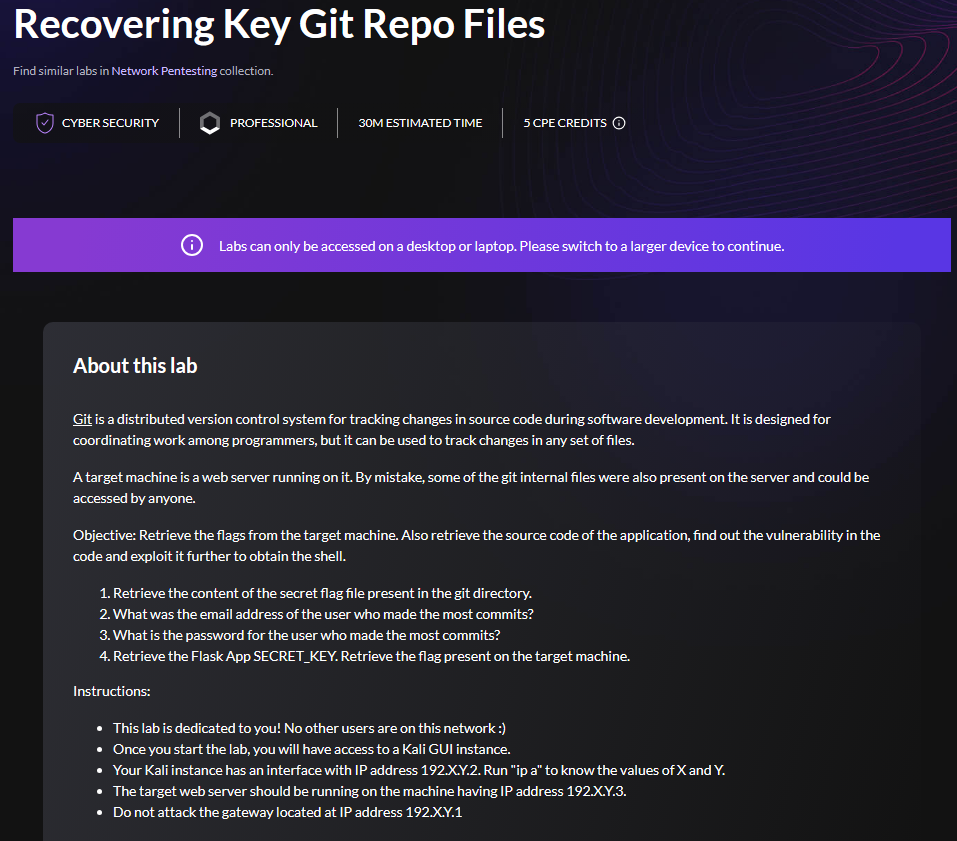
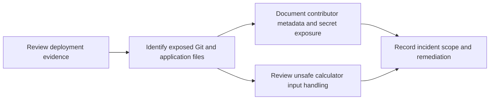
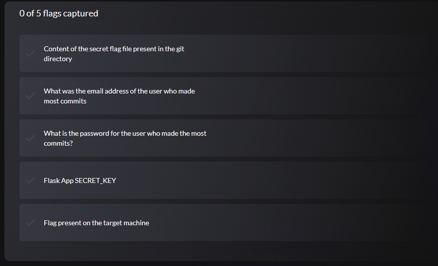

# Recovering Key Git Repo Files

## 1. Lab Overview

This lab examines a Flask calculator deployment that exposed Git internals and application files over HTTP. The manual reports that those files revealed contributor metadata and secrets. It also documents a separate input-handling flaw that allowed server-side code execution.



## 2. Lab Environment

| Component | Role |
| --- | --- |
| Kali GUI | Lab workstation. The overview assigns 192.X.Y.2. |
| Lab web server | The overview assigns 192.X.Y.3. The manual uses 192.130.237.3. |
| Calculator application | The manual shows it on TCP 5000. |
| Python HTTP service | The manual shows it on TCP 8000. |

## 3. Workflow Diagram



## 4. Tools Used

| Tool | Purpose |
| --- | --- |
| ip | Inspect workstation addresses |
| Git | Review authors and tracked files in an authorized local copy |
| Firefox | View the calculator in the lab |
| Python and Flask | Identify the application context for the reported findings |

## 5. Task-by-Task Walkthrough

The [PDF source notes](lab-source.md) summarize the manual. The screenshot lists five flags. No live host was accessed while preparing this walkthrough.



### T1: Review the exposed repository and flag file

**Goal.** Explain how an ignored file could still be exposed by the web service.

**Steps**

1. Identify the lab workstation interface. Review the service and deployment evidence reported in the manual.
2. Compare the application's served files with the files tracked by Git.

**Commands**

```bash
ip a
```

**Command explained.** Lists the local interfaces and addresses.

**Expected result / Finding.** The manual reports that the web service exposed .git and a separate ignored file named secret_flag. Git ignore rules affect tracking. They do not control files served over HTTP.

### T2: Identify the contributor with the most commits

**Goal.** Record the author shown in the reported Git metadata.

**Steps**

1. Compare recorded commit authors and email addresses. For an authorized local project copy, Git can summarize the author metadata.

**Local review example**

```bash
git shortlog -sne --all
```

**Command explained.** -s prints totals, -n sorts numerically, -e includes email addresses, and --all includes commits reachable from all refs. This example is an added local review command.

**Expected result / Finding.** The manual identifies Smith Jones (smith.jones@devl.evilcorp.com) as the only contributor in the reviewed evidence.

### T3: Document the exposed user credential

**Goal.** Record the credential exposure without copying the credential.

**Steps**

1. Record the affected account and source of exposure from the manual.
2. Note which credential would require rotation after containment.

**Expected result / Finding.** The manual reports credentials for jsmith in Git configuration. The password value is omitted.

### T4: Document the exposed Flask signing key

**Goal.** Explain the impact of an application secret becoming readable.

**Steps**

1. Review the manual's description of the Flask app and public file-serving route.
2. Record the exposed secret type and identify session integrity as an area to assess.

**Expected result / Finding.** The manual reports that the application source exposed Flask's SECRET_KEY. The key value is omitted.

### T5: Document the reported code execution impact

**Goal.** Explain why the calculator input handling is unsafe.

**Steps**

1. Review the manual's report that user input reached Python eval.
2. Record the impact and identify the defensive fix. Parse a restricted arithmetic grammar and allow only supported operations.

**Expected result / Finding.** The manual reports server-side command execution and a target flag. The payload, shell access procedure, and flag values are omitted.

## 6. Key Concepts (Beginner-Friendly)

- **Git metadata.** Internal records can expose authors, filenames, refs, and configuration.
- **Git ignore rules.** These guide which untracked files Git should ignore. Web access depends on deployment configuration.
- **Signing secret.** Flask uses its secret key to sign session data in its default session setup.
- **Unsafe evaluation.** Passing untrusted input to a language evaluator can let the input act as code.

## 7. SOC / Real-World Relevance

An investigator can use deployment evidence, HTTP logs, and process telemetry to scope an exposure. Restrict the public file surface, rotate exposed secrets, review session impact, and check process activity around suspicious calculator requests.

## 8. Quick Command Cheat Sheet

| Command | Purpose |
| --- | --- |
| ip a | Inspect local interfaces and IP addresses |
| git shortlog -sne --all | Count commits by author and email in an authorized local copy |

## 9. Common Mistakes & Troubleshooting

| Symptom | What to check |
| --- | --- |
| Git ignores a sensitive file but the file is still reachable | Check the deployment artifact and web server document root. |
| Author totals differ | Compare the refs selected by each source and how author identities are grouped. |
| A secret was removed from source | Check whether it was rotated and whether older copies remain. |
| The calculator accepts input outside arithmetic | Review the parser and verify it rejects unsupported syntax without executing it. |

## 10. Conclusion

- I documented Git metadata and secret exposure from a web deployment.
- I distinguished Git tracking from HTTP file access.
- I reviewed the cause and impact of unsafe expression evaluation.
