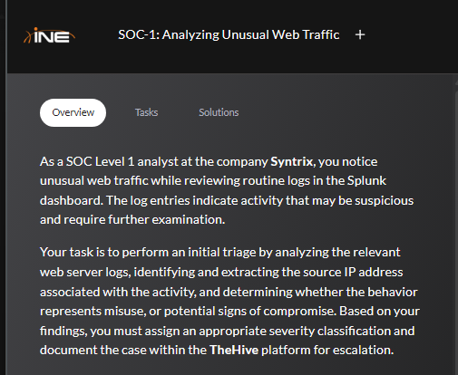
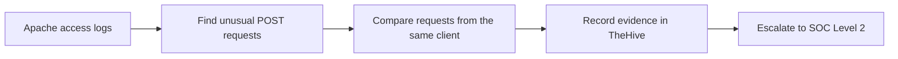

# SOC-1: Analyzing Unusual Web Traffic

## 1. Lab Overview

Investigate unusual Apache traffic at Syntrix. Use Splunk to identify the source and build a timeline. Record the suspected compromise in TheHive for SOC Level 2 review.



## 2. Lab Environment

| Component | Role |
| --- | --- |
| Ubuntu machine 1 | Splunk Search & Reporting at `http://localhost:8000` |
| Ubuntu machine 2 | TheHive at `http://localhost:9000` |
| Splunk index | `syntrix`, with lab events from November 2025 |
| Apache web server | `172.31.10.177`, as recorded in the lab notes |

## 3. Workflow Diagram



## 4. Tools Used

- **Splunk and SPL** to search Apache logs and compare events.
- **TheHive** to record findings, observables, and follow-up tasks.
- **Firefox** to access the two lab dashboards.

## 5. Task-by-Task Walkthrough

The findings below come from the [redacted lab notes](lab-source.md).

### T1. Locate the Apache logs

In Splunk, open **Search & Reporting**. Start with **All time** to locate the historical data, then focus on November 2025. Run the base search and inspect the `source` field.

```spl
index=syntrix
```

The notes identify `/var/log/apache2/access.log` and `/var/log/apache2/error.log`. The access log provides the request timeline used in this lab.

### T2. Trace the suspicious request sequence

```spl
index=syntrix source="/var/log/apache2/access.log" "POST"
```

The notes record a POST from `13.203.202.168` to `/codebase/handler.php` on November 26, 2025, at 06:28:34. The referrer contained `dir.php?type=filenew` and the server returned HTTP 200.

```spl
index=syntrix source="/var/log/apache2/access.log"
```

Review nearby events. The same client then requested `/img/bingo.php` with a `cmd` query parameter. The recorded response was HTTP 200 and 212 bytes. A PHP file in an image directory and repeated command-like parameters are consistent with suspected web shell activity.

```spl
index=syntrix source="/var/log/apache2/access.log" "cmd"
```

Compare client IP, timestamp, path, status, and response size across the results. Use the request sequence to support the hypothesis of upload abuse and possible command execution. Confirm file creation and execution with host or application evidence.

### T3. Document and escalate in TheHive

Create an empty case titled **Suspicious Web Activity Suggesting Web Shell Upload and Execution**. Set severity to **High**, with **TLP:AMBER** and **PAP:AMBER** as specified in the lab. Add the following observables and record the sighting time from Splunk.

| Observable | Value | Role |
| --- | --- | --- |
| Source IP | `13.203.202.168` | Suspected source |
| Destination IP | `172.31.10.177` | Affected asset |
| Filename | `bingo.php` | Suspected web shell |
| URI path | `/codebase/handler.php` | Possible upload endpoint |
| URI path | `/img/bingo.php` | Suspicious script location |
| Request pattern | `cmd` query parameter | Possible command execution |

Assign SOC Level 2 tasks to validate host impact, assess the external source using passive checks, and review the application's upload handling. Set the case owner to the SOC Level 2 analyst.

## 6. Key Concepts

- A referrer provides context for a request. A file-creation hint helps guide follow-up.
- HTTP 200 records a successful HTTP response. Verify application behavior using host or application evidence.
- The lab maps the suspected activity to ATT&CK T1190 (Exploit Public-Facing Application), T1505.003 (Web Shell), T1071.001 (Web Protocols), and T1059.004 (Unix Shell). Treat each as a hypothesis and record the supporting evidence.

## 7. SOC / Real-World Relevance

A useful handoff links the source, affected asset, and request sequence to the next evidence checks. Host file metadata, web server errors, and process telemetry can help validate whether the file was written and whether the web server launched a shell.

## 8. Quick Command Cheat Sheet

```spl
index=syntrix
index=syntrix source="/var/log/apache2/access.log"
index=syntrix source="/var/log/apache2/access.log" "POST"
index=syntrix source="/var/log/apache2/access.log" "cmd"
```

Run each line as a separate search.

## 9. Common Mistakes & Troubleshooting

- **No results.** Check the time picker and the `syntrix` index. The events are from November 2025.
- **Too many keyword matches.** Compare the method, URI, client IP, and time in the raw records.
- **Timestamp mismatch.** Check the time zone displayed in Splunk before recording the sighting in TheHive.

## 10. Conclusion

I used Apache access logs to trace suspicious web requests in Splunk.
I learned how to distinguish observed requests from suspected host impact.
I documented the evidence and validation tasks for the SOC Level 2 handoff.
