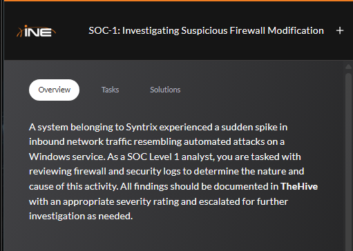
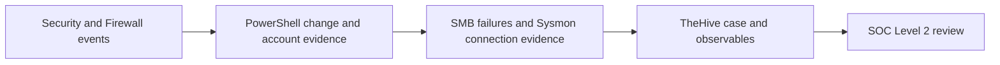

# SOC-1: Investigating Suspicious Firewall Modification

## 1. Lab Overview

Investigate a spike in failed SMB authentications after changes to Windows Firewall rules. Use Splunk to correlate Security, Firewall, PowerShell, SMB, and Sysmon records. Capture the findings in TheHive and hand the case to SOC Level 2.



## 2. Lab Environment

| Component | Role |
| --- | --- |
| Ubuntu machine 1 | Splunk Search & Reporting at http://localhost:8000 |
| Ubuntu machine 2 | TheHive at http://localhost:9000 |
| PC02 | Windows endpoint identified as 10.0.0.101 |
| syntrix | Splunk index containing historical December 2025 events |

## 3. Workflow Diagram



## 4. Tools Used

| Tool | Purpose |
| --- | --- |
| Splunk and SPL | Find and correlate Windows activity |
| Windows Firewall and Security logs | Show rule changes |
| PowerShell, SMB Server, and Sysmon logs | Identify process, account, authentication, and connection context |
| TheHive | Track the case, observables, and follow-up tasks |

## 5. Task-by-Task Walkthrough

Findings come from the [redacted source notes](lab-source.md). The environment screenshot was excluded because it shows login credentials. Individual event images and raw records were not supplied.


### T1: Find the firewall rule changes

**Goal.** Identify which host and inbound rules changed.

**Steps**

1. Open Search & Reporting, start with All time, and focus on December 2025. Run the index search and then the Security event filter.

**Commands**

```spl
index=syntrix
index=syntrix source="WinEventLog:Security" EventCode=4947
```

**Command explained.** Event 4947 is the Windows Security firewall rule modification record.

**Expected result / Finding.** The notes report three closely spaced events on PC02, involving built-in inbound SMB rules.

### T2: Identify the change and associated account

**Goal.** Correlate firewall events with PowerShell telemetry.

**Steps**

1. Review Event 2005 for the changed rules, direction, action, account SID, and process. Compare with PowerShell 4104. Use the SID search in 4103 records to resolve the account.

**Commands**

```spl
index=syntrix source="WinEventLog:Microsoft-Windows-Windows Firewall With Advanced Security/Firewall" EventCode=2005
index=syntrix source="WinEventLog:Microsoft-Windows-PowerShell/Operational" EventCode=4104
index=syntrix "S-1-5-21-3250466395-192540623-711299986-1010" EventCode=4103
```

**Command explained.** Event 2005 gives firewall detail. PowerShell 4104 supplies script block evidence, and the 4103 search pivots on the same SID.

**Expected result / Finding.** The notes associate brandon and WmiPrvSE.exe with the change. PowerShell records indicate that File and Printer Sharing (SMB-In) and File Server Remote Management (SMB-In) were set to allow inbound TCP from any remote address. That setting widens host-level access. Internet reachability depends on upstream controls.

### T3: Correlate the SMB failures and affected host

**Goal.** Determine what followed the rule change.

**Steps**

1. Review SMB Server Security 551 records around and after the change. Compare destination, time, and source distribution. Use Sysmon Event 3 to confirm PC02's address.

**Commands**

```spl
index=syntrix source="WinEventLog:Microsoft-Windows-SMBServer/Security"  EventCode=551
index=syntrix source="WinEventLog:Microsoft-Windows-Sysmon/Operational" EventCode=3
```

**Command explained.** Event 551 supplies SMB authentication failure evidence. Sysmon Event 3 records network activity when enabled.

**Expected result / Finding.** The solution identifies PC02 as 10.0.0.101 and reports a burst of failures from external addresses after the change. The failures alone do not demonstrate successful logon or compromise.

### T4: Document the incident and hand it to SOC Level 2

**Goal.** Preserve the findings and assign impact and authorization checks.

**Steps**

1. Create an empty high-severity case in TheHive with the title Suspicious Modification of Windows Firewall Rules Leading to SMB Brute-Force Activity. Apply the lab's TLP:AMBER and PAP:AMBER labels and tags windows-firewall, smb, brute-force, and powershell. Add the listed observables and technique mappings, then assign the two review tasks and case ownership to SOC Level 2.

**Commands.** Use the case, observable, technique, and task controls in TheHive.

**Command explained.** TheHive records the case data and ownership. The walkthrough uses UI controls for this task.

**Expected result / Finding.** The notes report the handoff. They do not show SOC Level 2 completing the investigation.

### Case evidence and handoff

The solution records these times on 1 December 2025, with no time zone supplied. It marks each observable as sighted and leaves the IOC flag off.

| Observable | Type | Sighting |
| --- | --- | --- |
| 10.0.0.101 | ip | 04:35:35 |
| Set-NetFirewallRule | other | 04:35:35 |
| brandon | other | 04:35:35 |
| The two affected SMB inbound rules | other | 04:35:35 |
| SMB Server Security Event 551 | other | 04:40:35 |

The solution maps the change to **T1562.004** (Disable or Modify System Firewall) and **T1059.001** (PowerShell), using 04:35:35 as the occurrence time.

The SOC Level 2 tasks are **Context on Affected Host and Associated User Account** and **Context on Potential Impact from Observed SMB Brute-force Attempts**. Verify change authorization and assess whether the failures were followed by successful access or service disruption.

## 6. Key Concepts (Beginner-Friendly)

- **Firewall scope.** The source address range a rule permits.
- **Upstream reachability.** Other network controls determine whether traffic can reach a host even if its firewall permits it.
- **SID.** A Windows security identifier that helps associate activity with an account.
- **Correlation.** Compare host, rule, account, source, and time to link events.

## 7. SOC / Real-World Relevance

A firewall change followed by authentication failures is worth investigating even before compromise is confirmed. Check the change approval and network path, then review successful logons and host activity to assess impact.

## 8. Quick Command Cheat Sheet

| Search | Purpose |
| --- | --- |
| index=syntrix | Open the lab dataset |
| Security EventCode=4947 | Find rule modifications |
| Firewall EventCode=2005 | Review rule and process details |
| PowerShell EventCode=4104 | Find script block evidence |
| SID with EventCode=4103 | Correlate the account with PowerShell activity |
| SMB Server Security EventCode=551 | Find failed SMB authentication records |
| Sysmon EventCode=3 | Review the connection and destination address |

## 9. Common Mistakes & Troubleshooting

| Symptom | What to check |
| --- | --- |
| The expected results are absent | Verify the December 2025 time range and exact source field. |
| Allow Any appears to prove public access | Check routing, upstream filtering, and available traffic records. |
| The authentication burst appears conclusive | Search for successful logon and other impact evidence separately. |
| Account attribution is uncertain | Match the SID and timestamps across the relevant sources. |

## 10. Conclusion

- I correlated the inbound SMB firewall changes with PowerShell and account evidence.
- I linked the subsequent failed authentication burst to PC02.
- I documented the case and assigned authorization and impact checks to SOC Level 2.
