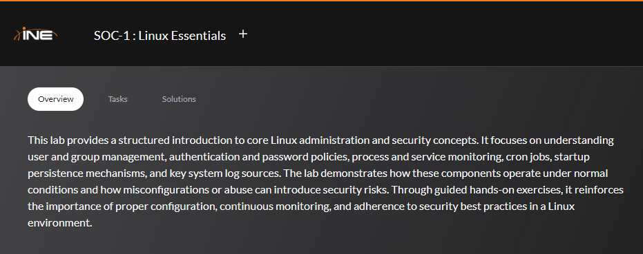
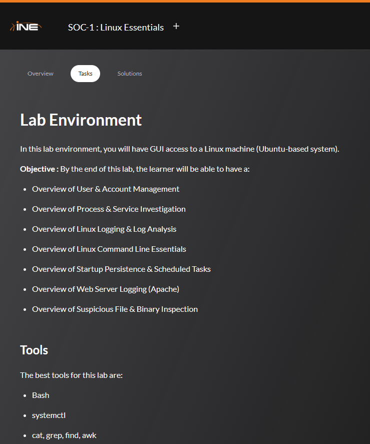
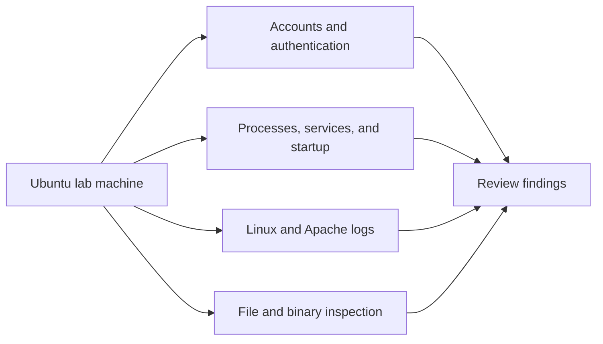

# SOC-1: Linux Essentials

## 1. Lab Overview

This lab introduces Linux administration and security monitoring on Ubuntu. It covers accounts, authentication, processes, services, startup behavior, and logs. It also introduces shell tools, Apache logging, and suspicious file inspection.

## 2. Lab Environment

- One Ubuntu-based Linux machine with GUI access.
- Tools listed by INE include Bash, `systemctl`, `cat`, `grep`, `find`, and `awk).
- The provided screenshots specify no host addresses or ports.

## 3. Workflow Diagram

## 4. Tools Used

| Tool | Purpose |
| --- | --- |
| Bash | Run Linux shell commands |
| `systemctl` | Inspect systemd services |
| `cat` | Read file contents |
| `grep` | Match lines of text |
| `find` | Locate files by criteria |
| `awk` | Select and summarize fields in text |
| Cron | Run jobs on a schedule |
| Apache | Serve web requests and record web activity |

## 5. Task-by-Task Walkthrough

These seven review outlines follow the objectives in the INE screenshot. The Linux task instructions, exact commands, task screenshots, and observed results are pending.

### T1: User & Account Management

**Goal.** Understand Linux accounts, groups, authentication, and password policy.

**Steps**

1. Review the lab's account and group material, then identify where authentication and password policy fit.

**Commands.** Pending the Linux task notes.

**Command explained.** Pending the exact command and its options.

**Expected result / Finding.** Distinguish a user account from a group and explain how group membership affects access. No task output was supplied.

### T2: Process & Service Investigation

**Goal.** Tell a running process from a managed service.

**Steps**

1. Review the lab's process and service material. Compare the current service state with its startup behavior.

**Commands.** Pending the Linux task notes.

**Command explained.** Pending the exact command and its options.

**Expected result / Finding.** Explain which evidence shows that something is running and which evidence shows how it starts. No task output was supplied.

### T3: Linux Logging & Log Analysis

**Goal.** Identify which Linux logs can answer an investigation question.

**Steps**

1. Review the logging material. Identify the source, time, and relevant fields in any log entries provided by the lab.

**Commands.** Pending the Linux task notes.

**Command explained.** Pending the exact command and its options.

**Expected result / Finding.** Describe what an event records and what context is needed to interpret it. No task output was supplied.

### T4: Linux Command Line Essentials

**Goal.** Use the shell to read, search, and summarize information.

**Steps**

1. Review the command-line examples when available. Identify the input and output of each tool.

**Commands.** Pending the Linux task notes.

**Command explained.** Pending the exact command and its options.

**Expected result / Finding.** Explain how shell tools can help narrow a large set of files or log entries. No task output was supplied.

### T5: Startup Persistence & Scheduled Tasks

**Goal.** Recognize jobs that run on a schedule or at startup.

**Steps**

1. Review the cron and startup material. For each example, identify the trigger and the action that runs.

**Commands.** Pending the Linux task notes.

**Command explained.** Pending the exact command and its options.

**Expected result / Finding.** Distinguish a recurring job from a startup action and record the evidence for each. No task output was supplied.

### T6: Web Server Logging (Apache)

**Goal.** Understand how Apache records web activity.

**Steps**

1. Review the Apache logging material. When a sample is available, identify the client, request path, time, and status.

**Commands.** Pending the Linux task notes.

**Command explained.** Pending the exact command and its options.

**Expected result / Finding.** Explain what a web access entry says about a request and the server's response. No task output was supplied.

### T7: Suspicious File & Binary Inspection

**Goal.** Record evidence about an unfamiliar file.

**Steps**

1. Review the lab's file inspection material. Note any paths, file details, and observations the exercise asks you to collect.

**Commands.** Pending the Linux task notes.

**Command explained.** Pending the exact command and its options.

**Expected result / Finding.** Summarize the available file evidence and identify what still needs checking. No task output was supplied.

## 6. Key Concepts (Beginner-Friendly)

- **Users and groups.** A user is an account. A group lets multiple accounts share access.
- **Authentication and password policy.** Authentication checks who is signing in. Password policy sets rules for passwords.
- **Processes and services.** A process is a running program. A service is a program managed by the system, often in the background.
- **Cron and startup.** Cron runs jobs on a schedule. Startup settings control what runs when a system boots or a user signs in.
- **Logs.** A log records events you can review later. Apache access logs can show which web paths clients requested.

## 7. SOC / Real-World Relevance

SOC analysts review accounts and groups for unexpected access, investigate unfamiliar services or scheduled jobs, and use logs to build a timeline. File inspection adds context when a process or job points to an unfamiliar file.

## 8. Quick Command Cheat Sheet

The screenshots name tools. Exact command lines and flags are pending the Linux task notes.

| Command | What it does |
| --- | --- |
| `systemctl` | Inspect systemd units and services |
| `cat` | Display file contents |
| `grep` | Find matching text |
| `find` | Locate files by criteria |
| `awk` | Extract and summarize text fields |

## 9. Common Mistakes & Troubleshooting

| Question | What to check |
| --- | --- |
| Why is a listed service missing from the running processes? | Check its current state separately from whether it is configured to start automatically. |
| Why is a scheduled action missing from the investigation timeline? | Check the schedule, the account it runs under, and the time window in the logs. |
| Why is the needed event missing from the log? | Check the log source, time range, and whether logging was enabled for that event. |

## 10. Conclusion

- The lab covers how Linux accounts, services, and scheduled jobs behave.
- System and Apache logs provide different kinds of investigation evidence.
- The Linux task notes are needed to document the commands and confirm lab findings.
