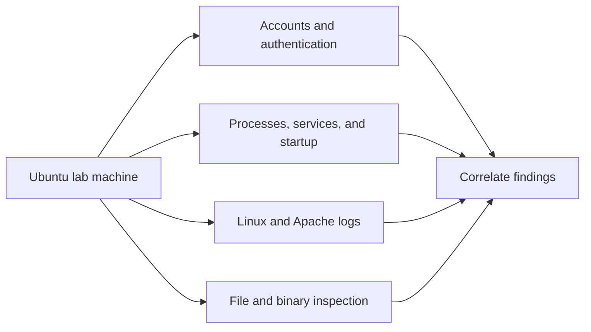

# SOC-1: Linux Essentials

## 1. Lab Overview

This lab introduces Linux administration and security monitoring on Ubuntu. You review accounts, processes, services, scheduled jobs, and host logs. By the end, you can use these sources to investigate authentication failures, unexpected startup activity, and unfamiliar files.


## 2. Lab Environment

- One Ubuntu-based Linux machine with GUI access.
- The lab uses Bash, systemd, cron, SSH, and Apache.
- The source specifies no host addresses or port numbers.


## 3. Workflow Diagram



## 4. Tools Used

| Tool | Purpose |
| --- | --- |
| Bash | Run commands and connect their output with pipes |
| `cat`, `grep`, `tail`, `head` | Read, filter, and limit text output |
| `ps`, `readlink` | Inspect processes and executable paths |
| `systemctl`, `journalctl` | Inspect service state and journal events |
| `crontab` | Review scheduled jobs |
| Apache and OpenSSH | Provide web and remote login evidence |
| `ls`, `find` | Inspect file metadata and search for indicators |
| `awk` | Extract fields from text, as listed in the INE screenshot |

## 5. Task-by-Task Walkthrough

The headings follow the seven objectives in the INE screenshot. Findings are from the [pasted lab notes](lab-source.md). The supplied images show the overview and environment. The task images marked “Content Image” in the notes were absent from the upload.

Replace angle-bracket placeholders with the relevant lab user, process, or service name before running a command. Set the Bash variable `PID` to the process ID you selected. Run the examples on the lab machine.

### T1: User & Account Management

**Goal.** Identify accounts, group membership, and authentication settings.

**Steps**

1. Review account and group entries. Compare password defaults with the PAM password configuration.

**Commands**

```bash
cat /etc/passwd
cat /etc/group
cat /etc/login.defs
cat /etc/pam.d/common-password
```

**Command explained**

- `cat /etc/passwd` – Show accounts, numeric user and group IDs, home directories, and login shells.
- `cat /etc/group` – Show groups and listed members. Primary membership is also recorded in the account entry.
- `cat /etc/login.defs` – Read login defaults and password aging settings. Their effect depends on the software using them.
- `cat /etc/pam.d/common-password` – Read the PAM password stack. The source shows `pam_unix.so` with `obscure` and `sha512`.

**Expected result / Finding.** The notes report that the `news` password was locked and that `pam_pwquality.so` did not appear in the shown stack. A password lock alone leaves other authentication methods to be checked. The notes spell `sha512` correctly in the configuration line and use `sha12` once in the explanation.

### T2: Process & Service Investigation

**Goal.** Identify running processes and what launches them.

**Steps**

1. List processes, select a PID for inspection, then compare the process with the state of related services.

**Commands**

```bash
ps aux
ps -p $PID -o pid,ppid,user,cmd
readlink -f /proc/$PID/exe
ps aux | grep -i <process_name>
systemctl list-units --type=service --state=running
systemctl status <service_name>
```

**Command explained**

- `ps aux` – List processes across users with their CPU and memory use.
- `ps -p $PID -o pid,ppid,user,cmd` – Select the PID stored in the Bash variable and display its parent, owner, and command.
- `readlink -f /proc/$PID/exe` – Resolve the executable path for the chosen process.
- `ps aux | grep -i <process_name>` – Search process listings case-insensitively.
- `systemctl list-units --type=service --state=running` – List service units currently running.
- `systemctl status <service_name>` – Show service state and recent information for one unit.

**Expected result / Finding.** The notes use FeatherPad as the example process. Its PID varies by session.

### T3: Linux Logging & Log Analysis

**Goal.** Find authentication failures and service events.

**Steps**

1. Review recent authentication events, filter for relevant entries, and compare with general system and kernel logs.

**Commands**

```bash
sudo tail -n 100 /var/log/auth.log
sudo grep -i "Failed" /var/log/auth.log | tail -n 50
sudo grep -i "Failed .* John" /var/log/auth.log | tail -n 50
sudo grep -i "sudo" /var/log/auth.log | tail -n 50
sudo journalctl -u ssh
cat /var/log/syslog
cat /var/log/kern.log
```

**Command explained**

- `sudo tail -n 100 /var/log/auth.log` – Show the most recent 100 lines with elevated read access.
- `sudo grep -i "Failed" /var/log/auth.log | tail -n 50` – Show the most recent 50 lines matching `Failed`, ignoring case.
- `sudo grep -i "Failed .* John" /var/log/auth.log | tail -n 50` – Narrow the text search to lines matching the lab’s John pattern.
- `sudo grep -i "sudo" /var/log/auth.log | tail -n 50` – Find recent entries containing `sudo`.
- `sudo journalctl -u ssh` – Read journal entries scoped to the SSH unit.
- `cat /var/log/syslog` – Read general system messages where this file is configured.
- `cat /var/log/kern.log` – Read kernel messages where this file is configured.

**Expected result / Finding.** The notes describe John’s denied sudo request and failed account-switch authentication involving John and Alice. A text match can include an audit entry recording the search itself.

### T4: Linux Command Line Essentials

**Goal.** Understand how shell commands combine to narrow output.

**Steps**

1. Use the sourced pipeline below as a worked example. Compare each side of the pipe to understand how the output is reduced.

**Commands**

```bash
sudo grep -i "Failed" /var/log/auth.log | tail -n 50
```

**Command explained**

- `sudo grep -i "Failed" /var/log/auth.log | tail -n 50` – `grep -i` selects matching lines. The pipe sends those lines to `tail -n 50`, which keeps the final 50.

**Expected result / Finding.** The screenshot lists `awk` as a tool. The notes supply no `awk` command or separate exercise output for this objective.

### T5: Startup Persistence & Scheduled Tasks

**Goal.** Review what can run at boot, login, or on a schedule.

**Steps**

1. Inspect system and user services, cron, and login files. Review SSH access settings and check which keys are authorized for the lab account.

**Commands**

```bash
systemctl list-unit-files --type=service | grep enabled
systemctl --user list-unit-files
cd /etc/cron.d/
crontab -l
sudo crontab -l
ls -la /home/<user>/.bashrc /home/<user>/.bash_history /home/<user>/.profile
cat /home/<user>/.bashrc
ls -la /home/<user>/
find /home/<user> -type f -name ".*"
cat /etc/profile
ls -la /etc/profile.d/
sudo cat /home/<user>/.ssh/authorized_keys 2>/dev/null
sudo cat /etc/ssh/sshd_config
```

**Command explained**

- `systemctl list-unit-files --type=service | grep enabled` – Search installed system service files for enablement text. Inspect the state column for exact status.
- `systemctl --user list-unit-files` – List unit files for the current user’s systemd manager.
- `cd /etc/cron.d/` – Enter the directory containing system cron definitions.
- `crontab -l` – List the current account’s cron jobs.
- `sudo crontab -l` – List root’s cron jobs when sudo is permitted.
- `ls -la /home/<user>/.bashrc /home/<user>/.bash_history /home/<user>/.profile` – Inspect metadata for shell configuration and history files.
- `cat /home/<user>/.bashrc` – Read the user’s Bash startup configuration.
- `ls -la /home/<user>/` – List home-directory entries and metadata, including dotfiles.
- `find /home/<user> -type f -name ".*"` – Find regular files whose names begin with a dot.
- `cat /etc/profile` – Read the system-wide login shell configuration.
- `ls -la /etc/profile.d/` – List files that may be sourced by system login configuration.
- `sudo cat /home/<user>/.ssh/authorized_keys 2>/dev/null` – Read the authorized public-key entries for the selected user and suppress errors.
- `sudo cat /etc/ssh/sshd_config` – Read the main SSH server configuration file. Included files and conditional settings can affect the effective configuration.

**Expected result / Finding.** The notes report a demonstration root cron job, ordinary hidden files in the inspected home directory, an authorized SSH key for John, and enabled SSH password authentication. The exact `PermitRootLogin` value is absent. An enabled service can still depend on conditions before it starts.

### T6: Web Server Logging (Apache)

**Goal.** Separate client requests from server errors.

**Steps**

1. Identify current, rotated, and demonstration logs. Compare request paths and response codes with the error log.

**Commands**

```bash
ls -la /var/log/apache2/
sudo tail -n 50 /var/log/apache2/access.log.bak
sudo tail -n 20 /var/log/apache2/error.log
sudo grep " 404 " /var/log/apache2/access.log | tail -n 20
```

**Command explained**

- `ls -la /var/log/apache2/` – List Apache logs and metadata.
- `sudo tail -n 50 /var/log/apache2/access.log.bak` – Read the last 50 entries in the lab’s demonstration backup.
- `sudo tail -n 20 /var/log/apache2/error.log` – Read the last 20 server error log entries.
- `sudo grep " 404 " /var/log/apache2/access.log | tail -n 20` – Find recent lines containing the space-delimited 404 status in the active log.

**Expected result / Finding.** The backup shows 404 responses for `/admin`, `/secret`, and `/test.php`. It also contains simulated injection and traversal indicators. A 200 response on its own gives no proof of command execution. The error log reportedly includes startup messages and a permission denial.

### T7: Suspicious File & Binary Inspection

**Goal.** Identify files worth reviewing based on ownership, permissions, or modification time.

**Steps**

1. Check temporary paths, system binary locations, and configuration directories. Compare results with expected ownership, permissions, and maintenance activity.

**Commands**

```bash
sudo find / -xdev -nouser -o -nogroup 2>/dev/null | head -n 50
sudo find /tmp /var/tmp /dev/shm -type f -perm /111 -ls 2>/dev/null
sudo find /bin /sbin /usr/bin /usr/sbin /usr/local/bin -type f -mtime -15 -ls 2>/dev/null | head -n 50
sudo find / -xdev -perm -4000 -type f -ls 2>/dev/null | head -n 100
sudo find /etc /var /tmp /dev/shm -type f -mtime -3 -ls 2>/dev/null | head -n 100
```

**Command explained**

- `sudo find / -xdev -nouser -o -nogroup 2>/dev/null | head -n 50` – Search for missing owner or group mappings and cap displayed lines. The source expression is ungrouped; its OR branches apply separately.
- `sudo find /tmp /var/tmp /dev/shm -type f -perm /111 -ls 2>/dev/null` – List regular files with any execute bit set in common writable locations.
- `sudo find /bin /sbin /usr/bin /usr/sbin /usr/local/bin -type f -mtime -15 -ls 2>/dev/null | head -n 50` – List up to 50 regularly formatted result lines for regular files modified in the last 15 days.
- `sudo find / -xdev -perm -4000 -type f -ls 2>/dev/null | head -n 100` – Stay on the starting filesystem and list up to 100 SUID regular-file result lines.
- `sudo find /etc /var /tmp /dev/shm -type f -mtime -3 -ls 2>/dev/null | head -n 100` – List up to 100 result lines for regular files modified within the last three days.

**Expected result / Finding.** The notes mention a temporary demonstration executable. Temporary-file retention varies by directory and host configuration. SUID or recent modification flags a file for review, with package updates and configured permissions providing context.

## 6. Key Concepts (Beginner-Friendly)

- **UID and GID.** Linux uses numeric IDs to associate accounts and groups with files and processes.
- **PAM.** Pluggable Authentication Modules apply rules for activities such as logging in and changing passwords.
- **Process and service.** A process is a running program. A service is a task managed by a system such as systemd, and it can have several processes.
- **Cron and startup.** Cron schedules commands at specified times. Shell startup files and systemd services can run actions at login or boot.
- **SUID.** For a supported executable, this permission can make it run with the file owner’s effective user ID. Review unexpected SUID files against a trusted baseline.

## 7. SOC / Real-World Relevance

A SOC analyst can connect an authentication event to the user, process, service, or scheduled job that followed it. Apache logs can reveal unusual browsing patterns, and file metadata can help locate related changes. Comparing those sources by time and account gives each finding context.

## 8. Quick Command Cheat Sheet

| Command | What it does |
| --- | --- |
| `cat /etc/passwd` | Show accounts, numeric user and group IDs, home directories, and login shells. |
| `cat /etc/group` | Show groups and listed members. Primary membership is also recorded in the account entry. |
| `cat /etc/login.defs` | Read login defaults and password aging settings. Their effect depends on the software using them. |
| `cat /etc/pam.d/common-password` | Read the PAM password stack. The source shows `pam_unix.so` with `obscure` and `sha512`. |
| `ps aux` | List processes across users with their CPU and memory use. |
| `ps -p $PID -o pid,ppid,user,cmd` | Select the PID stored in the Bash variable and display its parent, owner, and command. |
| `readlink -f /proc/$PID/exe` | Resolve the executable path for the chosen process. |
| `ps aux \| grep -i <process_name>` | Search process listings case-insensitively. |
| `systemctl list-units --type=service --state=running` | List service units currently running. |
| `systemctl status <service_name>` | Show service state and recent information for one unit. |
| `sudo tail -n 100 /var/log/auth.log` | Show the most recent 100 lines with elevated read access. |
| `sudo grep -i "Failed" /var/log/auth.log \| tail -n 50` | `grep -i` selects matching lines. The pipe sends those lines to `tail -n 50`, which keeps the final 50. |
| `sudo grep -i "Failed .* John" /var/log/auth.log \| tail -n 50` | Narrow the text search to lines matching the lab’s John pattern. |
| `sudo grep -i "sudo" /var/log/auth.log \| tail -n 50` | Find recent entries containing `sudo`. |
| `sudo journalctl -u ssh` | Read journal entries scoped to the SSH unit. |
| `cat /var/log/syslog` | Read general system messages where this file is configured. |
| `cat /var/log/kern.log` | Read kernel messages where this file is configured. |
| `systemctl list-unit-files --type=service \| grep enabled` | Search installed system service files for enablement text. Inspect the state column for exact status. |
| `systemctl --user list-unit-files` | List unit files for the current user’s systemd manager. |
| `cd /etc/cron.d/` | Enter the directory containing system cron definitions. |
| `crontab -l` | List the current account’s cron jobs. |
| `sudo crontab -l` | List root’s cron jobs when sudo is permitted. |
| `ls -la /home/<user>/.bashrc /home/<user>/.bash_history /home/<user>/.profile` | Inspect metadata for shell configuration and history files. |
| `cat /home/<user>/.bashrc` | Read the user’s Bash startup configuration. |
| `ls -la /home/<user>/` | List home-directory entries and metadata, including dotfiles. |
| `find /home/<user> -type f -name ".*"` | Find regular files whose names begin with a dot. |
| `cat /etc/profile` | Read the system-wide login shell configuration. |
| `ls -la /etc/profile.d/` | List files that may be sourced by system login configuration. |
| `sudo cat /home/<user>/.ssh/authorized_keys 2>/dev/null` | Read the authorized public-key entries for the selected user and suppress errors. |
| `sudo cat /etc/ssh/sshd_config` | Read the main SSH server configuration file. Included files and conditional settings can affect the effective configuration. |
| `ls -la /var/log/apache2/` | List Apache logs and metadata. |
| `sudo tail -n 50 /var/log/apache2/access.log.bak` | Read the last 50 entries in the lab’s demonstration backup. |
| `sudo tail -n 20 /var/log/apache2/error.log` | Read the last 20 server error log entries. |
| `sudo grep " 404 " /var/log/apache2/access.log \| tail -n 20` | Find recent lines containing the space-delimited 404 status in the active log. |
| `sudo find / -xdev -nouser -o -nogroup 2>/dev/null \| head -n 50` | Search for missing owner or group mappings and cap displayed lines. The source expression is ungrouped; its OR branches apply separately. |
| `sudo find /tmp /var/tmp /dev/shm -type f -perm /111 -ls 2>/dev/null` | List regular files with any execute bit set in common writable locations. |
| `sudo find /bin /sbin /usr/bin /usr/sbin /usr/local/bin -type f -mtime -15 -ls 2>/dev/null \| head -n 50` | List up to 50 regularly formatted result lines for regular files modified in the last 15 days. |
| `sudo find / -xdev -perm -4000 -type f -ls 2>/dev/null \| head -n 100` | Stay on the starting filesystem and list up to 100 SUID regular-file result lines. |
| `sudo find /etc /var /tmp /dev/shm -type f -mtime -3 -ls 2>/dev/null \| head -n 100` | List up to 100 result lines for regular files modified within the last three days. |

## 9. Common Mistakes & Troubleshooting

| Symptom | What to check |
| --- | --- |
| A command with angle brackets fails | Substitute the lab value for the entire placeholder before running it. |
| An authentication log file is absent | Check the journal or the host’s logging configuration. |
| The SSH settings look inconsistent | Review included files and conditional blocks before interpreting the main configuration file. |
| A process disappears while you inspect it | Confirm that the PID still belongs to the same program. |
| A web filter yields few results | Check whether the exercise data is in the backup, active, or rotated log. |
| A file search raises many leads | Compare timestamps, ownership, and permissions with known software changes. |

## 10. Conclusion

- I learned to inspect Linux users, authentication settings, and running services.
- I reviewed cron, shell startup files, and SSH settings for access and persistence clues.
- I used Linux and Apache logs to interpret activity and errors.
- I used file metadata to prioritize suspicious files for investigation.
