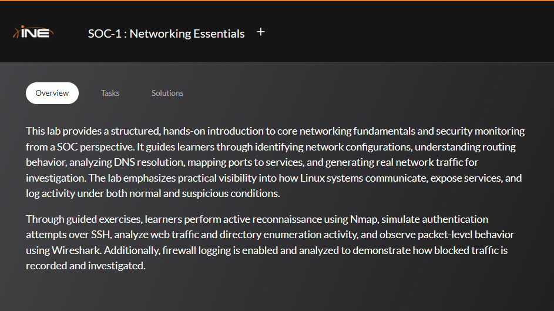
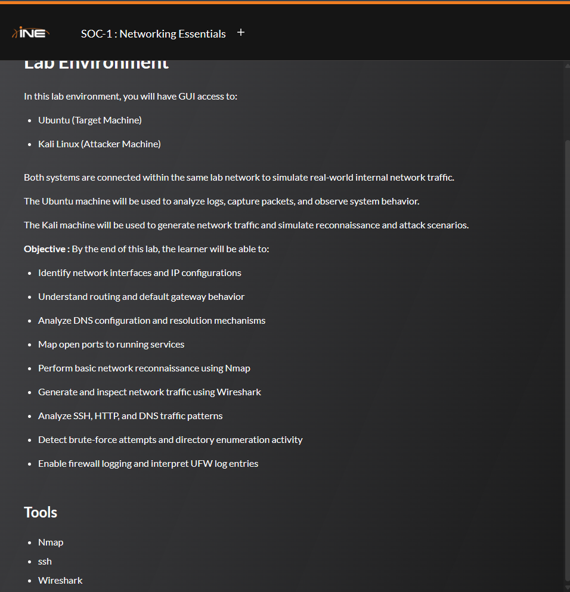
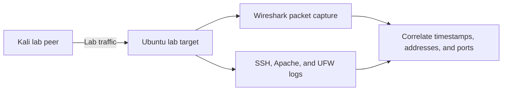

# SOC-1: Networking Essentials

## 1. Lab Overview

This lab covers Linux network configuration, service exposure, and security monitoring. You inspect interfaces, routes, and DNS settings, then connect network observations to packet captures and system logs. By the end, you can explain what SSH, HTTP, and blocked connections look like from a SOC analyst's perspective.



## 2. Lab Environment

| Machine | Role |
| --- | --- |
| Ubuntu | Lab target and collection point for packets, authentication logs, Apache logs, and UFW events |
| Kali Linux | Lab peer used to generate traffic on the shared network |

The source covers TCP 22 (SSH), 23 (Telnet, blocked in the example), 80 (HTTP), 3389 (RDP label), 4444 (temporary Netcat listener), and 5910 (possibly VNC). The service labels on 3389 and 5910 are clues to verify against the host's listening processes.



## 3. Workflow Diagram



## 4. Tools Used

| Tool | Purpose |
| --- | --- |
| ip and hostname | Show interfaces, addresses, and routes |
| resolvectl | Show DNS resolver settings |
| ss | List listening sockets and their owning processes |
| Nmap | Compare remotely visible ports with the local socket list |
| ping, SSH, and curl | Check connectivity and generate example traffic |
| Netcat | Demonstrate a TCP listener and a connection attempt |
| Wireshark | Capture and filter packets and follow HTTP streams |
| Apache and UFW | Provide web access and firewall logs |
| cat and tail | Read configuration and logs or follow newly written entries |

## 5. Task-by-Task Walkthrough

The findings below come from the supplied notes. The two screenshots show the lab overview and environment. The source's “Content Image” markers refer to task screenshots that were absent from the upload. The [source notes](lab-source.md) include three redactions covering the lab password, a password-guessing instruction, and an automated directory enumeration command.

### T1: Identify network configuration

**Goal.** Find each machine's IP addresses, local routes, default gateway, and DNS settings.

**Steps**

1. Compare interface and address output on Ubuntu and Kali.
2. Review the routing table on each machine.
3. Read the resolver file on both machines and inspect upstream DNS settings on Ubuntu.

**Commands**

```bash
ip a
hostname -I
ip route
cat /etc/resolv.conf
resolvectl status
```

**Command explained.** `ip a` shows interface state, MAC addresses, and IP addresses. `hostname -I` prints assigned addresses and skips loopback. `ip route` shows how the host selects a path. `cat` prints the resolver file, and `resolvectl status` shows resolver settings by interface.

**Expected result / Finding.** The notes list `lo` and `ens5` on Ubuntu and `eth0` and `eth1` on Kali. Ubuntu's example IPv4 address is `10.0.17.231`, with a default gateway of `10.0.16.1`. Ubuntu's local DNS stub is `127.0.0.53`, with `10.0.0.2` shown upstream. Kali lists `127.0.0.11`, which the notes associate with Docker's embedded resolver.

### T2: Map ports to services

**Goal.** Compare the services listening on Ubuntu with the ports visible from Kali.

**Steps**

1. Inspect listening sockets on Ubuntu.
2. Compare the notes' Kali scan results with the Ubuntu socket list.
3. Use the process name to verify a service whenever the port label alone leaves it uncertain.

**Commands**

```bash
ss -tulnp
nmap -sS 10.0.17.231
```

**Command explained.** In `ss`, `-t` selects TCP, `-u` selects UDP, `-l` selects listening sockets, `-n` shows numeric addresses and ports, and `-p` shows process information where available. Nmap's `-sS` selects a TCP SYN scan, which classifies port responses without completing the TCP handshake. The command records the target address used in the source's example.

**Expected result / Finding.** The notes show `sshd` on port 22. They report a reachable host, 996 closed ports out of 1,000 scanned, and open ports 22, 80, 3389, and 5910. A TCP reset is consistent with a closed port and gives limited information about firewall policy.

### T3: Generate traffic and inspect host logs

**Goal.** Match connectivity checks, an SSH session, and HTTP requests with what Ubuntu records.

**Steps**

1. Check the hosts' current addresses. The source uses different destination addresses across its examples.
2. Review the ping, SSH, and HTTP examples from Kali. On Ubuntu, watch the authentication and Apache access logs.
3. Compare the temporary Netcat listener with the established connection described in the notes. The supplied commands demonstrate a TCP connection test.

**Commands from Kali**

```bash
ping -c 4 10.0.27.36
ssh sshuser@10.0.27.36
curl http://10.0.17.231/
curl http://10.0.17.231/admin
nc 192.168.56.10 4444
```

**Commands from Ubuntu**

```bash
sudo tail -f /var/log/auth.log
sudo tail -f /var/log/apache2/access.log
nc -lnvp 4444
```

**Command explained.** `ping -c 4` sends four ICMP echo requests. `ssh user@host` opens an encrypted remote session. Each `curl` command sends an HTTP GET to the given path. `sudo` runs the log reader with elevated privileges, and `tail -f` follows new entries. In the Netcat listener example, `-l` listens, `-n` skips name resolution, `-v` shows more detail, and `-p 4444` specifies the local port. The client example supplies a destination address and port.

**Expected result / Finding.** Look for ICMP echo replies, an accepted SSH login in the authentication log, and Apache entries for the requested paths. The quoted SSH line gives source `10.10.38.19:41194`, while the explanation gives `10.10.43.13:45564`. The original log screenshot is needed to reconcile the two. The Netcat notes describe a `LISTEN` socket followed by an `ESTABLISHED` connection.

### T4: Capture and inspect packets

**Goal.** Recognize signs of scanning, repeated SSH activity, and web path enumeration in packet captures.

**Steps**

1. In Wireshark, choose the interface carrying the lab traffic and start a capture.
2. Stop the capture and inspect the traffic by protocol. Compare SYN, SYN-ACK, and RST packets across destination ports.
3. Isolate SSH traffic and correlate timestamps and source addresses with the authentication log.
4. Filter HTTP traffic and use **Follow HTTP Stream** on a relevant packet to view the request and response.

**Wireshark display filters**

```wireshark
tcp.port == 22
http
```

**Command explained.** `tcp.port == 22` matches packets with TCP source or destination port 22. `http` matches packets Wireshark decodes as HTTP. The notes refer to a SYN-scan display filter without giving its exact expression.

**Expected result / Finding.** The notes describe SYN packets sent to multiple ports, with SYN-ACK or RST replies. SSH packets can show the handshake and connection timing. Use host logs to confirm any failed authentication because SSH encrypts its authentication traffic. For HTTP, repeated requests to different paths and clusters of 403 and 404 responses can indicate enumeration. Use the stream view to inspect paths, headers, and status codes.

### T5: Inspect firewall logging

**Goal.** Identify a blocked inbound connection and read its key fields.

**Steps**

1. Review the UFW status on Ubuntu and check its rules and logging level.
2. Compare the notes' Kali connection test to TCP 23 with the UFW log on Ubuntu.
3. Identify the incoming interface, source, destination, protocol, and ports in the matching event.

**Commands from Ubuntu**

```bash
sudo ufw enable
sudo ufw status verbose
cat /var/log/ufw.log
```

**Command from Kali**

```bash
nc -v 10.0.17.231 23
```

**Command explained.** `ufw enable` activates the firewall and applies its rules. `ufw status verbose` shows the active state, policies, rules, and logging status. The source gives the firewall activation command and leaves the logging-level setup unspecified. `cat` reads the firewall log. Netcat's `-v` reports more detail about the connection attempt.

**Expected result / Finding.** The supplied `[UFW BLOCK]` event shows inbound traffic on `ens5`, with `SRC=10.10.38.19`, `DST=10.0.17.231`, `PROTO=TCP`, `SPT=53958`, and `DPT=23`. The source port belongs to the client connection. The destination port identifies the requested service port.

## 6. Key Concepts (Beginner-Friendly)

- **Interface and loopback.** An interface is a point where a host sends or receives traffic. Loopback lets programs talk to services on the same host.
- **Default gateway.** Think of it as the exit from the local network. The host uses it when no more specific route matches.
- **DNS stub resolver.** A local helper receives DNS requests from applications and passes them to an upstream resolver.
- **Listening socket.** A listener waits for new connections. An established socket represents an active connection between two endpoints.
- **Packet and log correlation.** A capture shows what crossed the network. A host log can add details such as the SSH login outcome or the firewall decision.

## 7. SOC / Real-World Relevance

A SOC analyst can compare the list of exposed services against the host's expected role. During an investigation, packet captures show timing and connection patterns, while SSH and Apache logs add authentication outcomes and requested paths. Firewall logs help identify which inbound attempts a rule blocked.

## 8. Quick Command Cheat Sheet

| Command | What it does |
| --- | --- |
| `ip a` | Show interfaces and their addresses |
| `hostname -I` | List assigned host IPs |
| `ip route` | Show routes and the default gateway |
| `cat /etc/resolv.conf` | Read the local DNS resolver configuration |
| `resolvectl status` | Show upstream DNS and per-interface settings |
| `ss -tulnp` | List listening TCP and UDP sockets and their processes |
| `nmap -sS 10.0.17.231` | Record the lab's TCP SYN scan example |
| `ping -c 4 10.0.27.36` | Send four ICMP echo requests |
| `ssh sshuser@10.0.27.36` | Open the lab's example SSH session |
| `sudo tail -f /var/log/auth.log` | Follow authentication events |
| `curl http://10.0.17.231/` and `curl http://10.0.17.231/admin` | Request two HTTP paths |
| `sudo tail -f /var/log/apache2/access.log` | Follow Apache requests |
| `nc -lnvp 4444` | Open the temporary TCP listener |
| `nc 192.168.56.10 4444` | Connect to the listener in the source example |
| `tcp.port == 22` and `http` | Filter SSH-port or HTTP packets in Wireshark |
| `sudo ufw enable` | Activate the firewall |
| `sudo ufw status verbose` | Check firewall rules and logging status |
| `nc -v 10.0.17.231 23` | Attempt a TCP connection to port 23 |
| `cat /var/log/ufw.log` | Read firewall events |

## 9. Common Mistakes & Troubleshooting

| Symptom | What to check |
| --- | --- |
| A command targets an unexpected machine | Check the live address on Ubuntu. The notes use `10.0.17.231`, `10.0.27.36`, and `192.168.56.10` in different examples. |
| Wireshark shows no matching traffic | Verify the capture interface and time window, then clear the display filter to see whether packets were captured. |
| Wireshark shows SSH but no login outcomes | Compare the packet timestamps with the host authentication log. |
| A scan label leaves a service uncertain | Compare the port with the listening process on Ubuntu. |
| UFW shows no block event | Check the active rules, logging status, and destination port, then look for entries from the correct time window. |

## 10. Conclusion

- I learned how to read Linux interface, route, and DNS settings.
- I practiced connecting port exposure with listening processes.
- I used packet patterns and host logs to interpret network activity.
- I identified the source, destination, and port in a firewall block event.
