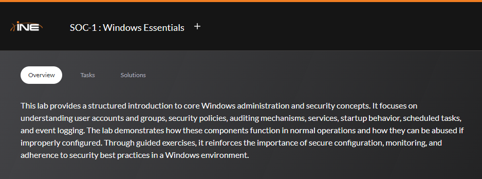
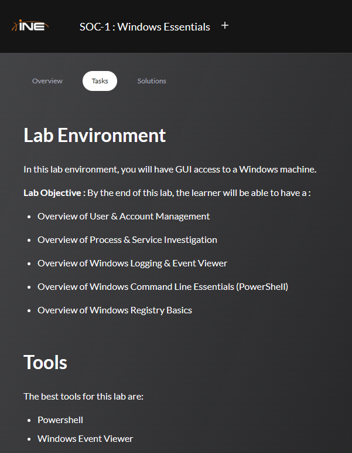
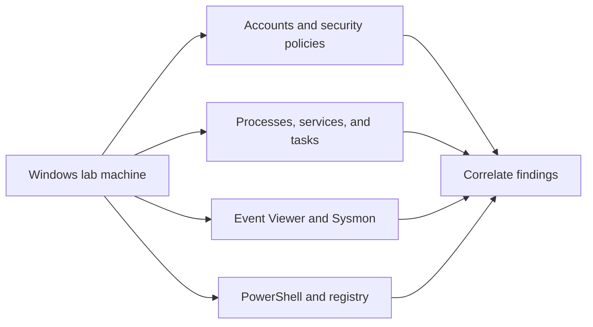

# SOC-1: Windows Essentials

## 1. Lab Overview

This lab introduces Windows administration and security monitoring. You review accounts, security policies, processes, services, and scheduled tasks. You also use Event Viewer, PowerShell, and the registry to investigate activity on a Windows host.



## 2. Lab Environment

- One Windows lab machine with GUI access.
- The screenshots list PowerShell and Windows Event Viewer. The notes also use Local Security Policy, Task Manager, Services, Task Scheduler, Registry Editor, and Sysmon logs.
- The supplied material specifies no Windows edition, host address, or port number.



## 3. Workflow Diagram



## 4. Tools Used

| Tool | Purpose |
| --- | --- |
| Local Users and Groups | Review local accounts and group membership |
| Local Security Policy | Inspect password, lockout, and auditing settings |
| Task Manager and Services | Inspect running processes and service configuration |
| Task Scheduler | Review tasks, triggers, and actions |
| Event Viewer and Sysmon | View Windows events and detailed endpoint activity |
| PowerShell | Query host configuration and event logs |
| Registry Editor | Browse Windows and application configuration |

## 5. Task-by-Task Walkthrough

The findings come from the [original lab notes](lab-source.md). The supplied screenshots show the lab overview and environment. The task screenshots marked “Content Image” in the notes were absent from the upload.

### T1: User & Account Management

**Goal.** Review Windows accounts, group membership, and sign-in policy.

**Steps**

1. Open Local Users and Groups. Review the Users and Groups lists, then open the `student` account properties and check **Account is disabled**.
2. Open Local Security Policy and go to **Account Policies > Password Policy** and **Account Lockout Policy**. Record the minimum length, complexity, age, and lockout threshold.

**Commands**

```cmd
lusrmgr.msc
secpol.msc
```

**Command explained**

- `lusrmgr.msc` opens Local Users and Groups from the Run dialog.
- `secpol.msc` opens Local Security Policy from the Run dialog.

**Expected result / Finding.** The notes show `student` enabled. They report a minimum password length of 0, complexity disabled, minimum and maximum password ages of 0 days, and a lockout threshold of 0. A zero threshold disables policy-triggered lockout. A zero minimum length allows blank passwords under that policy. Remote sign-in may still be restricted. Review membership in Administrators, Remote Desktop Users, Remote Management Users, Users, and Backup Operators.

### T2: Process & Service Investigation

**Goal.** Identify running programs, service startup settings, and scheduled activity.

**Steps**

1. Open Task Manager with Ctrl+Shift+Esc. In **Details**, inspect the process ID, user, file path, and digital signature where available.
2. Open Services and compare Automatic, Automatic (Delayed Start), Manual, and Disabled startup settings.
3. Open the current user's Startup folder. In Task Scheduler, browse **Task Scheduler Library > Microsoft > Windows** and inspect an existing task's status and trigger.
4. Review the **General**, **Triggers**, **Actions**, and **Conditions** tabs in the Create Task dialog to understand what determines when a task runs and what it launches.

**Commands**

```cmd
services.msc
shell:startup
taskschd.msc
```

**Command explained**

- `services.msc` opens the Services console from the Run dialog.
- `shell:startup` opens the current user's Startup folder when entered in the Run dialog.
- `taskschd.msc` opens Task Scheduler from the Run dialog.

**Expected result / Finding.** Task Manager shows process details, Services shows service state and startup type, and Task Scheduler shows the configured trigger and action. The notes describe the Create Task dialog and give no completed task configuration. The source repeats Step 8 for inspecting and creating a task.

### T3: Windows Logging & Event Viewer

**Goal.** Configure audit visibility and locate events relevant to an investigation.

**Steps**

1. In Local Security Policy, compare **Local Policies > Audit Policy** with **Advanced Audit Policy Configuration > Audit Policies**. Review the lab's Success and Failure settings for Logon, Credential Validation, User Account Management, and Security Group Management.
2. Open Event Viewer and inspect **Windows Logs > Security**, **Application**, and **System**. In the Security log, use **Filter Current Log** for event ID 4720.
3. Review **Applications and Services Logs > Microsoft > Windows > Sysmon > Operational** for process creation, driver load, and DNS query events where Sysmon is installed and configured.

**Commands**

```cmd
secpol.msc
eventvwr.msc
```

**Command explained**

- `secpol.msc` opens the policy console used to review audit settings.
- `eventvwr.msc` opens Event Viewer from the Run dialog.

**Expected result / Finding.** The notes report two 4720 matches in the filtered Security log. One shows `Administrator` creating `John123`. The notes also describe `John123` being added to `Guests` and a successful logon under `SYSTEM`.

| Log | Event ID | Meaning |
| --- | --- | --- |
| Security | 4624 | Successful logon |
| Security | 4625 | Failed logon |
| Security | 4634 | Logon session ended |
| Security | 4720 | User account created |
| Security | 4732 | Member added to a security-enabled local group |
| System | 7045 | Service installed |
| System | 6006 | Event Log service stopped |
| Sysmon | 1 | Process created |
| Sysmon | 6 | Driver loaded |
| Sysmon | 22 | DNS query |

### T4: Windows Command Line Essentials (PowerShell)

**Goal.** Collect user, group, process, service, task, and event details from PowerShell.

**Steps**

1. Review users, groups, and group membership. Replace each angle-bracket placeholder with the value relevant to the lab.
2. List processes and services, then narrow the output to a name. Use the CIM query to inspect the service account and executable path.
3. List scheduled tasks and filter by name. Then query the Security log by event ID and target account.

**Commands**

```powershell
Get-LocalUser
Get-LocalGroup
Get-LocalGroupMember <group_name>
Get-Process
Get-Process -Name "<process-name>"
Get-Service
Get-Service -Name "<service_name>"
Get-CimInstance Win32_Service | Where-Object {$_.Name -eq "<service_name>"} | Select-Object Name, DisplayName, State, StartMode, StartName, PathName
Get-ScheduledTask
Get-ScheduledTask | Where-Object {$_.TaskName -like "*update*"}
Get-WinEvent -ListLog *
Get-WinEvent -FilterHashtable @{LogName='Security'; Id=4720} -MaxEvents 20 |
Select-Object TimeCreated, Id, ProviderName, Message
Get-WinEvent -LogName Security -FilterXPath "*[System[(EventID=4624)]] and *[EventData[Data[@Name='TargetUserName']='administrator']]" |
Select-Object TimeCreated, Id, Message
```

**Command explained**

- `Get-LocalUser` lists local accounts and shows whether each is enabled.
- `Get-LocalGroup` lists local security groups.
- `Get-LocalGroupMember <group_name>` lists members of the selected group.
- `Get-Process` lists current processes and their IDs.
- `Get-Process -Name "<process-name>"` filters processes by name.
- `Get-Service` lists services and reports their current status.
- `Get-Service -Name "<service_name>"` returns the named service.
- `Get-CimInstance Win32_Service | Where-Object {$_.Name -eq "<service_name>"} | Select-Object Name, DisplayName, State, StartMode, StartName, PathName` gets service details, selects the named service with `-eq`, and shows its state, startup mode, account, and path.
- `Get-ScheduledTask` lists scheduled tasks.
- `Get-ScheduledTask | Where-Object {$_.TaskName -like "*update*"}` uses `-like` and wildcards to select names containing `update`.
- `Get-WinEvent -ListLog *` lists available event logs.
- `Get-WinEvent -FilterHashtable @{LogName='Security'; Id=4720} -MaxEvents 20 |` filters the Security log for account creation and returns up to 20 events with the requested fields.
- `Get-WinEvent -LogName Security -FilterXPath "*[System[(EventID=4624)]] and *[EventData[Data[@Name='TargetUserName']='administrator']]" |` uses XPath to select successful logons whose target account matches the value in the source.

**Expected result / Finding.** The account-creation query returns matching events up to its limit. The XPath query returns only records that match both the event ID and the target username. The notes give no output counts for these PowerShell queries.

### T5: Windows Registry Basics

**Goal.** Inspect startup entries and service configuration in the registry.

**Steps**

1. Open Registry Editor and identify the machine-wide and current-user hives. Review the source examples of `REG_SZ`, `REG_DWORD`, `REG_BINARY`, and `REG_MULTI_SZ`.
2. Read the machine-wide Run key. Identify a service name and inspect its registry subkey.

**Commands**

```cmd
regedit
```

```powershell
Get-ItemProperty "HKLM:\Software\Microsoft\Windows\CurrentVersion\Run"
Get-Service
Get-Item "HKLM:\SYSTEM\CurrentControlSet\Services\<ServiceName>"
```

**Command explained**

- `regedit` opens Registry Editor from the Run dialog.
- `Get-ItemProperty "HKLM:\Software\Microsoft\Windows\CurrentVersion\Run"` reads the machine-wide Run key's values, which can launch programs at user sign-in.
- `Get-Service` lists service names for the registry lookup.
- `Get-Item "HKLM:\SYSTEM\CurrentControlSet\Services\<ServiceName>"` opens the registry item for the selected service or driver.

**Expected result / Finding.** The Run key shows configured launch entries where present. The Services location contains a subkey for each configured service or driver. The notes provide no specific Run entry or service configuration to confirm.

## 6. Key Concepts (Beginner-Friendly)

- **Local accounts and groups.** A local account belongs to one Windows machine. Group membership can grant access or administrative privileges.
- **Auditing.** Audit settings determine which actions Windows records. Event IDs label the kind of action recorded.
- **Processes, services, and tasks.** A process is a running program. A service is managed by Windows, and a scheduled task starts when its trigger conditions are met.
- **Registry hives.** A hive is a branch of stored configuration. `HKLM` contains machine-wide settings, and `HKCU` holds settings for the current user.
- **Sysmon.** Sysmon can add process, driver, and DNS details that help explain what occurred around a Windows event.

## 7. SOC / Real-World Relevance

A SOC analyst can connect a new account to the account that created it, then check for group changes and later sign-ins. Service installation, scheduled task actions, and Run entries provide leads when investigating unexpected startup behavior. Compare event times, account names, and executable paths to build a timeline.

## 8. Quick Command Cheat Sheet

| Command | What it does |
| --- | --- |
| `regedit` | Opens Registry Editor from the Run dialog. |
| `lusrmgr.msc` | Opens Local Users and Groups from the Run dialog. |
| `secpol.msc` | Opens Local Security Policy from the Run dialog. |
| `services.msc` | Opens the Services console from the Run dialog. |
| `shell:startup` | Opens the current user's Startup folder when entered in the Run dialog. |
| `taskschd.msc` | Opens Task Scheduler from the Run dialog. |
| `eventvwr.msc` | Opens Event Viewer from the Run dialog. |
| `Get-LocalUser` | Lists local accounts and shows whether each is enabled. |
| `Get-LocalGroup` | Lists local security groups. |
| `Get-LocalGroupMember <group_name>` | Lists members of the selected group. |
| `Get-Process` | Lists current processes and their IDs. |
| `Get-Process -Name "<process-name>"` | Filters processes by name. |
| `Get-Service` | Lists services and reports their current status. |
| `Get-Service -Name "<service_name>"` | Returns the named service. |
| `Get-CimInstance Win32_Service \| Where-Object {$_.Name -eq "<service_name>"} \| Select-Object Name, DisplayName, State, StartMode, StartName, PathName` | Gets service details, selects the named service with `-eq`, and shows its state, startup mode, account, and path. |
| `Get-ScheduledTask` | Lists scheduled tasks. |
| `Get-ScheduledTask \| Where-Object {$_.TaskName -like "*update*"}` | Uses `-like` and wildcards to select names containing `update`. |
| `Get-WinEvent -ListLog *` | Lists available event logs. |
| `Get-WinEvent -FilterHashtable @{LogName='Security'; Id=4720} -MaxEvents 20 \| Select-Object TimeCreated, Id, ProviderName, Message` | Filters the Security log for account creation and returns up to 20 events with the requested fields. |
| `Get-WinEvent -LogName Security -FilterXPath "*[System[(EventID=4624)]] and *[EventData[Data[@Name='TargetUserName']='administrator']]" \| Select-Object TimeCreated, Id, Message` | Uses XPath to select successful logons whose target account matches the value in the source. |
| `Get-ItemProperty "HKLM:\Software\Microsoft\Windows\CurrentVersion\Run"` | Reads the machine-wide Run key's values, which can launch programs at user sign-in. |
| `Get-Item "HKLM:\SYSTEM\CurrentControlSet\Services\<ServiceName>"` | Opens the registry item for the selected service or driver. |

## 9. Common Mistakes & Troubleshooting

| Symptom | What to check |
| --- | --- |
| A management console does not open | Check the Windows edition and your account permissions. |
| The Security log has no matching event | Check the audit subcategory, access permissions, and filter time range. |
| The Sysmon Operational log is absent | Check whether Sysmon is installed and which events it is configured to collect. |
| A service or process lookup returns nothing | Check the exact name and replace the placeholder before running the command. |
| An automatic service is currently stopped | Review its current state, startup settings, and related System events. |
| A scheduled task looks unfamiliar | Compare its trigger, action, and run-as account with the host's expected configuration. |

## 10. Conclusion

- I learned how to review Windows accounts, groups, and sign-in policies.
- I inspected processes, services, scheduled tasks, and startup settings.
- I used audit events and PowerShell queries to investigate host activity.
- I reviewed registry locations that can explain how programs start.
