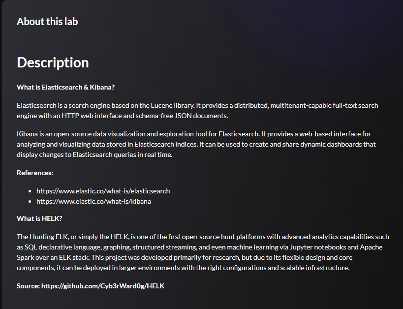
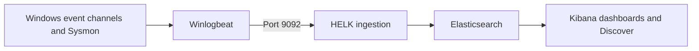

# Threat Detection with Elasticsearch and Kibana

## 1. Lab Overview

This lab sends detailed Windows logs to HELK and uses Kibana to investigate a simulated incident. You enable Windows auditing, install Sysmon, and configure Winlogbeat. Then you trace signs of initial access, persistence, and credential-access activity.



## 2. Lab Environment

| Machine | Role |
| --- | --- |
| Ubuntu 20.04 SOC machine | HELK, Elasticsearch, and Kibana at https://localhost |
| Windows Server 2019 | Audited endpoint with Sysmon and Winlogbeat |
| Kali Linux | Source machine for the supplied simulation |

The SOC example address is `10.0.21.29`. Winlogbeat uses the HELK listener on port `9092` in this lab. The recorded scenario names HFS 2.3 on port `80`.

## 3. Workflow Diagram



## 4. Tools Used

| Tool | Purpose |
| --- | --- |
| HELK and Elasticsearch | Ingest and index Windows telemetry |
| Kibana and Firefox | Review dashboards and search raw events |
| Group Policy and PowerShell | Configure Windows auditing |
| Sysmon | Record detailed endpoint activity |
| Winlogbeat | Forward Windows event logs to the lab pipeline |

## 5. Task-by-Task Walkthrough

Findings come from the [redacted solution notes](lab-source.md). The uploaded screenshot covers the overview. Individual task screenshots referenced in the solution were absent.

### T1: Start HELK

**Goal.** Bring up the lab pipeline and Kibana.

**Steps**

1. On Ubuntu, enter the HELK Docker directory and run the supplied setup script.
2. Once services start, open Kibana in Firefox on the SOC machine.

```bash
cd /opt/HELK/docker/
./helk_install.sh
```

**Command explained.** `cd` changes directories. The local shell script starts the lab setup.

**Expected result / Finding.** The solution reports that Kibana opened at `https://localhost`.

### T2: Enable detailed Windows logging

**Goal.** Capture process activity, PowerShell logging, and scheduled-task history.

**Steps**

1. Open `gpedit.msc`. Under Advanced Audit Policy Configuration > Detailed Tracking, enable Audit Process Creation and Audit Process Termination. In Security Options, enable the setting that forces audit policy subcategories to override category settings.
2. Under Administrative Templates > System > Audit Process Creation, enable command-line inclusion. Under Windows Components > Windows PowerShell, enable Module Logging and Script Block Logging.
3. Add the supplied preferences to `C:\Windows\System32\WindowsPowerShell\v1.0\profile.ps1`. Enable the Task Scheduler Operational channel and check that history is enabled.
4. Restart the lab endpoint as directed in the solution and reconnect.

```powershell
$LogCommandLifeCycleEvent = $true
$LogCommandHealthEvent = $true
```

```powershell
$logName = 'Microsoft-Windows-TaskScheduler/Operational'
$log = New-Object System.Diagnostics.Eventing.Reader.EventLogConfiguration $logName
$log.IsEnabled=$true
$log.SaveChanges()
Restart-Computer -Force
```

**Command explained.** The profile preferences enable command lifecycle and health logging when the profile loads. The event-log object turns on the Task Scheduler channel and saves the change. `Restart-Computer -Force` reboots the Windows endpoint.

**Expected result / Finding.** The relevant audit policies and channels should be enabled. Verify actual events before relying on them.

### T3: Install Sysmon

**Goal.** Collect additional endpoint events.

**Steps**

1. Install Sysmon with the supplied XML from the Administrator Documents folder.
2. Check the service state.

```powershell
C:\Users\Administrator\Documents\Sysmon.exe -accepteula -i C:\Users\Administrator\Documents\sysmonconfig-export.xml
Get-Service -Name Sysmon
```

**Command explained.** `-accepteula` accepts the license and `-i` installs Sysmon with the given configuration. `Get-Service` displays its status.

**Expected result / Finding.** The solution reports Sysmon installed with the lab tracing configuration.

### T4: Configure Winlogbeat

**Goal.** Forward the Windows logs into HELK.

**Steps**

1. Find the SOC IP on Ubuntu. In `winlogbeat.yml`, replace the sample address with the current address and keep the lab port.
2. From the Windows Winlogbeat directory, run the provided service installer and start the service.

```bash
ifconfig ens5
```

```yaml
hosts: ["10.0.21.29:9092"]
```

```powershell
cd C:\Users\Administrator\Desktop\Tools\winlogbeat
.\install-service-winlogbeat.ps1
Start-Service -Name winlogbeat
Get-Service -Name winlogbeat
```

**Command explained.** `ifconfig ens5` shows the SOC interface settings. The YAML sets the HELK listener. The PowerShell commands install, start, and verify Winlogbeat.

**Expected result / Finding.** The solution reports Winlogbeat running. The service state and receipt of events are separate checks.

### T5: Investigate signs of the initial foothold

**Goal.** Find evidence connecting HFS to script execution.

**Steps**

1. In Discover, search the recorded events for `hfs.exe`, then narrow to evidence involving `wscript.exe`.
2. Compare the process and parent fields and note the timestamp and script name.

**Commands.** Discover search terms are shown below. Enter them as text filters.

```text
hfs.exe
wscript.exe
```

**Command explained.** These are executable names used to find related indexed records.

**Expected result / Finding.** The notes associate HFS with Windows Script Host and the script `tlqjxleo.vbs`. Check raw process ancestry before treating a text match as proof.

### T6: Investigate maintenance-of-access artifacts

**Goal.** Identify files associated with the reported persistence activity.

**Steps**

1. Search Discover for `.vbs` and inspect matching file and process details.
2. Correlate the script and executable paths and compare them with the network dashboard.

```text
.vbs
```

**Command explained.** The text term finds records mentioning Visual Basic Script files.

**Expected result / Finding.** The notes identify `douwxodqwof.vbs` and `GtrkSyafTdtynCg.exe` under the Windows Temp directory. These are VBS artifacts. The source sometimes calls them VBA.

### T7: Investigate credential-access indicators

**Goal.** Check what telemetry is available for the reported Mimikatz activity.

**Steps**

1. Search Discover for `mimikatz`.
2. Compare process events with any available process-access records for sensitive targets such as LSASS.

```text
mimikatz
```

**Command explained.** This search term finds references to the utility in indexed events.

**Expected result / Finding.** The notes report matching records. They provide no specific LSASS access record or event identifier confirming that credentials were recovered.

### T8: Correlate findings in Kibana

**Goal.** Build a timeline across the reported stages.

**Steps**

1. Open the Sysmon and Sysmon Network HELK dashboards. Review event counts, process names, SHA-256 values, and destination addresses.
2. In Discover, correlate the T5 through T7 evidence by host, timestamp, and process ancestry.

**Commands.** Use the dashboards and Discover terms above.

**Expected result / Finding.** The notes show 116 Sysmon dashboard records and 38 network records in that run. Counts can vary. The reported artifacts support a timeline, with execution and outcome claims checked against individual events.

## 6. Key Concepts (Beginner-Friendly)

- **Winlogbeat.** A shipper that reads Windows channels and sends their events to the lab pipeline.
- **Process ancestry.** The parent and child fields help identify what launched a program.
- **Script block logging.** PowerShell can record script text for later investigation.
- **Dashboard and raw events.** A dashboard shows patterns. Individual events supply the fields needed to support a finding.

## 7. SOC / Real-World Relevance

A SOC analyst can move from an unusual process in a dashboard to the original events that establish when it ran, what launched it, and which files or destinations were involved.

## 8. Quick Command Cheat Sheet

| Command or search | What it does |
| --- | --- |
| `./helk_install.sh` | Start the lab HELK setup |
| `gpedit.msc` | Open Windows Group Policy Editor |
| `Get-Service -Name Sysmon` | Check Sysmon service state |
| `ifconfig ens5` | Show the SOC interface address |
| `.\install-service-winlogbeat.ps1` | Register the Winlogbeat service |
| `Start-Service -Name winlogbeat` | Start the log shipper |
| `Get-Service -Name winlogbeat` | Verify the running state |
| `hfs.exe`, `wscript.exe`, `.vbs`, `mimikatz` | Find the recorded evidence in Discover |

## 9. Common Mistakes & Troubleshooting

| Symptom | What to check |
| --- | --- |
| Kibana is unavailable | Check that the HELK services finished starting on Ubuntu. |
| Windows logs are absent | Verify local channels, Winlogbeat status, and the SOC listener address and port. |
| Process records lack command lines | Check the audit policy, command-line inclusion setting, and Sysmon filters. |
| A filename search returns several hits | Compare timestamps, process ancestry, and host fields. |

## 10. Conclusion

- I enabled Windows auditing and sent Sysmon and Windows events to HELK.
- I used Kibana to trace HFS, script, executable, and credential-access indicators.
- I identified where additional records were needed to confirm an outcome.
