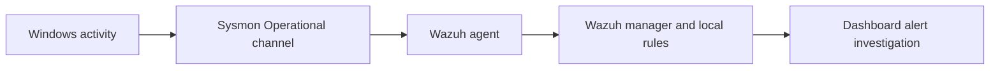

# Threat Detection with Wazuh Sysmon

## 1. Lab Overview

Connect a Windows server to Wazuh and collect Sysmon events. Configure rules to surface process activity, then use the dashboard to correlate authentication, service, registry, and account evidence. By the end, you can explain what the lab alerts show and where more evidence is needed.

## 2. Lab Environment

| Machine | Role |
| --- | --- |
| Ubuntu 20.04 | Wazuh manager and dashboard at https://localhost |
| Windows Server 2019 | Wazuh agent and Sysmon |
| Kali Linux | Source system for the lab simulation |

The notes use manager IP `10.0.26.67` and Windows IP `10.0.18.168`. Use the current manager address on your lab. The source does not specify agent ports.

## 3. Workflow Diagram



## 4. Tools Used

| Tool | Purpose |
| --- | --- |
| Sysmon | Record endpoint activity in Windows |
| Wazuh agent | Forward selected Windows event channels |
| Wazuh manager and dashboard | Apply rules and review alerts |
| PowerShell | Install and manage Windows components |
| Firefox | Open the Wazuh dashboard |

## 5. Task-by-Task Walkthrough

The walkthrough uses the [redacted solution notes](lab-source.md). The supplied environment screenshot exposes lab passwords and was excluded. Individual task images were absent.

### T1: Configure the Wazuh agent

**Goal.** Connect the Windows server to the manager.

**Steps**

1. On Ubuntu, open the dashboard and check the initial agent count. Use the interface listing to find the manager address.
2. On Windows, run the Desktop MSI with that address in both manager properties. Start the service and check the Windows address.
3. Refresh the dashboard and match the active agent to the endpoint.

```bash
ip addr
```

```powershell
cd Desktop
msiexec.exe /i wazuh-agent.msi /q WAZUH_MANAGER=10.0.26.67 WAZUH_REGISTRATION_SERVER=10.0.26.67 WAZUH_AGENT_GROUP=default
Start-Service -Name WazuhSvc
ipconfig
```

**Command explained.** ip addr and ipconfig list interface details. The MSI uses /i to install and /q for quiet mode. Its properties assign the manager, registration server, and group. Start-Service starts WazuhSvc.

**Expected result / Finding.** The notes report one active Windows agent after refresh.

### T2: Configure Sysmon

**Goal.** Generate detailed Windows endpoint telemetry.

**Steps**

1. Run the supplied Sysmon installer with the lab XML configuration.
2. Check the Sysmon Operational channel in Windows Event Viewer.

```powershell
C:\Users\Administrator\Documents\Sysmon.exe -accepteula -i C:\Users\Administrator\Documents\sysmonconfig-export.xml
```

**Command explained.** -accepteula accepts the Sysinternals license. -i installs Sysmon with the specified configuration.

**Expected result / Finding.** Sysmon is installed and the Operational channel records events allowed by the configuration.

### T3: Forward the Sysmon channel

**Goal.** Send Sysmon events to the Wazuh manager.

**Steps**

1. Add the localfile stanza to ossec.conf in C:\Program Files (x86)\ossec-agent.
2. Restart WazuhSvc and verify collection from the channel.

```xml
  <localfile>
    <location>Microsoft-Windows-Sysmon/Operational</location>
    <log_format>eventchannel</log_format>
  </localfile>
```

```powershell
Restart-Service -Name WazuhSvc
```

**Command explained.** eventchannel selects Windows Event Log collection. Restart-Service reloads the agent settings. The notes mention disabling client buffering but do not provide a complete setting to reproduce.

**Expected result / Finding.** The agent can read the Sysmon Operational channel after restart.

### T4: Create executable detection rules

**Goal.** Flag Sysmon activity involving the executable named in the lab.

**Steps**

1. On the manager, open local_rules.xml and add the supplied rule group.
2. Restart the manager and review the lab alert under **Wazuh > Modules > Security Events**.

```bash
nano /var/ossec/etc/rules/local_rules.xml
```

```xml
<group name="windows, sysmon, sysmon_process-anomalies,">
   <rule id="100000" level="12">
     <if_group>sysmon_event1</if_group>
     <field name="win.eventdata.image">mimikatz.exe</field>
     <description>Sysmon - Suspicious Process - mimikatz.exe</description>
   </rule>
   <rule id="100001" level="12">
     <if_group>sysmon_event8</if_group>
     <field name="win.eventdata.sourceImage">mimikatz.exe</field>
     <description>Sysmon - Suspicious Process mimikatz.exe created a remote thread</description>
   </rule>
   <rule id="100002" level="12">
     <if_group>sysmon_event_10</if_group>
     <field name="win.eventdata.sourceImage">mimikatz.exe</field>
     <description>Sysmon - Suspicious Process mimikatz.exe accessed $(win.eventdata.targetImage)</description>
   </rule>
</group>
```

```bash
/etc/init.d/wazuh-manager restart
```

**Command explained.** nano opens the local rules file and the service script reloads the manager. The XML matches an image or source image in the listed Sysmon groups for process creation, remote thread creation, and process access.

**Expected result / Finding.** The notes report an alert for mimikatz.exe. A filename match is a lead. Review related events for context.

### T5: Surface Sysmon events in the dashboard

**Goal.** Test the broad Sysmon rule using ordinary process activity.

**Steps**

1. Add the supplied rule to the same local rules file.
2. Restart the manager using the T4 command. Open PowerShell on Windows and look for Sysmon Event ID 1 in Security Events.

```xml
<group name="sysmon,">
  <rule id="220000" level="12">
    <if_group>sysmon</if_group>
    <description>Windows Sysmon event. Event ID: $(win.system.eventID)</description>
    <options>no_full_log</options>
  </rule>
</group>
```

**Command explained.** Rule 220000 matches the Sysmon group at level 12. Its description includes the event ID, and no_full_log omits the full original log from the alert.

**Expected result / Finding.** The notes report a process-creation event. That confirms visibility for the tested record. Broader coverage should be checked against the source channel.

### T6: Map the simulation to evidence

**Goal.** Identify what the reported pass-the-hash, process migration, and service and account changes should leave in logs.

**Steps**

1. Use the reported simulation window and Windows agent to scope the review.
2. Record the expected evidence types for authentication, service creation, process activity, and account changes.

**Commands.** Review the recorded scenario as evidence.

**Expected result / Finding.** The notes describe successful NTLM authentication, service and registry changes, cross-process activity, and a new account added to local Administrators.

### T7: Correlate the alerts in Wazuh

**Goal.** Build a timeline from the dashboard evidence.

**Steps**

1. In Security Events, narrow to the Windows endpoint and the exercise time. The notes report 26 alerts at level 12 or above in that run.
2. Compare the NTLM alert with process creation and registry value changes. Inspect the reported service creation and its T1543.003 mapping.
3. Review Event ID 8 for the source and target processes and users. Correlate the later account creation and group membership change by timestamp.

**Commands.** Use the dashboard fields and event details.

**Expected result / Finding.** The notes report Sysmon Event IDs 1, 8, and 13, plus the NTLM and account evidence. Successful NTLM alone does not establish pass-the-hash. Event 8 records remote thread creation and needs context to support process migration.

## 6. Key Concepts (Beginner-Friendly)

- **Event channel.** Windows groups event records by source and purpose.
- **Agent and manager.** The agent collects records. The manager applies rules and produces alerts.
- **Rule scope.** A broad rule can improve visibility while adding noise.
- **Correlation.** Compare host, time, account, and process fields to link events.

## 7. SOC / Real-World Relevance

A SOC analyst can use this workflow to verify collection first, then investigate suspicious authentications and changes across several event types. This helps distinguish a rule match from a confirmed incident.

## 8. Quick Command Cheat Sheet

| Command | What it does |
| --- | --- |
| `ip addr` | List manager addresses. |
| `cd Desktop` | Open the installer directory. |
| `msiexec.exe /i wazuh-agent.msi /q WAZUH_MANAGER=10.0.26.67 WAZUH_REGISTRATION_SERVER=10.0.26.67 WAZUH_AGENT_GROUP=default` | Install and configure the agent. |
| `Start-Service -Name WazuhSvc` | Start the agent. |
| `ipconfig` | Show the Windows address. |
| `C:\Users\Administrator\Documents\Sysmon.exe -accepteula -i C:\Users\Administrator\Documents\sysmonconfig-export.xml` | Install Sysmon with the lab XML. |
| `Restart-Service -Name WazuhSvc` | Reload the agent configuration. |
| `nano /var/ossec/etc/rules/local_rules.xml` | Edit manager rules. |
| `/etc/init.d/wazuh-manager restart` | Reload manager rules. |

## 9. Common Mistakes & Troubleshooting

| Symptom | What to check |
| --- | --- |
| The Windows agent stays offline | Check the manager address, registration settings, and WazuhSvc state. |
| Sysmon exists locally but is missing in Wazuh | Check the exact channel name, agent configuration, and restart. |
| A rule does not fire | Check event group and field names in the received data and verify that the manager loaded the rules. |
| The alert count differs | Confirm the agent, time range, and severity filter. |

## 10. Conclusion

- I connected a Windows agent and forwarded Sysmon events.
- I reviewed executable-specific and broad Sysmon rule behavior.
- I used authentication, process, registry, and account evidence to build an investigation timeline.
