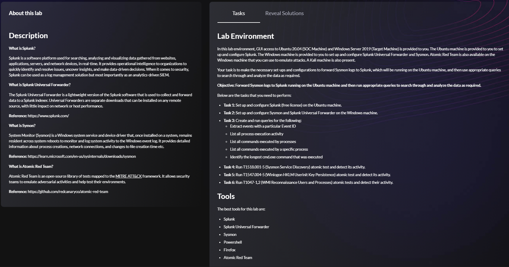
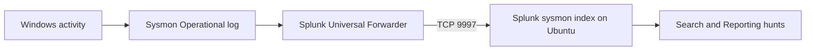

# Threat Hunting with Splunk and Sysmon

## 1. Lab Overview

This lab sends Windows Sysmon events to Splunk on Ubuntu. You use SPL to review process activity and investigate examples of service discovery, a Winlogon registry change, and WMI discovery. By the end, you can trace a hunt result back to the events that support it.



## 2. Lab Environment

| Machine | Role |
| --- | --- |
| Ubuntu 20.04 SOC machine | Splunk Web at `http://localhost:8000` and forwarder receiver on TCP `9997`. |
| Windows Server 2019 | Sysmon and Splunk Universal Forwarder. |
| Kali Linux | Listed in the environment. The supplied detection workflow runs on Ubuntu and Windows. |

The notes give `10.0.16.42` as the example Ubuntu address. Use the address assigned to your SOC machine in the MSI command.

## 3. Workflow Diagram



## 4. Tools Used

| Tool | Purpose |
| --- | --- |
| Splunk and SPL | Index events and search their fields. |
| Sysmon | Record process and registry activity in Windows. |
| Splunk Universal Forwarder | Send the Sysmon channel to the SOC machine. |
| Event Viewer | Verify events are recorded locally. |
| PowerShell and Bash | Install and configure the lab components. |
| Atomic Red Team | Provides the exercise scenarios whose telemetry is investigated. |

## 5. Task-by-Task Walkthrough

Findings are based on the [redacted source notes](lab-source.md). The uploaded screenshot covers the overview and task list. The individual task screenshots referenced in the notes were absent.

### T1: Set up Splunk on Ubuntu

**Goal.** Create a destination for forwarded events.

**Steps**

1. Install the supplied package from `/root/Desktop/Tools`. In `/opt/splunk/bin`, start Splunk after reviewing the license. Enable boot startup if required.
2. Open Splunk Web and go to **Settings > System > Licensing**. Select the Free license as specified for this lab, restart Splunk, and verify the license.
3. Create the `sysmon` index under **Settings > Data > Indexes**. Under **Forwarding and receiving**, add receiving port `9997`.

**Commands**

```bash
dpkg -i splunk-9.0.3-dd0128b1f8cd-linux-2.6-amd64.deb
./splunk start --accept-license
./splunk enable boot-start
./splunk restart
```

**Command explained.** `dpkg -i` installs the package. `start --accept-license` starts Splunk and accepts its license. `enable boot-start` configures startup at boot. `restart` applies the license change.

**Expected result / Finding.** Splunk Web opens, the `sysmon` index exists, and the receiver is configured on port `9997`.

### T2: Collect Windows Sysmon events

**Goal.** Forward the Sysmon Operational channel to the new index.

**Steps**

1. On Ubuntu, use `ip addr` to identify the receiver address.
2. On Windows, open PowerShell in the provided Tools directory. Install Sysmon with the supplied XML and verify the Operational channel in Event Viewer.
3. Install the Universal Forwarder. Save the stanza below to `C:\Program Files\SplunkUniversalForwarder\etc\system\local\inputs.conf` and restart it.
4. Open **Search & Reporting**, check **Data Summary**, and run the index search.

**Commands on Ubuntu**

```bash
ip addr
```

**Commands on Windows**

```powershell
./Sysmon64.exe -accepteula -i sysmonconfig.xml
msiexec.exe /i splunkforwarder-9.0.3-dd0128b1f8cd-x64-release.msi RECEIVING_INDEXER="10.0.16.42:9997" AGREETOLICENSE=Yes /quiet
```

```ini
[WinEventLog://Microsoft-Windows-Sysmon/Operational]
index = sysmon
sourcetype = "XmlWinEventLog:Microsoft-Windows-Sysmon/Operational"
disabled = false
renderXml = false
```

```powershell
& 'C:\Program Files\SplunkUniversalForwarder\bin\splunk.exe' restart
```

```spl
index="sysmon"
```

**Command explained.** `ip addr` lists interface addresses. Sysmon's `-i` installs it using the XML, and `-accepteula` accepts its license. For the MSI, `/i` installs, `RECEIVING_INDEXER` sets the destination, `AGREETOLICENSE` accepts the license, and `/quiet` suppresses interactive setup. The stanza enables the channel, sets the index and sourcetype, and requests non-XML rendering. The restart loads the new input. The SPL search selects the index within the selected time range.

**Expected result / Finding.** The notes report Sysmon events in Splunk. The configured sourcetype includes `XmlWinEventLog` while `renderXml` is false. Check the actual event format and extracted fields if a search misses results.

### T3: Search process and registry activity

**Goal.** Find a specific event code, compare process activity, and rank command lines by length.

**Steps**

1. Search for registry value-set events.
2. Group parent executables and command lines by process image.
3. Narrow the results to `cmd.exe` and sort by command-line length.

**Queries**

```spl
index="sysmon" EventCode=13
index="sysmon" | stats values(ParentImage) by Image
index="sysmon" | stats values(CommandLine) by Image
index="sysmon" Image="*cmd.exe" | stats values(CommandLine) by Image
index="sysmon" Image="*cmd.exe" | eval len=len(CommandLine) | table len, CommandLine | sort -len
```

**Command explained.** `EventCode=13` filters to Sysmon registry value-set events. `stats values(...)` lists distinct field values for each image. `eval len=len(CommandLine)` calculates length, `table` selects result columns, and `sort -len` orders longest first.

**Expected result / Finding.** The searches should return relevant events and ranked command lines when the fields are available. Length alone does not establish malicious intent.

### T4: Detect Sysmon service discovery

**Goal.** Identify telemetry consistent with checking whether Sysmon is present.

**Steps**

1. Run the index search from T2 and set the time range to the exercise activity.
2. In **All Fields**, select `ParentCommandLine`. Review its values and click the entry associated with minifilter inspection.
3. Expand the matching event and review its host, timestamp, image, and parent process.

**Commands.** This task uses the index search from T2 and the Splunk field picker. The exact drill-down query is absent from the notes.

**Expected result / Finding.** The notes describe a command associated with `fltMC.exe` and Sysmon driver discovery. The utility also has legitimate administrative uses.

### T5: Detect a Winlogon Userinit registry change

**Goal.** Identify the event recording a change to the Userinit value.

**Steps**

1. Review command lines associated with PowerShell during the exercise window.
2. Narrow the results to Sysmon event 13 and a target object ending in `Userinit`.
3. Open the matching record and check the process, registry target, and value details.

**Queries**

```spl
index="sysmon" Image="*powershell.exe" | stats values(CommandLine) by Image
index="sysmon" Image="*powershell.exe" TargetObject="*Userinit" EventCode=13
```

**Command explained.** The first query groups distinct PowerShell command lines. The second narrows the hunt to registry value-set records with the specified target and process image.

**Expected result / Finding.** The notes report a matching event that shows an unexpected additional executable in the Winlogon Userinit value.

### T6: Detect WMI user and process discovery

**Goal.** Investigate WMIC activity associated with local account and process enumeration.

**Steps**

1. Search for events whose image contains `WMIC.exe`.
2. Inspect `ParentCommandLine` values in Splunk and open matching events.
3. Compare the parent process, command line, host, and time to distinguish the two discovery activities.

**Query**

```spl
index="sysmon" Image="*WMIC.exe*"
```

**Command explained.** The surrounding wildcards match image paths containing `WMIC.exe`.

**Expected result / Finding.** The notes report matching records related to local user and running process discovery. Review context because administrative tooling can produce similar events.

## 6. Key Concepts (Beginner-Friendly)

- **Sysmon event.** A Windows record with details about activity such as process creation or registry changes.
- **Forwarder and index.** The forwarder ships records. The index is where Splunk stores them for searching.
- **Process ancestry.** The parent process helps explain what launched a program and can link related activity.
- **Hunt lead.** An unusual command line or registry target gives you a reason to inspect the original event and its context.

## 7. SOC / Real-World Relevance

A SOC analyst can use this workflow to verify telemetry coverage, then investigate how a suspicious process started and what it changed. Combining process ancestry, timestamps, and registry events helps distinguish lab detections from ordinary administration.

## 8. Quick Command Cheat Sheet

| Command | What it does |
| --- | --- |
| `dpkg -i splunk-9.0.3-dd0128b1f8cd-linux-2.6-amd64.deb` | Install Splunk. |
| `./splunk start --accept-license` | Start Splunk and accept its license. |
| `./splunk enable boot-start` | Configure Splunk to start at boot. |
| `./splunk restart` | Restart Splunk. |
| `./Sysmon64.exe -accepteula -i sysmonconfig.xml` | Install Sysmon using the lab XML. |
| `msiexec.exe /i splunkforwarder-9.0.3-dd0128b1f8cd-x64-release.msi RECEIVING_INDEXER="10.0.16.42:9997" AGREETOLICENSE=Yes /quiet` | Install the Universal Forwarder with a receiving destination. |
| `& 'C:\Program Files\SplunkUniversalForwarder\bin\splunk.exe' restart` | Restart the forwarder. |
| `ip addr` | Find the SOC machine address. |
| `index="sysmon"` | Search the Sysmon index. |
| `index="sysmon" EventCode=13` | Find registry value-set events. |
| `index="sysmon" \| stats values(ParentImage) by Image` | Group parent images by process image. |
| `index="sysmon" \| stats values(CommandLine) by Image` | Group distinct command lines by image. |
| `index="sysmon" Image="*cmd.exe" \| stats values(CommandLine) by Image` | List command lines for cmd.exe. |
| `index="sysmon" Image="*cmd.exe" \| eval len=len(CommandLine) \| table len, CommandLine \| sort -len` | Rank cmd.exe command lines by length. |
| `index="sysmon" Image="*powershell.exe" \| stats values(CommandLine) by Image` | List PowerShell command lines. |
| `index="sysmon" Image="*powershell.exe" TargetObject="*Userinit" EventCode=13` | Find PowerShell Userinit value changes. |
| `index="sysmon" Image="*WMIC.exe*"` | Find events with a WMIC image. |

## 9. Common Mistakes & Troubleshooting

| Symptom | What to check |
| --- | --- |
| No events reach Splunk | Verify the Windows Operational log first, then confirm receiver port `9997`, the current address, and the input index. |
| Searches return events but miss fields | Inspect the raw record, sourcetype, rendering format, and field extraction. |
| An exercise event is missing | Check the selected host and time range, and confirm that the Sysmon config captures that event type. |
| A filtered result seems suspicious | Review its parent process, account, timestamp, and expected administrative context. |

## 10. Conclusion

- I forwarded Windows Sysmon events to Splunk on Ubuntu.
- I used SPL to review process, command-line, and registry events.
- I investigated telemetry associated with service discovery, Winlogon changes, and WMI activity.
