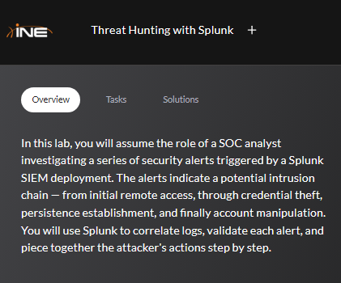
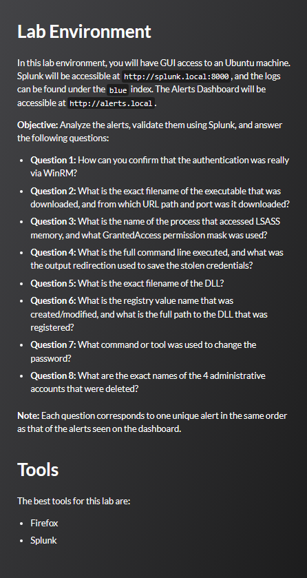
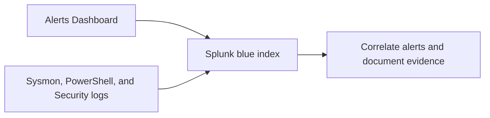

# Threat Hunting with Splunk

## 1. Lab Overview

This lab uses Splunk to investigate eight Windows security alerts. You compare alert details with Sysmon, PowerShell, and Security events. By the end, you can explain which records support each finding.



## 2. Lab Environment

| Component | Purpose |
| --- | --- |
| Ubuntu GUI and Firefox | Analyst workstation |
| Alerts Dashboard | Alert list at http://alerts.local |
| Splunk | Search & Reporting at http://splunk.local:8000 using index blue |
| ATTACKDEFENSE | Windows host named in the WinRM evidence |

The notes show TCP 5985 for WinRM and TCP 8000 for the reported download.



## 3. Workflow Diagram



## 4. Tools Used

| Tool | Purpose |
| --- | --- |
| Firefox | Open both lab dashboards |
| Alerts Dashboard | Review alert titles and severity |
| Splunk and SPL | Find and correlate records |
| Sysmon | Investigate process, network, and registry activity |
| PowerShell and Windows Security logs | Investigate script and account activity |

## 5. Task-by-Task Walkthrough

Start in Splunk Search & Reporting with **All time** and the index search below. Narrow the time range for each alert when correlating events. The [redacted source notes](lab-source.md) supply the findings. Both supplied screenshots cover the overview and objectives. Individual task screenshots were absent.

```spl
index=blue
```

### T1: Suspicious WinRM Remote Login Detected

**Goal.** Validate the reported remote session.

**Steps**

1. Open the corresponding alert and note the host and time.
2. Match the provider process to a network record and the alert host, account, and time.

**Commands**

```spl
index=blue LogName="Microsoft-Windows-Sysmon/Operational" EventCode=1 Image="*\\wsmprovhost.exe"
index=blue LogName="Microsoft-Windows-Sysmon/Operational" EventCode=3
```

**Command explained.** Sysmon Event 1 records process creation. Event 3 records network connections.

**Expected result / Finding.** The notes report wsmprovhost.exe and port 5985 on ATTACKDEFENSE, with Administrator access from 10.0.0.56.

### T2: Suspicious File Download Activity

**Goal.** Identify the executable and where it came from.

**Steps**

1. Open the corresponding alert and note the host and time.
2. Open the matching script block and read the filename, URL path, and port.

**Commands**

```spl
index=blue source="WinEventLog:Microsoft-Windows-PowerShell/Operational" EventCode=4104 "C:\\Windows\\Temp\\*.exe"
```

**Command explained.** PowerShell Event 4104 records script block text. The filter matches executable references in Temp.

**Expected result / Finding.** The notes identify gotyou.exe and /gotyou.exe on 10.0.0.56:8000. A file or network record can help confirm completion.

### T3: Suspicious Process Accessing LSASS Memory

**Goal.** Identify the process and access mask.

**Steps**

1. Open the corresponding alert and note the host and time.
2. Find Sysmon Event 10 and inspect SourceImage, TargetImage, and GrantedAccess.

**Commands**

```spl
index=blue source="WinEventLog:Microsoft-Windows-Sysmon/Operational" *lsass.exe* *Administrator*
```

**Command explained.** Event 10 records a process opening another process. The query matches LSASS and Administrator text.

**Expected result / Finding.** The reported source is gotyou.exe and the access mask is 0x1010. This supports process access.

### T4: Credential Dumping Keywords Detected

**Goal.** Identify the output artifact reported in the alert.

**Steps**

1. Open the corresponding alert and note the host and time.
2. Inspect the script block as evidence and record the executable and output filename.

**Commands**

```spl
index=blue LogName=Microsoft-Windows-PowerShell/Operational EventCode=4104 "*privilege::debug*"
```

**Command explained.** The search matches an alert keyword in PowerShell script block text.

**Expected result / Finding.** The notes report gotyou.exe and redirection with the greater-than operator to creds.txt. The credential-dumping command is redacted.

### T5: Unsigned DLL Written to System32

**Goal.** Identify the DLL name.

**Steps**

1. Open the corresponding alert and note the host and time.
2. Review the matching PowerShell entry. Check file creation and signature evidence where available.

**Commands**

```spl
index=blue LogName="Windows PowerShell" EventCode=800 "C:\\Windows\\System32\\*.dll"
```

**Command explained.** Event 800 records pipeline activity. The filter matches System32 DLL references.

**Expected result / Finding.** The notes identify evil_netsh.dll. The PowerShell record is a lead for checking file creation and signature status.

### T6: Suspicious Registry Modification Detected

**Goal.** Identify the changed value and DLL path.

**Steps**

1. Open the corresponding alert and note the host and time.
2. Read TargetObject and Details in the matching event. Compare the filename with T5.

**Commands**

```spl
index=blue LogName=Microsoft-Windows-Sysmon/Operational EventCode=13 "*NetSh*"
```

**Command explained.** Sysmon Event 13 records a registry value being set. The filter narrows records to NetSh.

**Expected result / Finding.** The notes report evil_helper under HKLM\SOFTWARE\Microsoft\NetSh, pointing to C:\Windows\System32\evil_netsh.dll.

### T7: Administrator Account Password Changed

**Goal.** Identify the tool associated with the password reset.

**Steps**

1. Open the corresponding alert and note the host and time.
2. Compare the Security record with process creation by account, host, and time.

**Commands**

```spl
index=blue LogName=Security EventCode=4724
index=blue source="WinEventLog:Microsoft-Windows-Sysmon/Operational" EventCode=1 CommandLine="*Administrator*"
```

**Command explained.** Event 4724 records an attempted reset. Sysmon Event 1 provides process details.

**Expected result / Finding.** The notes identify net user. Check the audit outcome to establish whether the reset succeeded.

### T8: Multiple User Accounts Deleted

**Goal.** Identify the exact deleted accounts.

**Steps**

1. Open the corresponding alert and note the host and time.
2. Inspect the target account in each event and distinguish it from the subject account.

**Commands**

```spl
index=blue LogName=Security EventCode=4726
index=blue EventCode=4726 *Account Name*
```

**Command explained.** Event 4726 records user account deletion. The second filter adds account-name text.

**Expected result / Finding.** The targets were sysadmin, netadmin, itadmin, and servadmin. The notes identify Administrator as the actor.

## 6. Key Concepts (Beginner-Friendly)

- **Alert and event.** An alert flags activity for review. An event is a record you can inspect.
- **Correlation.** Match host, account, process, and time to connect evidence.
- **Subject and target.** The subject is the actor. The target is the affected account.

## 7. SOC / Real-World Relevance

A SOC analyst can connect several alerts into a timeline, from remote access to changes on the host. Checking the underlying events helps distinguish reported activity from a verified outcome.

## 8. Quick Command Cheat Sheet

| Command | What it does |
| --- | --- |
| `index=blue` | Search the lab dataset. |
| `index=blue LogName="Microsoft-Windows-Sysmon/Operational" EventCode=1 Image="*\\wsmprovhost.exe"` | Find WinRM provider launches. |
| `index=blue LogName="Microsoft-Windows-Sysmon/Operational" EventCode=3` | Find Sysmon network events. |
| `index=blue source="WinEventLog:Microsoft-Windows-PowerShell/Operational" EventCode=4104 "C:\\Windows\\Temp\\*.exe"` | Find executable references in Temp. |
| `index=blue source="WinEventLog:Microsoft-Windows-Sysmon/Operational" *lsass.exe* *Administrator*` | Find records mentioning LSASS and Administrator. |
| `index=blue LogName=Microsoft-Windows-PowerShell/Operational EventCode=4104 "*privilege::debug*"` | Find PowerShell script blocks matching the alert keyword. |
| `index=blue LogName="Windows PowerShell" EventCode=800 "C:\\Windows\\System32\\*.dll"` | Find DLL references in System32. |
| `index=blue LogName=Microsoft-Windows-Sysmon/Operational EventCode=13 "*NetSh*"` | Find NetSh registry value-set events. |
| `index=blue LogName=Security EventCode=4724` | Find password reset attempts. |
| `index=blue source="WinEventLog:Microsoft-Windows-Sysmon/Operational" EventCode=1 CommandLine="*Administrator*"` | Find process creation mentioning Administrator. |
| `index=blue LogName=Security EventCode=4726` | Find account deletions in Security. |
| `index=blue EventCode=4726 *Account Name*` | Narrow account deletions by account-name text. |

## 9. Common Mistakes & Troubleshooting

| Symptom | What to check |
| --- | --- |
| A search returns no events | Confirm the index, source, fields, and time range. |
| Several sessions match | Compare host, source address, account, and time. |
| A script block contains a suspicious command | Check related process and file events before reporting successful execution. |
| A reset event appears | Review its audit outcome and target account. |

## 10. Conclusion

- I investigated eight Windows alerts using Splunk.
- I correlated remote access, process, registry, and account activity.
- I identified which findings needed additional evidence.
