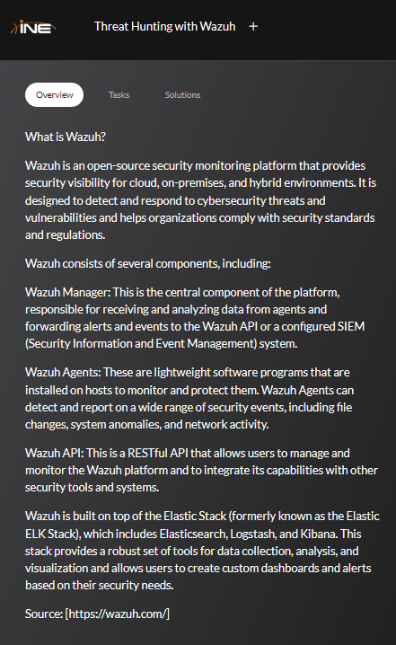
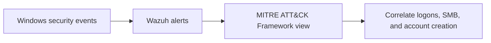

# Threat Hunting with Wazuh

## 1. Lab Overview

This lab investigates historical Windows security events in Wazuh. You correlate failed logons, a successful network logon, SMB share activity, and account creation. By the end, you can record indicators and explain which event supports each finding.

## 2. Lab Environment

- Ubuntu GUI running Wazuh Manager and Dashboard at `https://localhost`.
- Historical records from a Windows agent marked disconnected during review.
- Incident date **11 February 2026**. The reported Windows endpoint is `192.168.1.120`.

## 3. Workflow Diagram

## 4. Tools Used

| Tool | Purpose |
| --- | --- |
| Firefox | Open the Wazuh Dashboard |
| Wazuh Manager and Dashboard | Review retained Windows alerts and event details |
| MITRE ATT&CK view | Browse alerts grouped by mapped technique |

## 5. Task-by-Task Walkthrough

The [pasted solution summary](lab-source.md) supplies the reported evidence. The overview screenshot is included. The environment screenshot displays credentials and was excluded. Referenced solution images were not saved.

### T1: Open the historical agent records

**Goal.** Find the correct endpoint and incident window.

**Steps**

1. In Firefox, open the Wazuh Dashboard on Ubuntu and sign in using the lab-provided access details. Select the Windows agent, then go to **More > MITRE ATT&CK > Framework**. Set the start date to **11 February 2026** and enable **Hide techniques with no alerts**.

**Commands.** Use the dashboard controls described above.

**Expected result / Finding.** The notes show one disconnected Windows agent with retained security alerts.

### T2: Investigate failed logons

**Goal.** Identify the source and target in the brute-force alerts.

**Steps**

1. Open **Brute Force**, compare timestamps, and expand the latest failed logon. Record the source IP, target IP, and account.

**Commands.** Use the dashboard controls described above.

**Expected result / Finding.** The notes report repeated failures from `3.110.33.3` against `192.168.1.120` for `Administrator`.

### T3: Investigate the successful network logon

**Goal.** Compare the successful logon with the earlier failed attempts.

**Steps**

1. Open **Pass the Hash**, expand the first successful remote logon, and compare the account and address with the failures. Record the logon type.

**Commands.** Use the dashboard controls described above.

**Expected result / Finding.** The notes report the same source IP and account and logon type `3`, which indicates a network logon. These details support correlation. They do not establish hash reuse.

### T4: Inspect SMB share activity

**Goal.** Identify the source, account, and share evidence.

**Steps**

1. Open **SMB/Windows Admin Shares** and expand the latest event. Compare its time, source, and account with the network logon. Inspect the share field.

**Commands.** Use the dashboard controls described above.

**Expected result / Finding.** The notes associate `3.110.33.3` and `Administrator` with SMB share activity. The exact share name and any data transfer are unverified.

### T5: Investigate account creation

**Goal.** Identify who created which account.

**Steps**

1. Open **Account Manipulation** and expand the latest account-creation event. Record the subject and new account, then compare the timestamp with earlier activity.

**Commands.** Use the dashboard controls described above.

**Expected result / Finding.** The notes report that `Administrator` created `evil-user`. This is a possible persistence indicator. The notes provide no later use or group membership evidence.

## 6. Key Concepts (Beginner-Friendly)

- **Network logon.** Windows type 3 indicates access over the network. SMB is one service that can produce it.
- **Correlation.** Match source, account, endpoint, and time to assess whether events may be related.
- **Subject and new account.** The subject performed the action. The new account is the identity created.

## 7. SOC / Real-World Relevance

A SOC analyst can investigate retained alerts even when an endpoint is offline. Comparing underlying events helps build a timeline and assess what the alert labels actually support.

## 8. Quick Command Cheat Sheet

The lab uses dashboard navigation.

| Dashboard view | What to check |
| --- | --- |
| More > MITRE ATT&CK > Framework | Incident start date and technique visibility |
| Brute Force | Failed logon times, source, endpoint, and account |
| Pass the Hash | Successful logon, source, account, and logon type |
| SMB/Windows Admin Shares | Share field, source, account, and timestamp |
| Account Manipulation | Subject, new account, and timestamp |

## 9. Common Mistakes & Troubleshooting

| Symptom | What to check |
| --- | --- |
| Historical alerts are absent | Verify the selected agent and incident time range. |
| Several events share an IP | Match the endpoint, account, and timestamps before linking them. |
| A technique label looks conclusive | Inspect the original event and document what it establishes. |

## 10. Conclusion

- I examined historical Windows alerts in Wazuh.
- I correlated logons, SMB share activity, and account creation.
- I recorded the indicators and identified the remaining evidence gaps.
